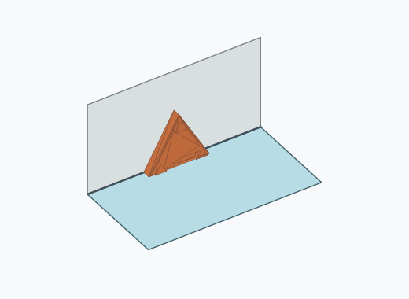
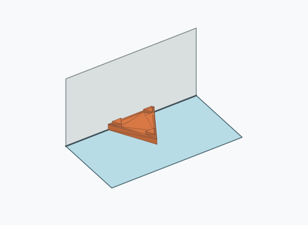
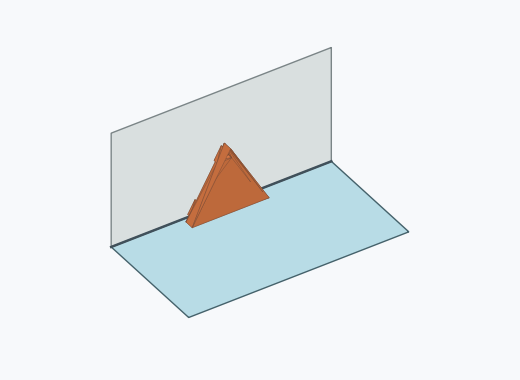
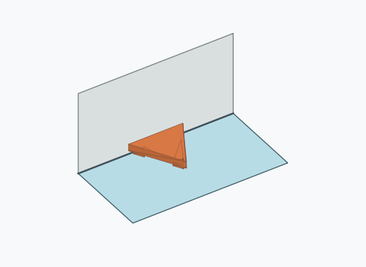

# Df1a: grouped observed poses

10,000 completed drops; 9,997 settled. 7 assessed source poses; 4 groups meet the 1% cutoff.

Grouping uses 0.5 mm equivalent lift and a 60° maximum diameter. All members receive the same disturbance protocol.

| Representative | Image | Members | Combined count | Frequency | Retention AUC |
| --- | --- | --- | ---: | ---: | ---: |
| Df1a_0004 |  | Df1a_0004 | 2638 | 26.38% | 1.0000 |
| Df1a_0005 |  | Df1a_0005 | 2586 | 25.86% | 1.0000 |
| Df1a_0006 |  | Df1a_0006 | 2386 | 23.86% | 1.0000 |
| Df1a_0001 |  | Df1a_0001 | 2354 | 23.54% | 1.0000 |

[All original observations and member images](original_observations.json), [memberships](membership.csv), [barrier evidence](grouping_geometry.json), [member stability curves](group_stability.csv), [individual disturbance curves](stability.csv), [validation](validation.json).

Frequencies retain the original completed-drop denominator. Stability scores describe the configured virtual chute.
