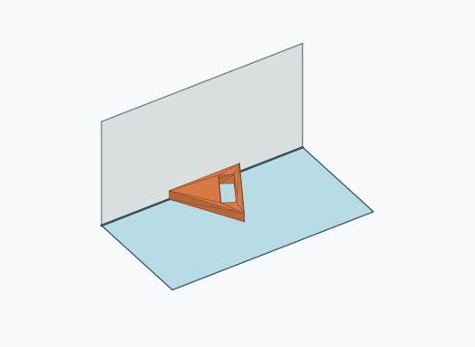
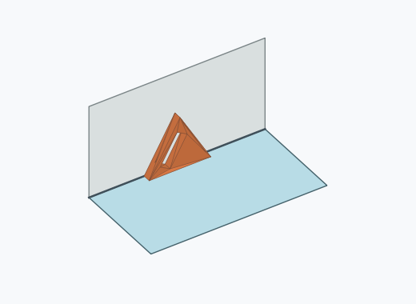
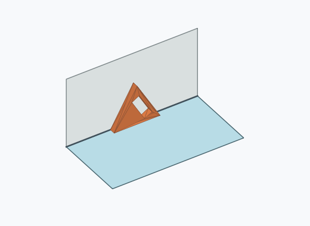
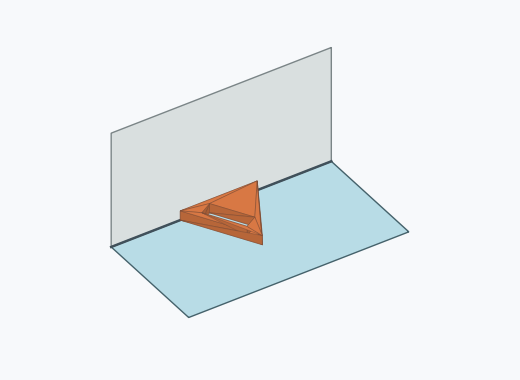
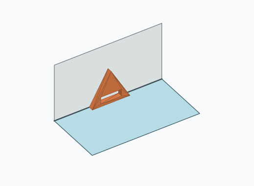
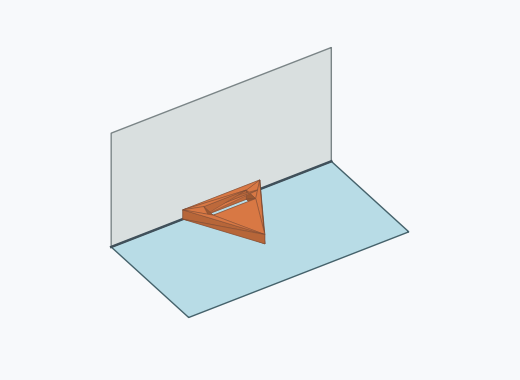

# Df2i: grouped observed poses

10,000 completed drops; 9,996 settled. 9 assessed source poses; 6 groups meet the 1% cutoff.

Grouping uses 0.5 mm equivalent lift and a 60° maximum diameter. All members receive the same disturbance protocol.

| Representative | Image | Members | Combined count | Frequency | Retention AUC |
| --- | --- | --- | ---: | ---: | ---: |
| Df2i_0001 |  | Df2i_0001 | 1833 | 18.33% | 1.0000 |
| Df2i_0004 |  | Df2i_0004 | 1794 | 17.94% | 1.0000 |
| Df2i_0005 |  | Df2i_0005 | 1785 | 17.85% | 1.0000 |
| Df2i_0002 |  | Df2i_0002 | 1717 | 17.17% | 1.0000 |
| Df2i_0007 |  | Df2i_0007 | 1445 | 14.45% | 1.0000 |
| Df2i_0006 |  | Df2i_0006 | 1400 | 14.00% | 1.0000 |

[All original observations and member images](original_observations.json), [memberships](membership.csv), [barrier evidence](grouping_geometry.json), [member stability curves](group_stability.csv), [individual disturbance curves](stability.csv), [validation](validation.json).

Frequencies retain the original completed-drop denominator. Stability scores describe the configured virtual chute.
