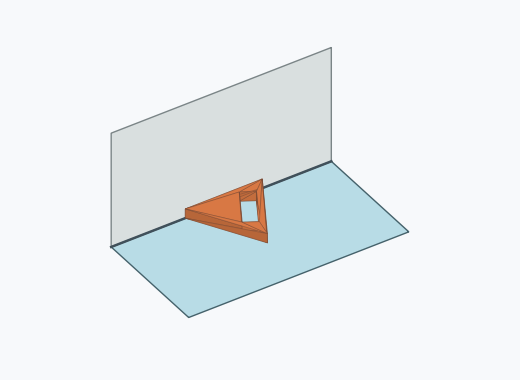
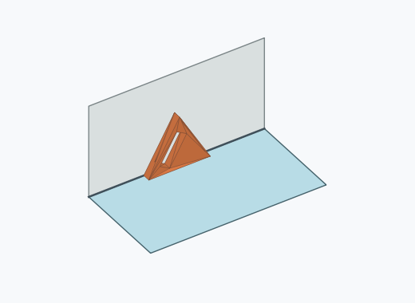
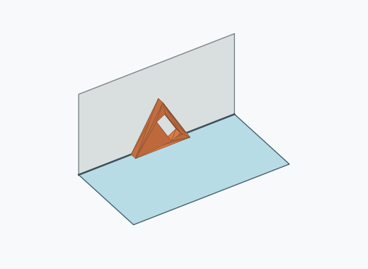
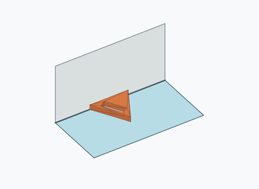
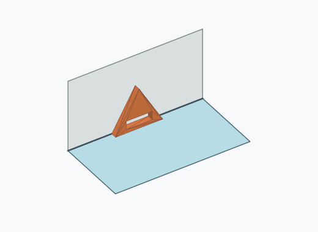
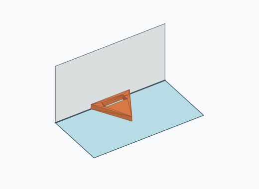
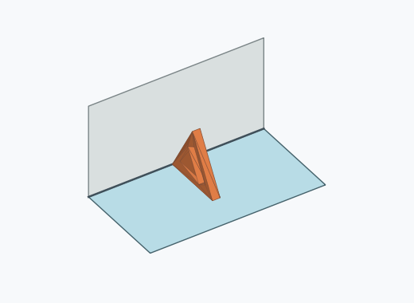
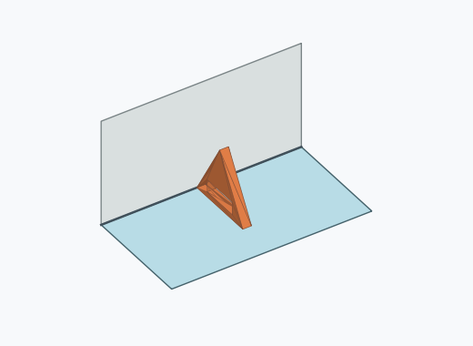
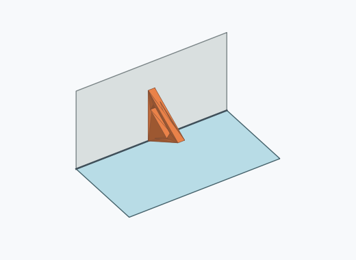

# Df2i

[Workpiece index](../README.md#workpieces)

## Historical pose catalogue

Group numbers rank the saved pose basins by their combined incidence within each observation phase. Pose 0 is the most frequent individual pose in its observation phase. The membership CSV links the displayed numbers to the saved pose IDs. Groups below 1% remain visible.

[Group membership CSV](group_memberships.csv) · [Grouping method](../README.md#catalogue-grouping)

### Transport poses

9,996 settled outcomes across 10,000 historical drops on a 500 mm chute. Incidence uses all completed drops as the denominator.

Outcome counts: settled: 9,996, unsettled: 4.

| Pose | Group | Image | Count | Incidence | 95% interval | Share of settled outcomes |
| --- | --- | --- | ---: | ---: | ---: | ---: |
| Pose 0 | Group 0 |  | 1833 | 18.33 % | 17.58–19.10 % | 18.34 % |
| Pose 1 | Group 1 |  | 1794 | 17.94 % | 17.20–18.70 % | 17.95 % |
| Pose 2 | Group 2 |  | 1785 | 17.85 % | 17.11–18.61 % | 17.86 % |
| Pose 3 | Group 3 |  | 1717 | 17.17 % | 16.44–17.92 % | 17.18 % |
| Pose 4 | Group 4 |  | 1445 | 14.45 % | 13.77–15.15 % | 14.46 % |
| Pose 5 | Group 5 |  | 1400 | 14.00 % | 13.33–14.69 % | 14.01 % |
| Pose 6 | Group 6 |  | 13 | 0.13 % | 0.08–0.22 % | 0.13 % |
| Pose 7 | Group 7 |  | 8 | 0.08 % | 0.04–0.16 % | 0.08 % |
| Pose 8 | Group 8 |  | 1 | 0.01 % | 0.00–0.06 % | 0.01 % |

[Pose catalogue JSON](poses.json) · [Pose catalogue YAML](poses.yaml) · [Frequencies](frequencies.csv) · [Trial records](trials.csv)

Pose orientations use `xyzw` quaternions from the workpiece frame to the chute frame. Recognition uses the recorded symmetry, a 5° tolerance, and a 1° ambiguity margin. The pose registry reserves previously observed IDs for later recognition.

### Historical run files

- [Configuration](config.json)
- [Manifest](manifest.json)
