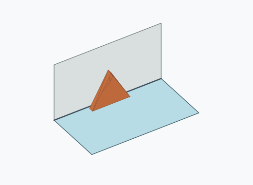
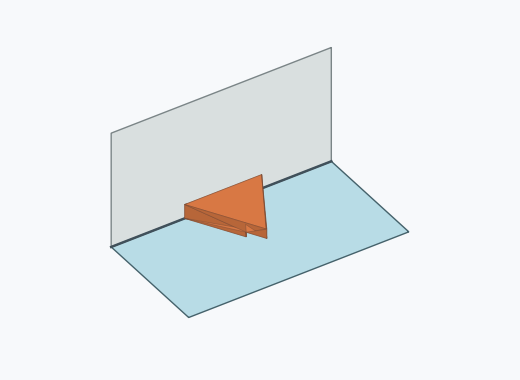
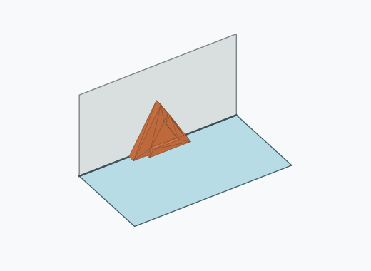
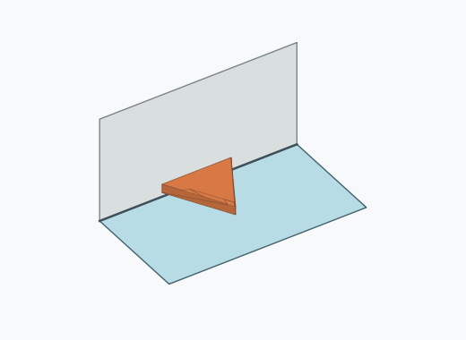
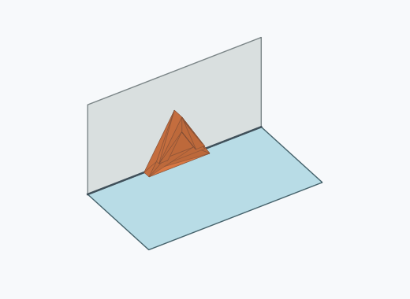
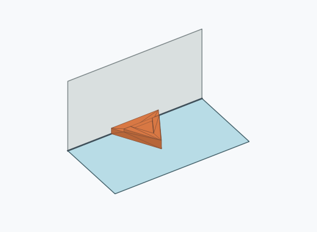
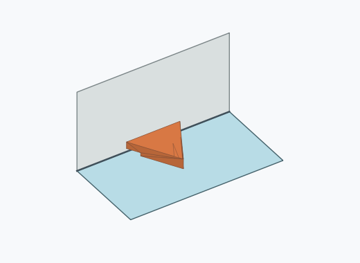

# Df4a: grouped observed poses

10,000 completed drops; 9,999 settled. 20 assessed source poses; 12 groups meet the 1% cutoff.

Grouping uses 0.5 mm equivalent lift and a 60° maximum diameter. All members receive the same disturbance protocol.

| Representative | Image | Members | Combined count | Frequency | Retention AUC |
| --- | --- | --- | ---: | ---: | ---: |
| Df4a_0011 |  | Df4a_0011 | 951 | 9.51% | 1.0000 |
| Df4a_0015 |  | Df4a_0015 | 936 | 9.36% | 1.0000 |
| Df4a_0006 |  | Df4a_0006 | 896 | 8.96% | 1.0000 |
| Df4a_0002 |  | Df4a_0002 | 891 | 8.91% | 1.0000 |
| Df4a_0005 |  | Df4a_0005 | 888 | 8.88% | 1.0000 |
| Df4a_0016 |  | Df4a_0016 | 863 | 8.63% | 1.0000 |
| Df4a_0010 |  | Df4a_0010, Df4a_0019 | 856 | 8.56% | 1.0000 |
| Df4a_0001 |  | Df4a_0001 | 826 | 8.26% | 1.0000 |
| Df4a_0013 |  | Df4a_0013 | 755 | 7.55% | 1.0000 |
| Df4a_0009 |  | Df4a_0009, Df4a_0018 | 720 | 7.20% | 1.0000 |
| Df4a_0017 |  | Df4a_0017 | 707 | 7.07% | 1.0000 |
| Df4a_0012 |  | Df4a_0012 | 654 | 6.54% | 1.0000 |

[All original observations and member images](original_observations.json), [memberships](membership.csv), [barrier evidence](grouping_geometry.json), [member stability curves](group_stability.csv), [individual disturbance curves](stability.csv), [validation](validation.json).

Frequencies retain the original completed-drop denominator. Stability scores describe the configured virtual chute.
