# Df4a

[Workpiece index](../README.md#workpieces)

## Historical pose catalogue

Group numbers rank the saved pose basins by their combined incidence within each observation phase. Pose 0 is the most frequent individual pose in its observation phase. The membership CSV links the displayed numbers to the saved pose IDs. Groups below 1% remain visible.

[Group membership CSV](group_memberships.csv) · [Grouping method](../README.md#catalogue-grouping)

### Transport poses

9,999 settled outcomes across 10,000 historical drops on a 500 mm chute. Incidence uses all completed drops as the denominator.

Outcome counts: settled: 9,999, unsettled: 1.

| Pose | Group | Image | Count | Incidence | 95% interval | Share of settled outcomes |
| --- | --- | --- | ---: | ---: | ---: | ---: |
| Pose 0 | Group 0 |  | 951 | 9.51 % | 8.95–10.10 % | 9.51 % |
| Pose 1 | Group 1 | 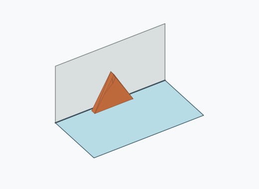 | 936 | 9.36 % | 8.80–9.95 % | 9.36 % |
| Pose 2 | Group 2 |  | 896 | 8.96 % | 8.42–9.54 % | 8.96 % |
| Pose 3 | Group 3 | 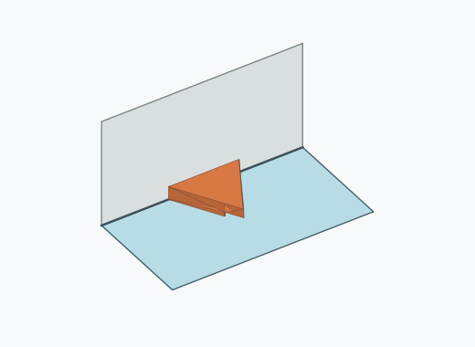 | 891 | 8.91 % | 8.37–9.48 % | 8.91 % |
| Pose 4 | Group 4 | 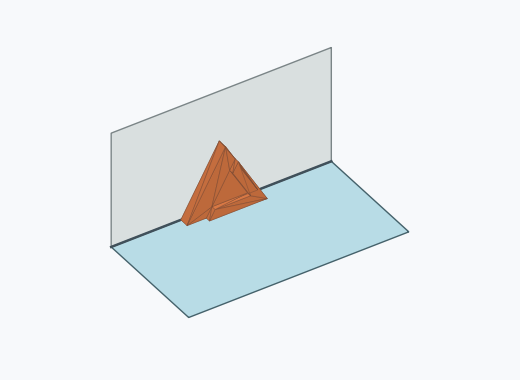 | 888 | 8.88 % | 8.34–9.45 % | 8.88 % |
| Pose 5 | Group 5 |  | 863 | 8.63 % | 8.10–9.20 % | 8.63 % |
| Pose 6 | Group 6 |  | 855 | 8.55 % | 8.02–9.11 % | 8.55 % |
| Pose 7 | Group 7 | 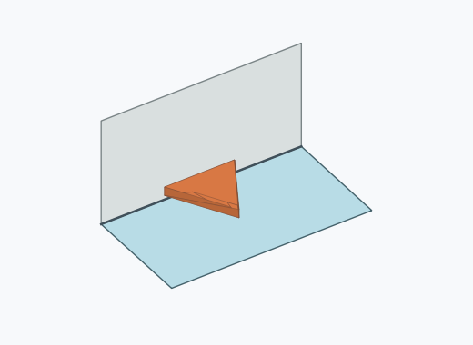 | 826 | 8.26 % | 7.74–8.82 % | 8.26 % |
| Pose 8 | Group 8 | 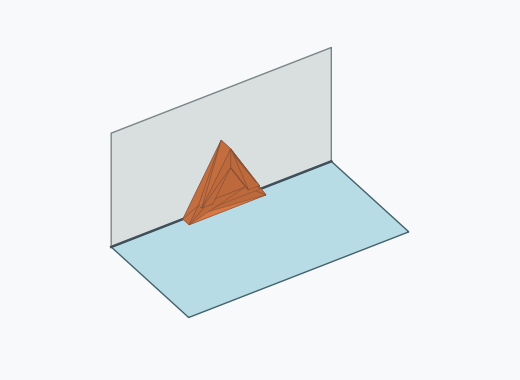 | 755 | 7.55 % | 7.05–8.08 % | 7.55 % |
| Pose 9 | Group 9 | 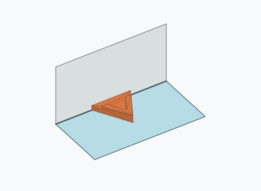 | 719 | 7.19 % | 6.70–7.71 % | 7.19 % |
| Pose 10 | Group 10 |  | 707 | 7.07 % | 6.58–7.59 % | 7.07 % |
| Pose 11 | Group 11 | 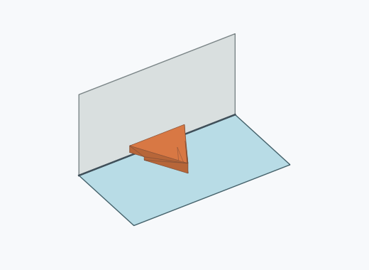 | 654 | 6.54 % | 6.07–7.04 % | 6.54 % |
| Pose 12 | Group 12 | 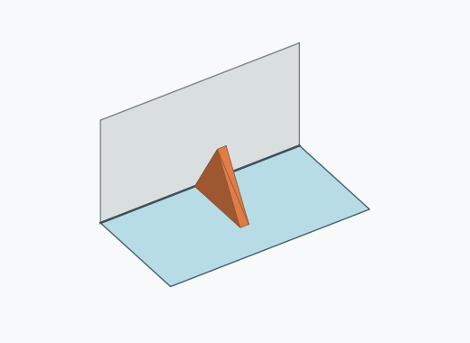 | 14 | 0.14 % | 0.08–0.23 % | 0.14 % |
| Pose 13 | Group 13 | 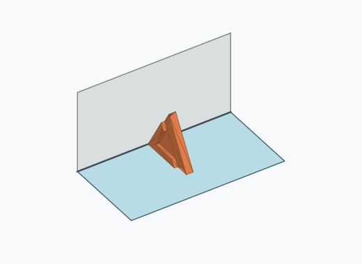 | 13 | 0.13 % | 0.08–0.22 % | 0.13 % |
| Pose 14 | Group 14 |  | 12 | 0.12 % | 0.07–0.21 % | 0.12 % |
| Pose 15 | Group 15 | 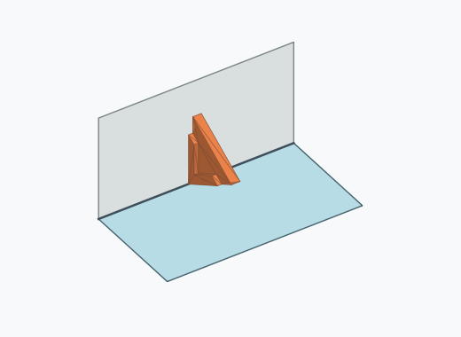 | 11 | 0.11 % | 0.06–0.20 % | 0.11 % |
| Pose 16 | Group 16 |  | 3 | 0.03 % | 0.01–0.09 % | 0.03 % |
| Pose 17 | Group 17 |  | 3 | 0.03 % | 0.01–0.09 % | 0.03 % |
| Pose 18 | Group 9 | 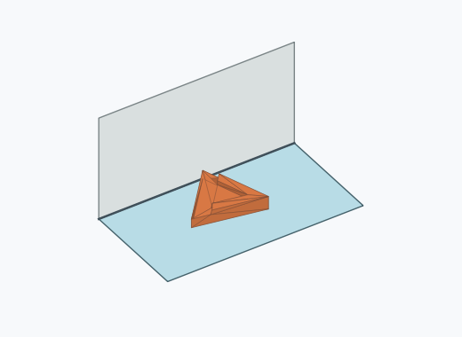 | 1 | 0.01 % | 0.00–0.06 % | 0.01 % |
| Pose 19 | Group 6 | 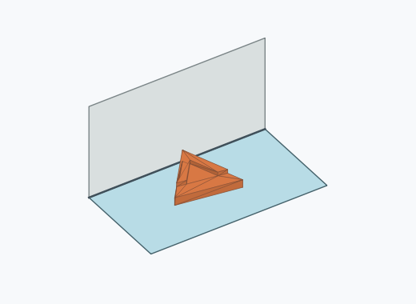 | 1 | 0.01 % | 0.00–0.06 % | 0.01 % |

[Pose catalogue JSON](poses.json) · [Pose catalogue YAML](poses.yaml) · [Frequencies](frequencies.csv) · [Trial records](trials.csv)

Pose orientations use `xyzw` quaternions from the workpiece frame to the chute frame. Recognition uses the recorded symmetry, a 5° tolerance, and a 1° ambiguity margin. The pose registry reserves previously observed IDs for later recognition.

### Historical run files

- [Configuration](config.json)
- [Manifest](manifest.json)
