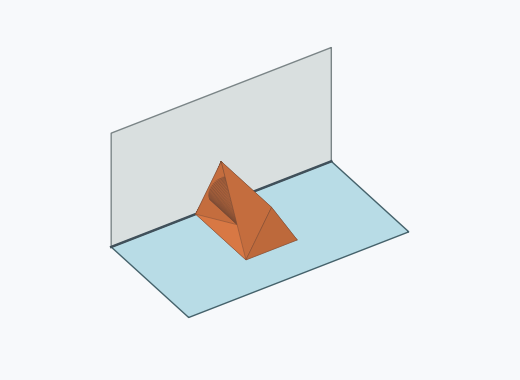

# Dk1i: grouped observed poses

10,000 completed drops; 9,998 settled. 8 assessed source poses; 6 groups meet the 1% cutoff.

Grouping uses 0.5 mm equivalent lift and a 60° maximum diameter. All members receive the same disturbance protocol.

| Representative | Image | Members | Combined count | Frequency | Retention AUC |
| --- | --- | --- | ---: | ---: | ---: |
| Dk1i_0005 |  | Dk1i_0003, Dk1i_0005 | 2768 | 27.68% | 1.0000 |
| Dk1i_0002 |  | Dk1i_0002, Dk1i_0004 | 2691 | 26.91% | 1.0000 |
| Dk1i_0007 |  | Dk1i_0007 | 1644 | 16.44% | 1.0000 |
| Dk1i_0006 |  | Dk1i_0006 | 1439 | 14.39% | 1.0000 |
| Dk1i_0001 |  | Dk1i_0001 | 746 | 7.46% | 1.0000 |
| Dk1i_0008 |  | Dk1i_0008 | 710 | 7.10% | 1.0000 |

[All original observations and member images](original_observations.json), [memberships](membership.csv), [barrier evidence](grouping_geometry.json), [member stability curves](group_stability.csv), [individual disturbance curves](stability.csv), [validation](validation.json).

Frequencies retain the original completed-drop denominator. Stability scores describe the configured virtual chute.
