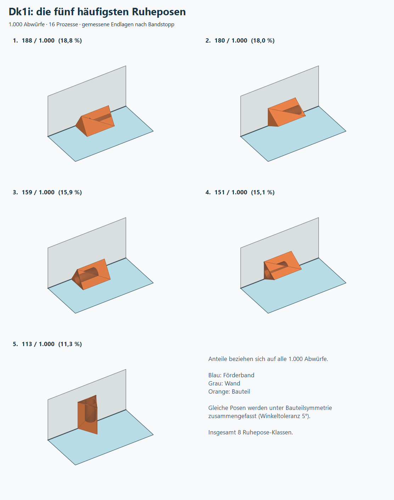
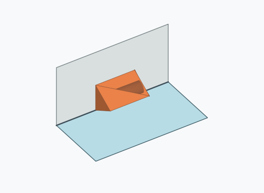
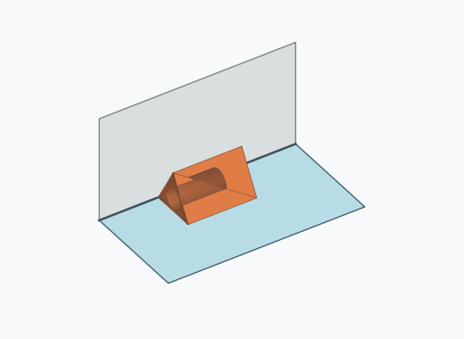
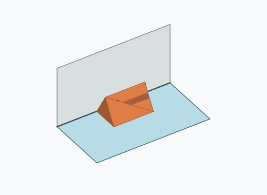
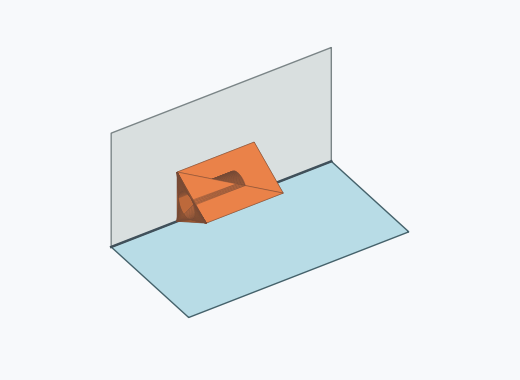
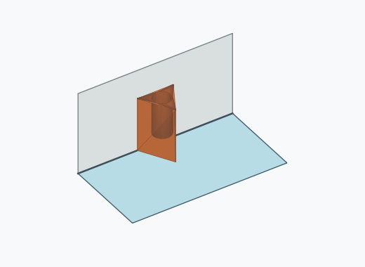
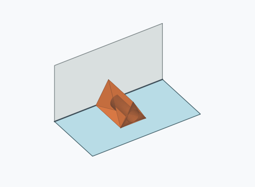
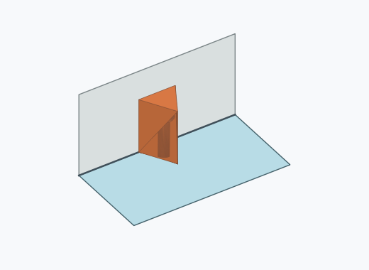

# Dk1i

## 1.000 Fallversuche mit 16 Prozessen

Dies ist der am 18.10.2026 angeforderte Lauf. Während der Fahrt waren
998 Teile ruhig und 2 noch unsettled; nach dem Bandstopp waren 999 ruhig
und 1 weiterhin unsettled. Es wurden acht Ruhepose-Klassen beobachtet.
Die folgenden fünf häufigsten Klassen entsprechen genau den im Chat gezeigten Bildern.
Ihre Anteile beziehen sich auf alle 1.000 Abwürfe.

- [Alle acht Ruheposen mit Bildern und Häufigkeiten](#ruheposen-nach-bandstopp)
- [Zusammenfassung des Laufs](summary.json)
- [Zuordnung aller 1.000 Ruheprüfungen zu Pose-IDs](trials_after_stop.csv)
- [Einzelne Ruheprüfungen](stop_observations.csv)
- [Vollständige Laufdaten und Impulsprotokolle als ZIP](simulation_results.zip)
- [Ausführungsnachweis](execution.json) und [Datenprüfung](validation.json)

1000 Fallversuche auf 500 mm Strecke; 998 eingependelte Endlagen. Prozentangaben beziehen sich auf alle Fallversuche.

Dies sind beobachtete Simulationslagen unter den dokumentierten Parametern; Reibung und Unebenheitsmodell sind noch nicht an realen Häufigkeiten kalibriert.

| Pose | Bild | Anzahl | Anteil | 95-%-Intervall | Anteil eingependelt |
| --- | --- | ---: | ---: | ---: | ---: |
| Dk1i_0002 |  | 188 | 18.80 % | 16.50–21.34 % | 18.84 % |
| Dk1i_0004 |  | 180 | 18.00 % | 15.74–20.50 % | 18.04 % |
| Dk1i_0003 |  | 160 | 16.00 % | 13.86–18.40 % | 16.03 % |
| Dk1i_0005 |  | 150 | 15.00 % | 12.92–17.35 % | 15.03 % |
| Dk1i_0007 |  | 113 | 11.30 % | 9.48–13.41 % | 11.32 % |
| Dk1i_0006 |  | 80 | 8.00 % | 6.47–9.85 % | 8.02 % |
| Dk1i_0001 |  | 76 | 7.60 % | 6.11–9.41 % | 7.62 % |
| Dk1i_0008 |  | 51 | 5.10 % | 3.90–6.64 % | 5.11 % |

Zusätzliche Ruheprüfung nach Bandstopp: 999 von 1000 beobachteten Teilen ruhig. Fahrhäufigkeiten oben bleiben davon getrennt. Ruheposen stehen als stop_observation in trials.csv.

## Ruheposen nach Bandstopp

**999 ruhige Endlagen, 8 Pose-Klassen.** Diese Bilder zeigen die gemessenen Orientierungen nach der Ruheprüfung.

Die Hauptanteile beziehen sich auf alle 1000 Abwürfe; die letzte Spalte auf die 999 ruhigen Endlagen. Drehungen um eine kontinuierliche Bauteilsymmetrieachse gelten als dieselbe Pose. Die Achsenrichtung bleibt berücksichtigt; entgegengesetzte Bauteilseiten werden getrennt.

| Ruhepose | Bild | Anzahl | Anteil aller Abwürfe | 95-%-Intervall | Anteil ruhiger Endlagen |
| --- | --- | ---: | ---: | ---: | ---: |
| Dk1i_stop_0003 |  | 188 | 18.80 % | 16.50–21.34 % | 18.82 % |
| Dk1i_stop_0004 |  | 180 | 18.00 % | 15.74–20.50 % | 18.02 % |
| Dk1i_stop_0002 |  | 159 | 15.90 % | 13.76–18.30 % | 15.92 % |
| Dk1i_stop_0005 |  | 151 | 15.10 % | 13.01–17.45 % | 15.12 % |
| Dk1i_stop_0007 |  | 113 | 11.30 % | 9.48–13.41 % | 11.31 % |
| Dk1i_stop_0006 |  | 81 | 8.10 % | 6.56–9.96 % | 8.11 % |
| Dk1i_stop_0001 |  | 76 | 7.60 % | 6.11–9.41 % | 7.61 % |
| Dk1i_stop_0008 |  | 51 | 5.10 % | 3.90–6.64 % | 5.11 % |

Ruheposen und Erkennung: [JSON](poses_after_stop.json), [YAML](poses_after_stop.yaml). Häufigkeiten: [CSV](frequencies_after_stop.csv). Zuordnung aller Versuche: [CSV](trials_after_stop.csv). Fahrmessung und Fahrposen bleiben separat in poses.json und trials.csv.

Ergebnisstatus: settled: 998, unsettled: 2

Details und Erkennung: [JSON](poses.json), [YAML](poses.yaml). Quaternionen: xyzw, Bauteil → Rutsche. Symmetrieoperationen werden rechts an die Bauteilrotation multipliziert. Die kontinuierliche Symmetrieachse wird gerichtet verglichen. Orientierungsabstand ≤5°; bei konkurrierenden Treffern innerhalb 1° bleibt die Zuordnung mehrdeutig.

Die Pose-IDs bleiben über Läufe erhalten. Der Registereintrag einer früher beobachteten, aktuell nicht aufgetretenen Pose bleibt zur Wiedererkennung reserviert.
