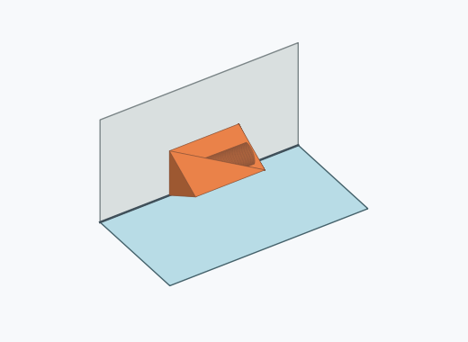
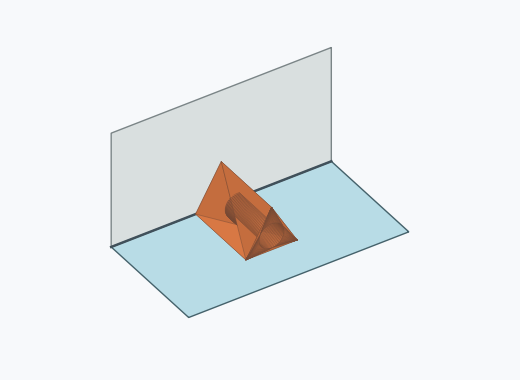
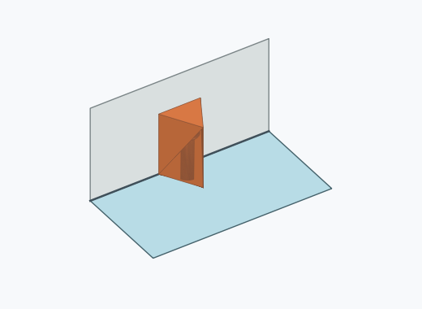
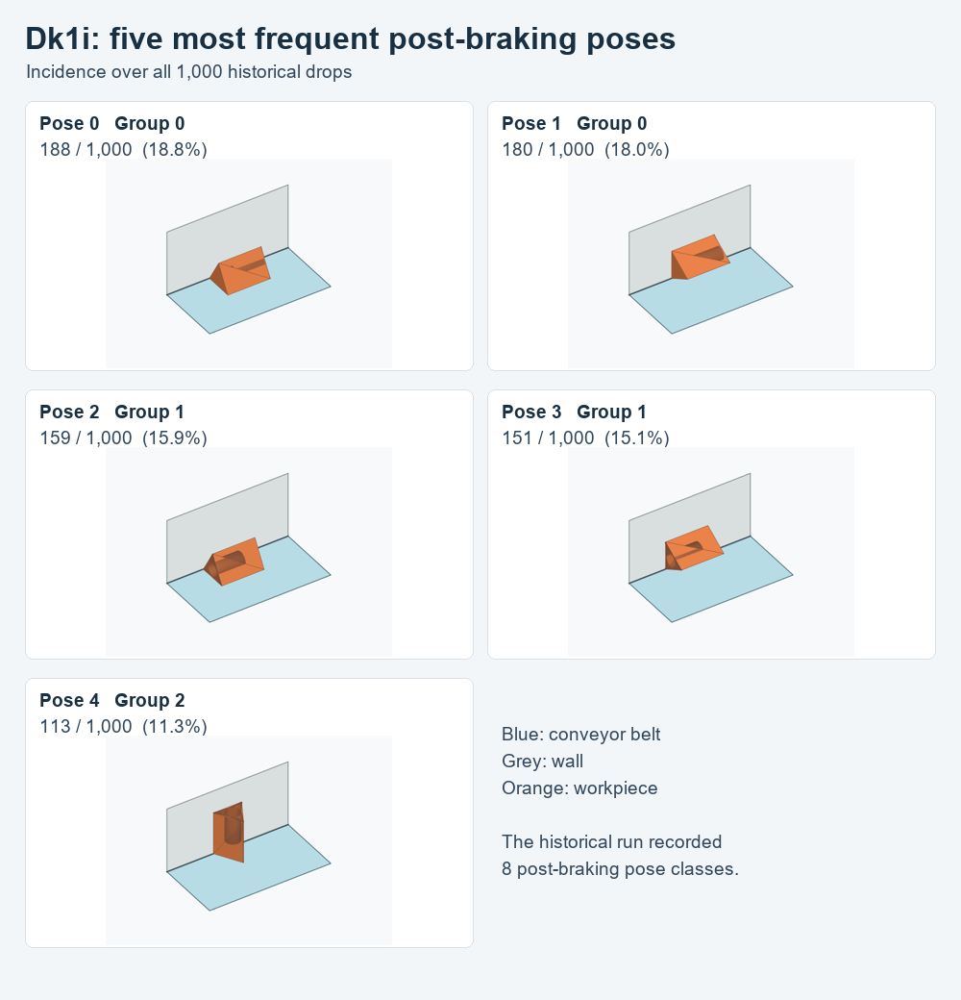
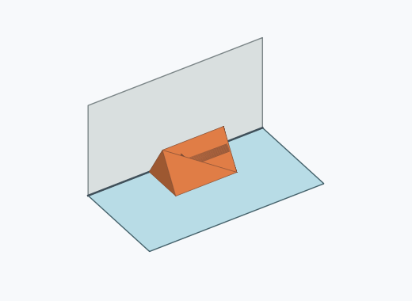
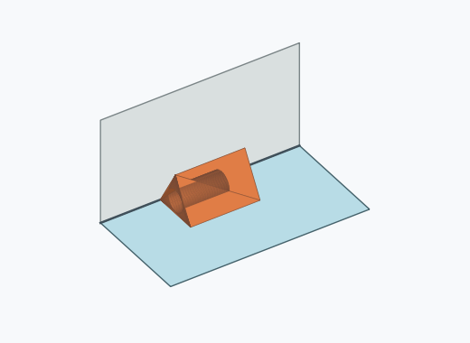
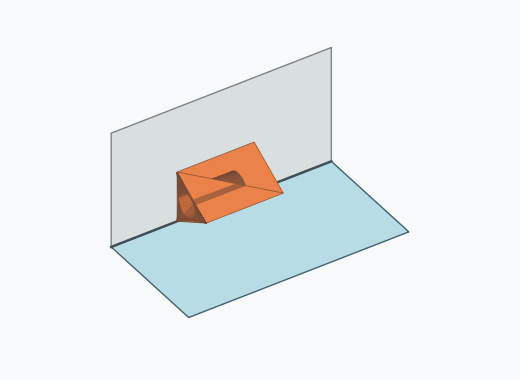
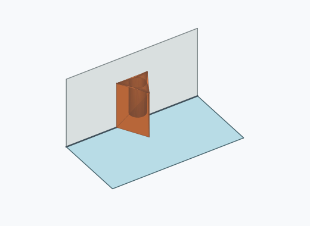
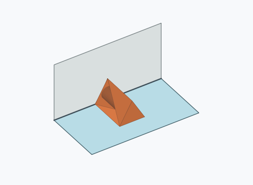

# Dk1i

[Workpiece index](../README.md#workpieces)

## 10,000-drop paper study

The stationary series recorded **10,000** settled outcomes. The moving series recorded **9,950** settled outcomes at the virtual exit. Each series contains 10,000 drops.

[Study overview](simulations/20261107_10000/README.md) · [Stationary results](simulations/20261107_10000/static/README.md) · [Moving results](simulations/20261107_10000/100mm_s/README.md)

## Historical pose catalogue

Group numbers rank the saved pose basins by their combined incidence within each observation phase. The percentages in the table describe each individual pose. Groups below 1% remain visible.

[Group membership CSV](group_memberships.csv) · [Grouping method](../README.md#catalogue-grouping)

### Transport poses

998 settled outcomes across 1,000 historical drops on a 500 mm chute. Incidence uses all completed drops as the denominator.

Outcome counts: settled: 998, unsettled: 2.

| Pose | Group | Image | Count | Incidence | 95% interval | Share of settled outcomes |
| --- | --- | --- | ---: | ---: | ---: | ---: |
| Dk1i_0002 | Group 0 |  | 188 | 18.80 % | 16.50–21.34 % | 18.84 % |
| Dk1i_0004 | Group 0 |  | 180 | 18.00 % | 15.74–20.50 % | 18.04 % |
| Dk1i_0003 | Group 1 |  | 160 | 16.00 % | 13.86–18.40 % | 16.03 % |
| Dk1i_0005 | Group 1 |  | 150 | 15.00 % | 12.92–17.35 % | 15.03 % |
| Dk1i_0007 | Group 2 |  | 113 | 11.30 % | 9.48–13.41 % | 11.32 % |
| Dk1i_0006 | Group 3 |  | 80 | 8.00 % | 6.47–9.85 % | 8.02 % |
| Dk1i_0001 | Group 4 |  | 76 | 7.60 % | 6.11–9.41 % | 7.62 % |
| Dk1i_0008 | Group 5 |  | 51 | 5.10 % | 3.90–6.64 % | 5.11 % |

[Pose catalogue JSON](poses.json) · [Pose catalogue YAML](poses.yaml) · [Frequencies](frequencies.csv) · [Trial records](trials.csv)

### Post-braking poses

999 settled outcomes across 1,000 historical drops on a 500 mm chute. Incidence uses all completed drops as the denominator.

Outcome counts: settled: 999, unsettled: 1.

The rest check followed the transport outcome and covered 1,000 trials.

| Pose | Group | Image | Count | Incidence | 95% interval | Share of settled outcomes |
| --- | --- | --- | ---: | ---: | ---: | ---: |
| Dk1i_stop_0003 | Group 0 |  | 188 | 18.80 % | 16.50–21.34 % | 18.82 % |
| Dk1i_stop_0004 | Group 0 |  | 180 | 18.00 % | 15.74–20.50 % | 18.02 % |
| Dk1i_stop_0002 | Group 1 |  | 159 | 15.90 % | 13.76–18.30 % | 15.92 % |
| Dk1i_stop_0005 | Group 1 |  | 151 | 15.10 % | 13.01–17.45 % | 15.12 % |
| Dk1i_stop_0007 | Group 2 |  | 113 | 11.30 % | 9.48–13.41 % | 11.31 % |
| Dk1i_stop_0006 | Group 3 |  | 81 | 8.10 % | 6.56–9.96 % | 8.11 % |
| Dk1i_stop_0001 | Group 4 |  | 76 | 7.60 % | 6.11–9.41 % | 7.61 % |
| Dk1i_stop_0008 | Group 5 |  | 51 | 5.10 % | 3.90–6.64 % | 5.11 % |

[Pose catalogue JSON](poses_after_stop.json) · [Pose catalogue YAML](poses_after_stop.yaml) · [Frequencies](frequencies_after_stop.csv) · [Trial records](trials_after_stop.csv)

Pose orientations use `xyzw` quaternions from the workpiece frame to the chute frame. Recognition uses the recorded symmetry, a 5° tolerance, and a 1° ambiguity margin. The pose registry reserves previously observed IDs for later recognition.

### Historical run files

- [Configuration](config.json)
- [Manifest](manifest.json)
- [Summary](summary.json)
- [Post-braking observations](stop_observations.csv)
- [Complete historical run archive](simulation_results.zip)
- [Execution record](execution.json)
- [Data validation](validation.json)
- [Earlier 1,000-drop comparisons](simulations/README.md)

The historical run used 16 worker processes.
