# Dk2a

[Workpiece index](../README.md#workpieces)

## Historical pose catalogue

Group numbers rank the saved pose basins by their combined incidence within each observation phase. Pose 0 is the most frequent individual pose in its observation phase. The membership CSV links the displayed numbers to the saved pose IDs. Groups below 1% remain visible.

[Group membership CSV](group_memberships.csv) · [Grouping method](../README.md#catalogue-grouping)

### Transport poses

9,845 settled outcomes across 10,000 historical drops on a 500 mm chute. Incidence uses all completed drops as the denominator.

Outcome counts: settled: 9,845, unsettled: 155.

| Pose | Group | Image | Count | Incidence | 95% interval | Share of settled outcomes |
| --- | --- | --- | ---: | ---: | ---: | ---: |
| Pose 0 | Group 0 | 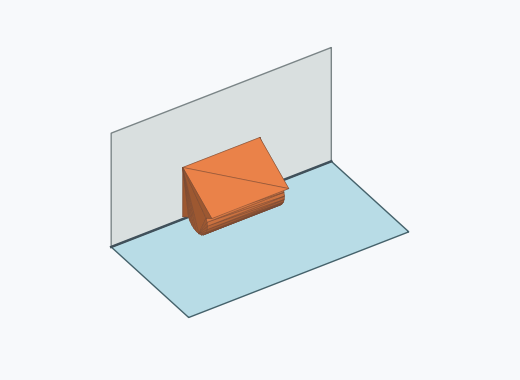 | 1694 | 16.94 % | 16.22–17.69 % | 17.21 % |
| Pose 1 | Group 1 | 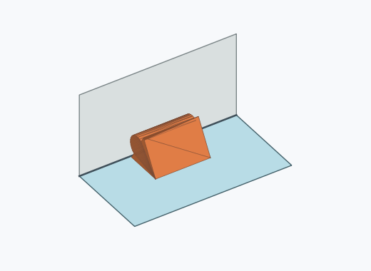 | 1557 | 15.57 % | 14.87–16.29 % | 15.82 % |
| Pose 2 | Group 4 | 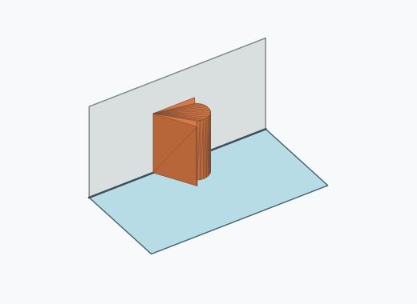 | 785 | 7.85 % | 7.34–8.39 % | 7.97 % |
| Pose 3 | Group 5 | 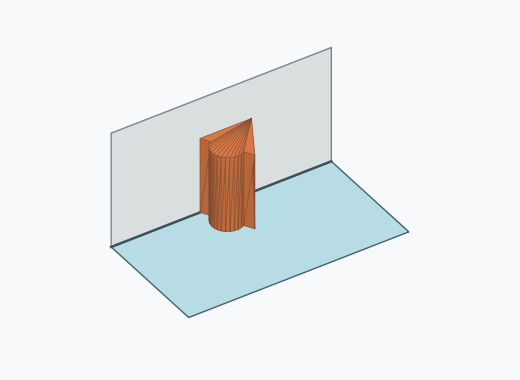 | 713 | 7.13 % | 6.64–7.65 % | 7.24 % |
| Pose 4 | Group 6 | 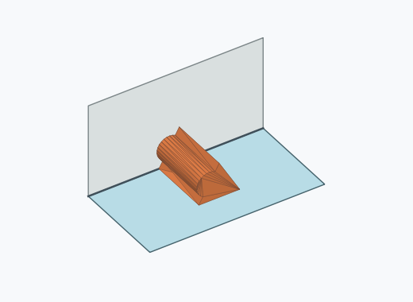 | 688 | 6.88 % | 6.40–7.39 % | 6.99 % |
| Pose 5 | Group 7 | 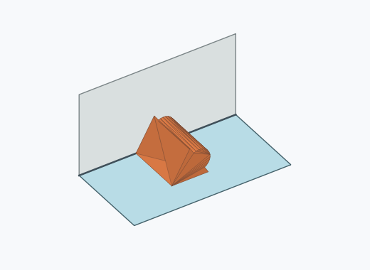 | 675 | 6.75 % | 6.27–7.26 % | 6.86 % |
| Pose 6 | Group 2 | 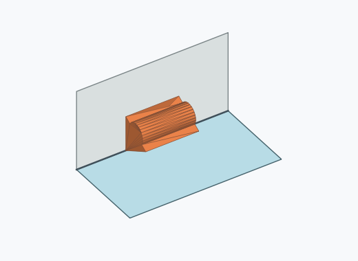 | 667 | 6.67 % | 6.20–7.18 % | 6.78 % |
| Pose 7 | Group 2 | 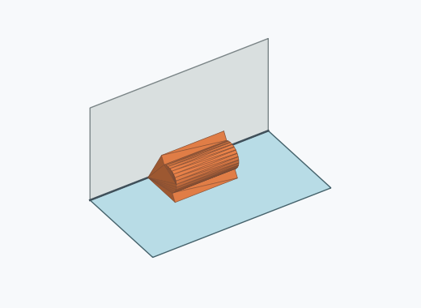 | 629 | 6.29 % | 5.83–6.78 % | 6.39 % |
| Pose 8 | Group 8 | 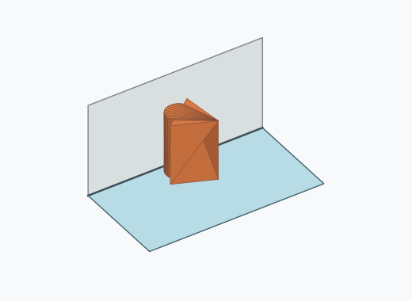 | 524 | 5.24 % | 4.82–5.69 % | 5.32 % |
| Pose 9 | Group 9 | 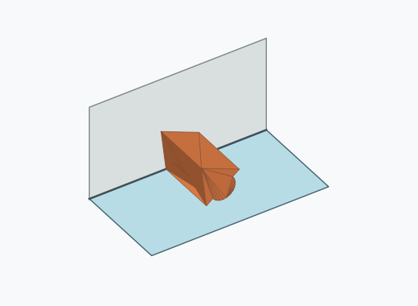 | 511 | 5.11 % | 4.70–5.56 % | 5.19 % |
| Pose 10 | Group 3 | 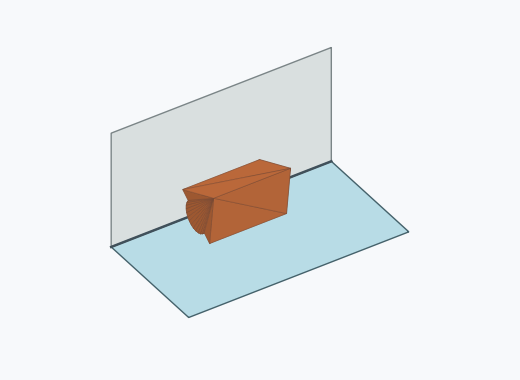 | 478 | 4.78 % | 4.38–5.22 % | 4.86 % |
| Pose 11 | Group 3 | 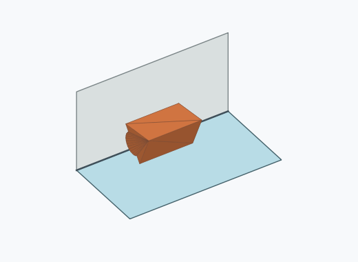 | 469 | 4.69 % | 4.29–5.12 % | 4.76 % |
| Pose 12 | Group 10 | 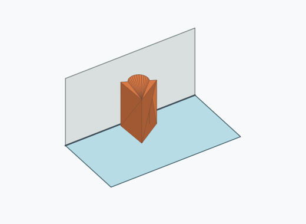 | 258 | 2.58 % | 2.29–2.91 % | 2.62 % |
| Pose 13 | Group 11 |  | 131 | 1.31 % | 1.11–1.55 % | 1.33 % |
| Pose 14 | Group 11 | 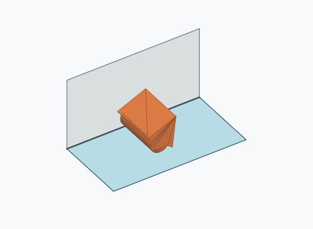 | 52 | 0.52 % | 0.40–0.68 % | 0.53 % |
| Pose 15 | Group 12 | 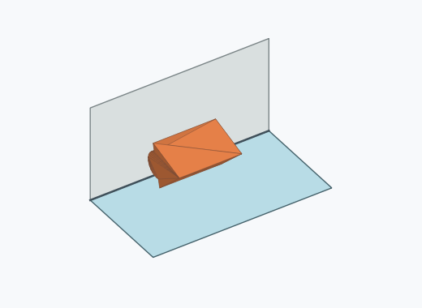 | 13 | 0.13 % | 0.08–0.22 % | 0.13 % |
| Pose 16 | Group 7 | 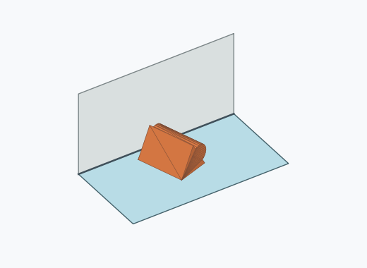 | 1 | 0.01 % | 0.00–0.06 % | 0.01 % |

[Pose catalogue JSON](poses.json) · [Pose catalogue YAML](poses.yaml) · [Frequencies](frequencies.csv) · [Trial records](trials.csv)

Pose orientations use `xyzw` quaternions from the workpiece frame to the chute frame. Recognition uses the recorded symmetry, a 5° tolerance, and a 1° ambiguity margin. The pose registry reserves previously observed IDs for later recognition.

### Historical run files

- [Configuration](config.json)
- [Manifest](manifest.json)
