# Dk2a: grouped observed poses

10,000 completed drops; 9,845 settled. 17 assessed source poses; 12 groups meet the 1% cutoff.

Grouping uses 0.5 mm equivalent lift and a 60° maximum diameter. All members receive the same disturbance protocol.

| Representative | Image | Members | Combined count | Frequency | Retention AUC |
| --- | --- | --- | ---: | ---: | ---: |
| Dk2a_0006 | 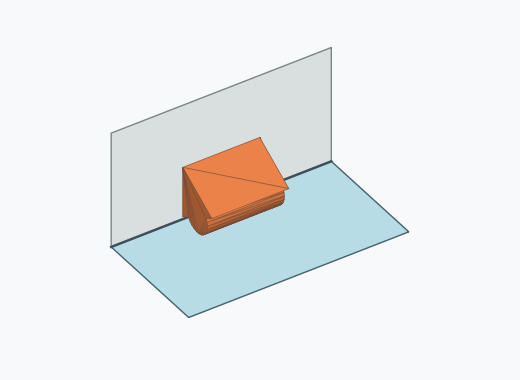 | Dk2a_0006 | 1694 | 16.94% | 1.0000 |
| Dk2a_0004 | 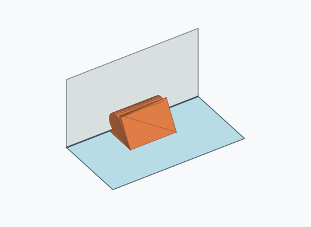 | Dk2a_0004 | 1557 | 15.57% | 1.0000 |
| Dk2a_0016 | 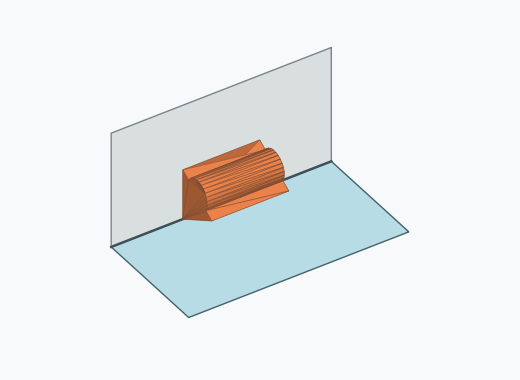 | Dk2a_0013, Dk2a_0016 | 1296 | 12.96% | 1.0000 |
| Dk2a_0012 | 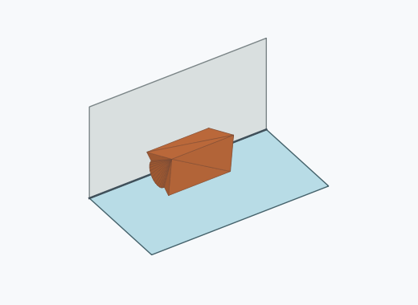 | Dk2a_0011, Dk2a_0012 | 947 | 9.47% | 1.0000 |
| Dk2a_0002 | 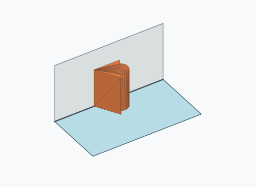 | Dk2a_0002 | 785 | 7.85% | 1.0000 |
| Dk2a_0015 | 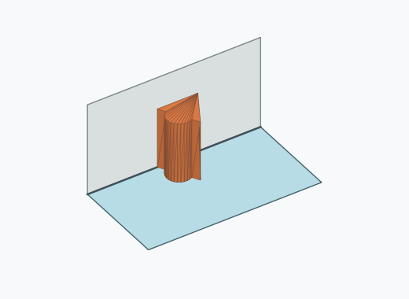 | Dk2a_0015 | 713 | 7.13% | 1.0000 |
| Dk2a_0014 | 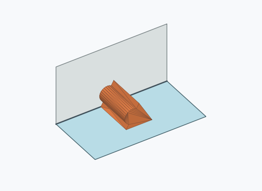 | Dk2a_0014 | 688 | 6.88% | 1.0000 |
| Dk2a_0007 | 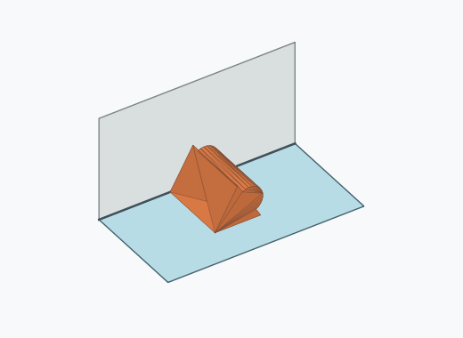 | Dk2a_0007, Dk2a_0017 | 676 | 6.76% | 1.0000 |
| Dk2a_0005 | 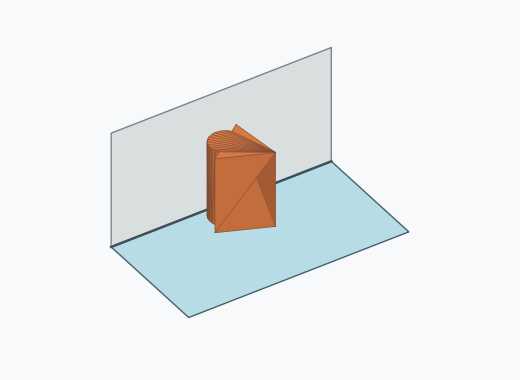 | Dk2a_0005 | 524 | 5.24% | 1.0000 |
| Dk2a_0003 | 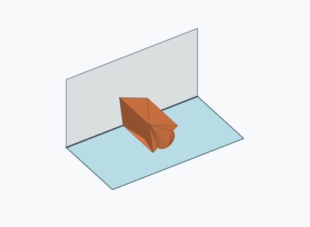 | Dk2a_0003 | 511 | 5.11% | 1.0000 |
| Dk2a_0001 | 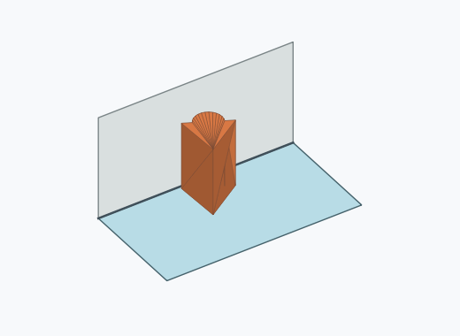 | Dk2a_0001 | 258 | 2.58% | 0.7266 |
| Dk2a_0010 | 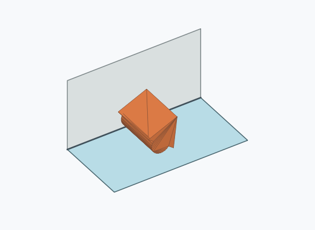 | Dk2a_0009, Dk2a_0010 | 183 | 1.83% | 0.8359 |

[All original observations and member images](original_observations.json), [memberships](membership.csv), [barrier evidence](grouping_geometry.json), [member stability curves](group_stability.csv), [individual disturbance curves](stability.csv), [validation](validation.json).

Frequencies retain the original completed-drop denominator. Stability scores describe the configured virtual chute.
