# Dk4i

[Workpiece index](../README.md#workpieces)

## Historical pose catalogue

Group numbers rank the saved pose basins by their combined incidence within each observation phase. Pose 0 is the most frequent individual pose in its observation phase. The membership CSV links the displayed numbers to the saved pose IDs. Groups below 1% remain visible.

[Group membership CSV](group_memberships.csv) · [Grouping method](../README.md#catalogue-grouping)

### Transport poses

9,999 settled outcomes across 10,000 historical drops on a 500 mm chute. Incidence uses all completed drops as the denominator.

Outcome counts: settled: 9,999, unsettled: 1.

| Pose | Group | Image | Count | Incidence | 95% interval | Share of settled outcomes |
| --- | --- | --- | ---: | ---: | ---: | ---: |
| Pose 0 | Group 1 | 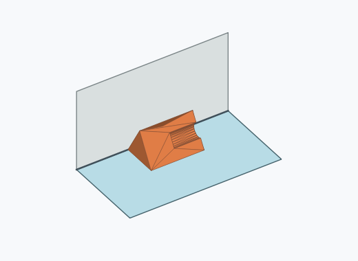 | 633 | 6.33 % | 5.87–6.82 % | 6.33 % |
| Pose 1 | Group 0 | 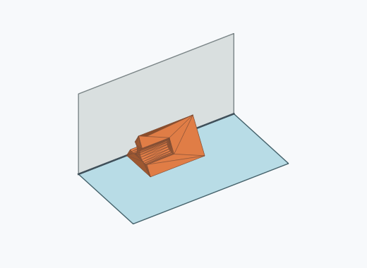 | 609 | 6.09 % | 5.64–6.58 % | 6.09 % |
| Pose 2 | Group 2 | 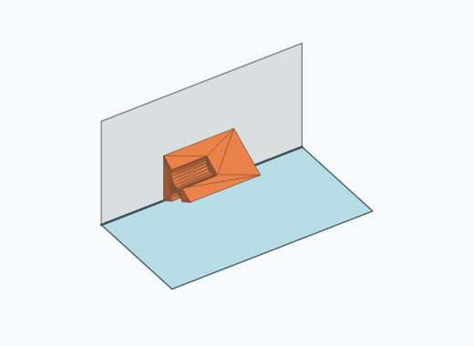 | 584 | 5.84 % | 5.40–6.32 % | 5.84 % |
| Pose 3 | Group 6 | 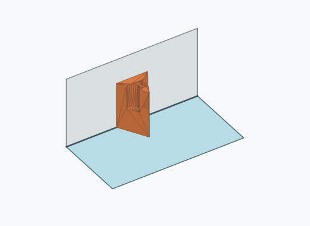 | 552 | 5.52 % | 5.09–5.98 % | 5.52 % |
| Pose 4 | Group 4 |  | 541 | 5.41 % | 4.98–5.87 % | 5.41 % |
| Pose 5 | Group 5 | 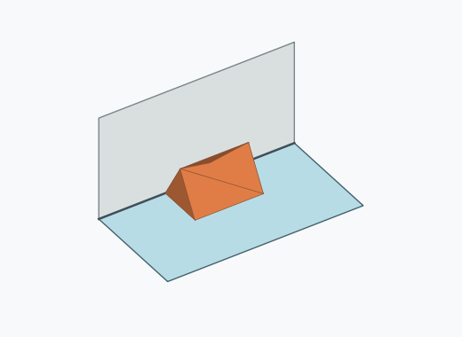 | 502 | 5.02 % | 4.61–5.47 % | 5.02 % |
| Pose 6 | Group 3 |  | 495 | 4.95 % | 4.54–5.39 % | 4.95 % |
| Pose 7 | Group 7 | 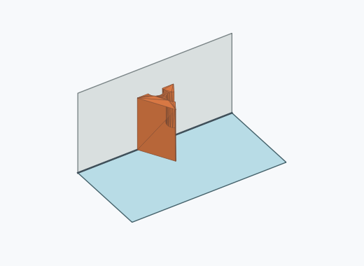 | 456 | 4.56 % | 4.17–4.99 % | 4.56 % |
| Pose 8 | Group 8 | 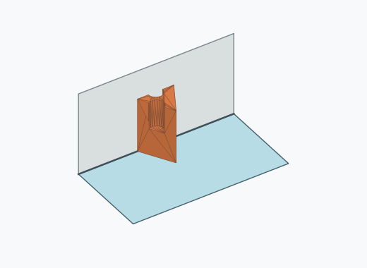 | 445 | 4.45 % | 4.06–4.87 % | 4.45 % |
| Pose 9 | Group 9 |  | 440 | 4.40 % | 4.02–4.82 % | 4.40 % |
| Pose 10 | Group 3 | 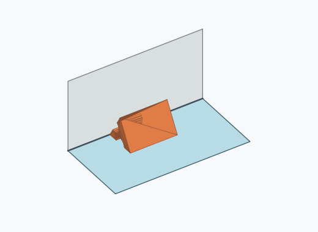 | 425 | 4.25 % | 3.87–4.66 % | 4.25 % |
| Pose 11 | Group 10 | 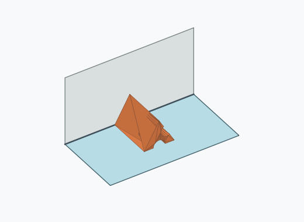 | 405 | 4.05 % | 3.68–4.45 % | 4.05 % |
| Pose 12 | Group 11 | 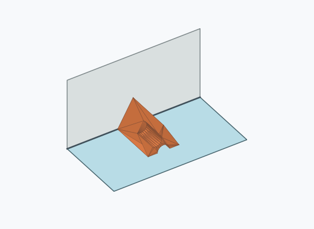 | 405 | 4.05 % | 3.68–4.45 % | 4.05 % |
| Pose 13 | Group 5 | 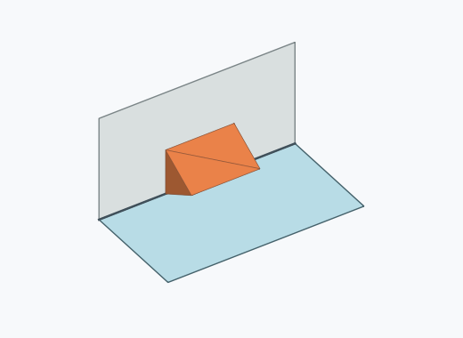 | 403 | 4.03 % | 3.66–4.43 % | 4.03 % |
| Pose 14 | Group 4 |  | 370 | 3.70 % | 3.35–4.09 % | 3.70 % |
| Pose 15 | Group 0 | 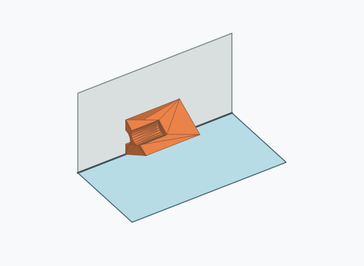 | 366 | 3.66 % | 3.31–4.05 % | 3.66 % |
| Pose 16 | Group 2 |  | 360 | 3.60 % | 3.25–3.98 % | 3.60 % |
| Pose 17 | Group 12 | 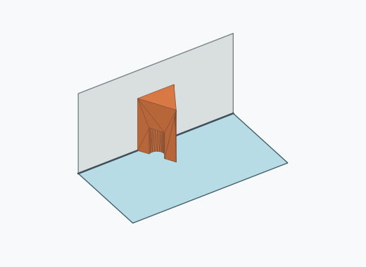 | 325 | 3.25 % | 2.92–3.62 % | 3.25 % |
| Pose 18 | Group 1 | 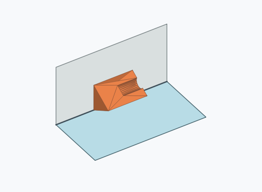 | 315 | 3.15 % | 2.83–3.51 % | 3.15 % |
| Pose 19 | Group 13 | 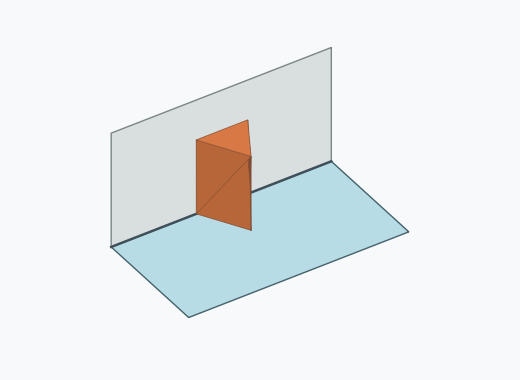 | 281 | 2.81 % | 2.50–3.15 % | 2.81 % |
| Pose 20 | Group 14 | 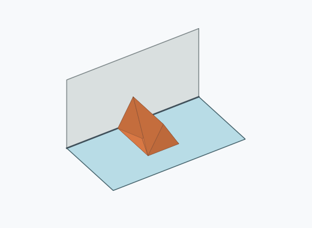 | 280 | 2.80 % | 2.49–3.14 % | 2.80 % |
| Pose 21 | Group 15 |  | 275 | 2.75 % | 2.45–3.09 % | 2.75 % |
| Pose 22 | Group 16 | 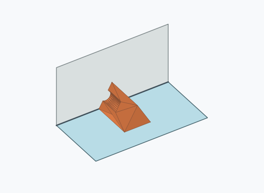 | 268 | 2.68 % | 2.38–3.02 % | 2.68 % |
| Pose 23 | Group 17 | 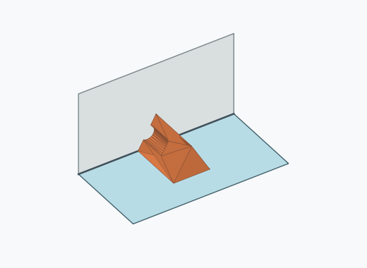 | 264 | 2.64 % | 2.34–2.97 % | 2.64 % |

[Pose catalogue JSON](poses.json) · [Pose catalogue YAML](poses.yaml) · [Frequencies](frequencies.csv) · [Trial records](trials.csv)

Pose orientations use `xyzw` quaternions from the workpiece frame to the chute frame. Recognition uses the recorded symmetry, a 5° tolerance, and a 1° ambiguity margin. The pose registry reserves previously observed IDs for later recognition.

### Historical run files

- [Configuration](config.json)
- [Manifest](manifest.json)

<!-- remaining-workpieces-20261110_10000:start -->
## Additional 10,000-drop runs

10,000 stationary and 10,000 moving-belt drops with the archived reference settings.

[Results and validation](simulations/20261110_10000/README.md).
<!-- remaining-workpieces-20261110_10000:end -->
