# Dk4i: grouped observed poses

10,000 completed drops; 9,999 settled. 24 assessed source poses; 18 groups meet the 1% cutoff.

Grouping uses 0.5 mm equivalent lift and a 60° maximum diameter. All members receive the same disturbance protocol.

| Representative | Image | Members | Combined count | Frequency | Retention AUC |
| --- | --- | --- | ---: | ---: | ---: |
| Dk4i_0009 | 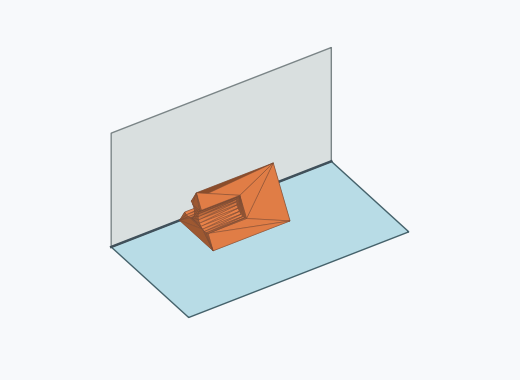 | Dk4i_0009, Dk4i_0011 | 975 | 9.75% | 1.0000 |
| Dk4i_0003 | 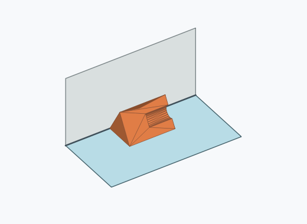 | Dk4i_0003, Dk4i_0005 | 948 | 9.48% | 1.0000 |
| Dk4i_0006 | 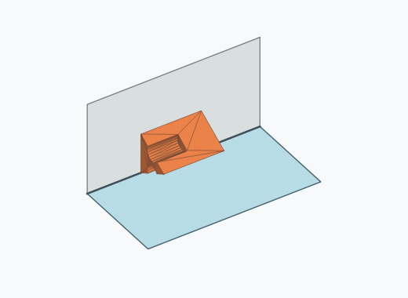 | Dk4i_0004, Dk4i_0006 | 944 | 9.44% | 1.0000 |
| Dk4i_0022 |  | Dk4i_0020, Dk4i_0022 | 920 | 9.20% | 1.0000 |
| Dk4i_0023 | 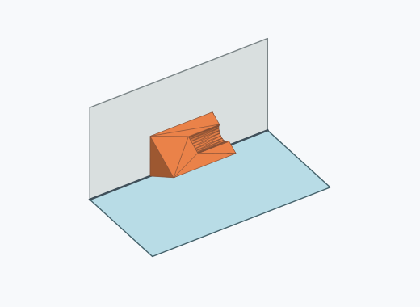 | Dk4i_0021, Dk4i_0023 | 911 | 9.11% | 1.0000 |
| Dk4i_0010 | 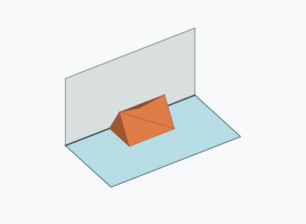 | Dk4i_0010, Dk4i_0012 | 905 | 9.05% | 1.0000 |
| Dk4i_0015 | 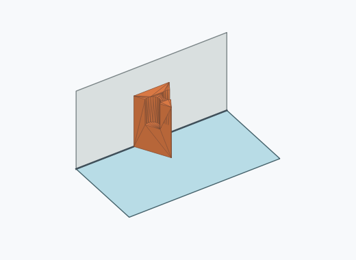 | Dk4i_0015 | 552 | 5.52% | 1.0000 |
| Dk4i_0017 | 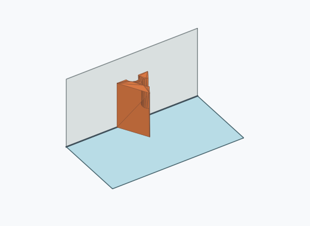 | Dk4i_0017 | 456 | 4.56% | 1.0000 |
| Dk4i_0016 |  | Dk4i_0016 | 445 | 4.45% | 1.0000 |
| Dk4i_0008 | 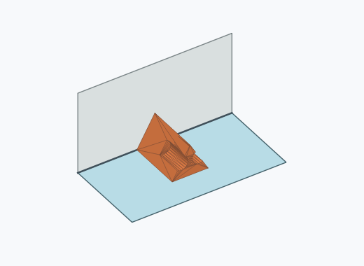 | Dk4i_0008 | 440 | 4.40% | 1.0000 |
| Dk4i_0007 | 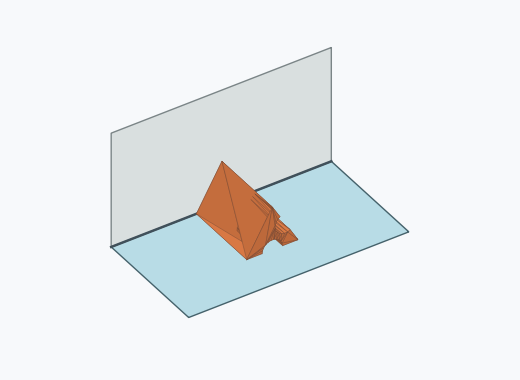 | Dk4i_0007 | 405 | 4.05% | 1.0000 |
| Dk4i_0014 |  | Dk4i_0014 | 405 | 4.05% | 1.0000 |
| Dk4i_0001 | 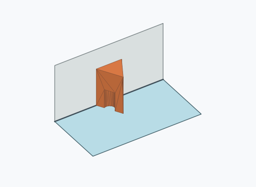 | Dk4i_0001 | 325 | 3.25% | 1.0000 |
| Dk4i_0002 | 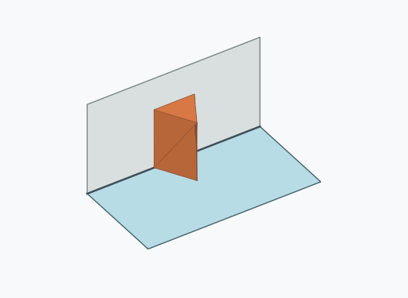 | Dk4i_0002 | 281 | 2.81% | 1.0000 |
| Dk4i_0024 | 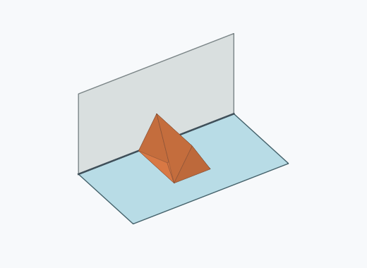 | Dk4i_0024 | 280 | 2.80% | 1.0000 |
| Dk4i_0013 | 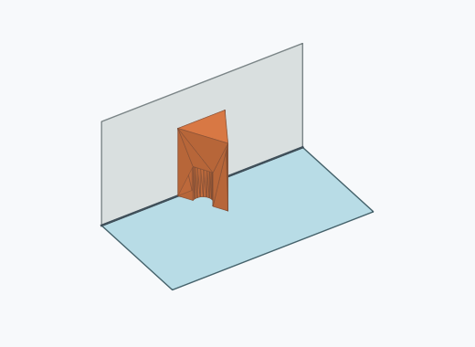 | Dk4i_0013 | 275 | 2.75% | 1.0000 |
| Dk4i_0019 | 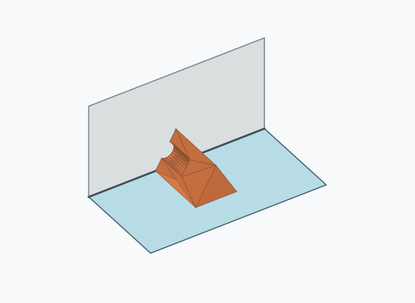 | Dk4i_0019 | 268 | 2.68% | 1.0000 |
| Dk4i_0018 | 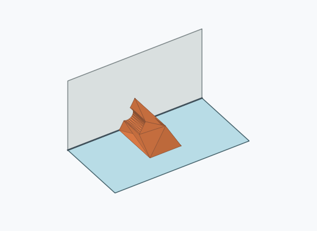 | Dk4i_0018 | 264 | 2.64% | 1.0000 |

[All original observations and member images](original_observations.json), [memberships](membership.csv), [barrier evidence](grouping_geometry.json), [member stability curves](group_stability.csv), [individual disturbance curves](stability.csv), [validation](validation.json).

Frequencies retain the original completed-drop denominator. Stability scores describe the configured virtual chute.
