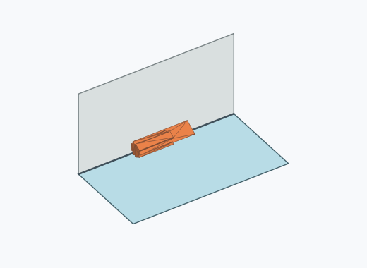
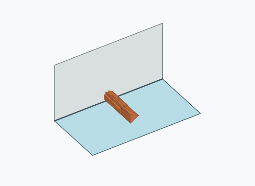
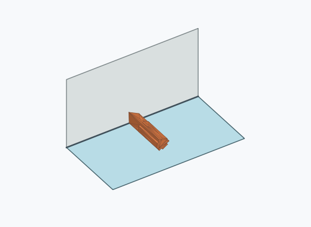
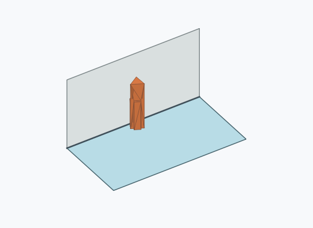

# Dl1a: grouped observed poses

10,000 completed drops; 9,983 settled. 16 assessed source poses; 5 groups meet the 1% cutoff.

Grouping uses 0.5 mm equivalent lift and a 60° maximum diameter. All members receive the same disturbance protocol.

| Representative | Image | Members | Combined count | Frequency | Retention AUC |
| --- | --- | --- | ---: | ---: | ---: |
| Dl1a_0007 |  | Dl1a_0005, Dl1a_0007, Dl1a_0010, Dl1a_0016 | 4724 | 47.24% | 1.0000 |
| Dl1a_0006 |  | Dl1a_0004, Dl1a_0006, Dl1a_0009, Dl1a_0015 | 4628 | 46.28% | 1.0000 |
| Dl1a_0013 |  | Dl1a_0013, Dl1a_0014 | 332 | 3.32% | 1.0000 |
| Dl1a_0003 |  | Dl1a_0003, Dl1a_0008 | 155 | 1.55% | 1.0000 |
| Dl1a_0002 |  | Dl1a_0001, Dl1a_0002 | 113 | 1.13% | 0.9844 |

[All original observations and member images](original_observations.json), [memberships](membership.csv), [barrier evidence](grouping_geometry.json), [member stability curves](group_stability.csv), [individual disturbance curves](stability.csv), [validation](validation.json).

Frequencies retain the original completed-drop denominator. Stability scores describe the configured virtual chute.
