# Dl1a

[Workpiece index](../README.md#workpieces)

## 10,000-drop paper study

The stationary series recorded **9,992** settled outcomes. The moving series recorded **10,000** settled outcomes at the virtual exit. Each series contains 10,000 drops.

[Study overview](simulations/20261107_10000/README.md) · [Stationary results](simulations/20261107_10000/static/README.md) · [Moving results](simulations/20261107_10000/100mm_s/README.md)

## Historical pose catalogue

Group numbers rank the saved pose basins by their combined incidence within each observation phase. The percentages in the table describe each individual pose. Groups below 1% remain visible.

[Group membership CSV](group_memberships.csv) · [Grouping method](../README.md#catalogue-grouping)

### Transport poses

9,983 settled outcomes across 10,000 historical drops on a 500 mm chute. Incidence uses all completed drops as the denominator.

Outcome counts: settled: 9,983, unsettled: 17.

| Pose | Group | Image | Count | Incidence | 95% interval | Share of settled outcomes |
| --- | --- | --- | ---: | ---: | ---: | ---: |
| Dl1a_0007 | Group 0 |  | 2965 | 29.65 % | 28.76–30.55 % | 29.70 % |
| Dl1a_0006 | Group 1 | 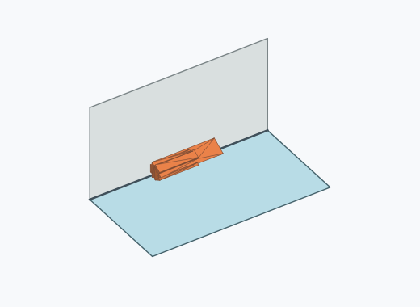 | 2569 | 25.69 % | 24.84–26.56 % | 25.73 % |
| Dl1a_0004 | Group 1 | 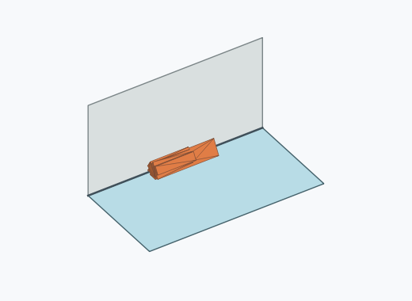 | 1924 | 19.24 % | 18.48–20.02 % | 19.27 % |
| Dl1a_0005 | Group 0 | 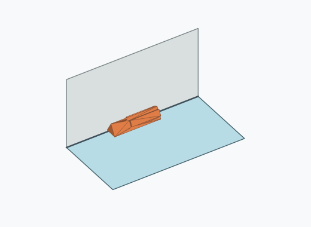 | 1667 | 16.67 % | 15.95–17.41 % | 16.70 % |
| Dl1a_0014 | Group 2 | 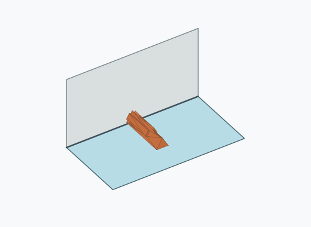 | 285 | 2.85 % | 2.54–3.19 % | 2.85 % |
| Dl1a_0009 | Group 1 | 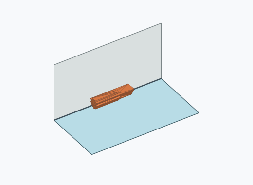 | 121 | 1.21 % | 1.01–1.44 % | 1.21 % |
| Dl1a_0008 | Group 3 | 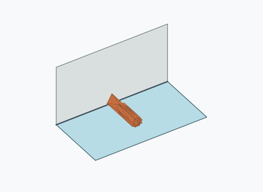 | 117 | 1.17 % | 0.98–1.40 % | 1.17 % |
| Dl1a_0001 | Group 4 | 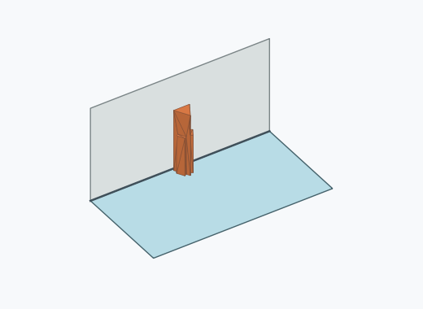 | 91 | 0.91 % | 0.74–1.12 % | 0.91 % |
| Dl1a_0010 | Group 0 | 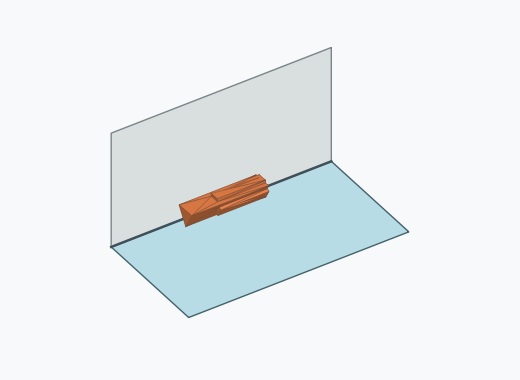 | 76 | 0.76 % | 0.61–0.95 % | 0.76 % |
| Dl1a_0013 | Group 2 | 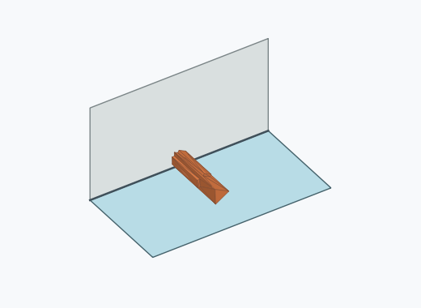 | 47 | 0.47 % | 0.35–0.62 % | 0.47 % |
| Dl1a_0003 | Group 3 | 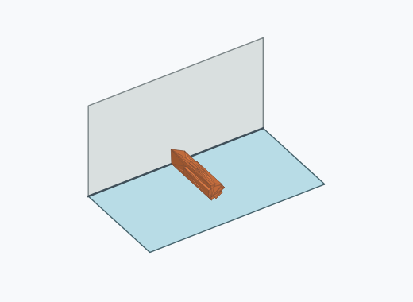 | 38 | 0.38 % | 0.28–0.52 % | 0.38 % |
| Dl1a_0002 | Group 4 | 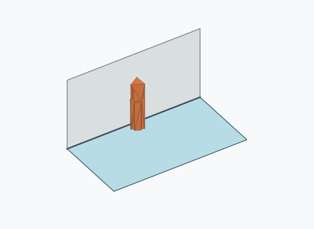 | 22 | 0.22 % | 0.15–0.33 % | 0.22 % |
| Dl1a_0012 | Group 5 | 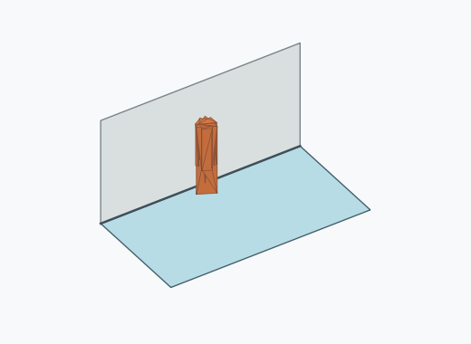 | 16 | 0.16 % | 0.10–0.26 % | 0.16 % |
| Dl1a_0016 | Group 0 | 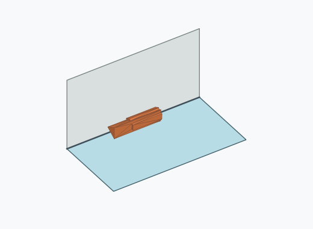 | 16 | 0.16 % | 0.10–0.26 % | 0.16 % |
| Dl1a_0011 | Group 5 | 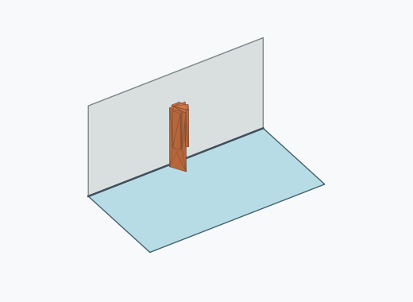 | 15 | 0.15 % | 0.09–0.25 % | 0.15 % |
| Dl1a_0015 | Group 1 | 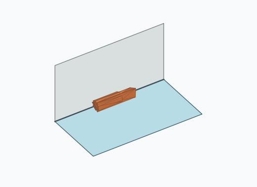 | 14 | 0.14 % | 0.08–0.23 % | 0.14 % |

[Pose catalogue JSON](poses.json) · [Pose catalogue YAML](poses.yaml) · [Frequencies](frequencies.csv) · [Trial records](trials.csv)

Pose orientations use `xyzw` quaternions from the workpiece frame to the chute frame. Recognition uses the recorded symmetry, a 5° tolerance, and a 1° ambiguity margin. The pose registry reserves previously observed IDs for later recognition.

### Historical run files

- [Configuration](config.json)
- [Manifest](manifest.json)
- [Earlier 1,000-drop comparisons](simulations/README.md)
