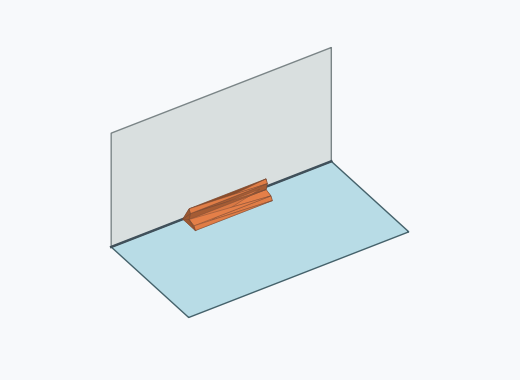
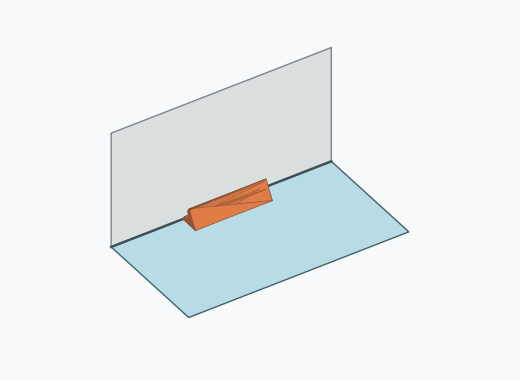
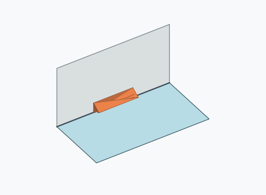
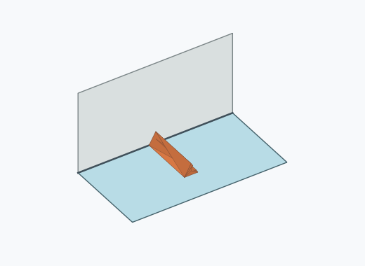
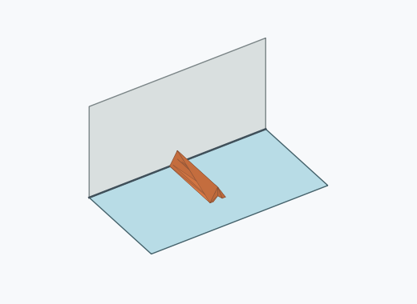

# Dl2i: grouped observed poses

10,000 completed drops; 9,965 settled. 19 assessed source poses; 6 groups meet the 1% cutoff.

Grouping uses 0.5 mm equivalent lift and a 60° maximum diameter. All members receive the same disturbance protocol.

| Representative | Image | Members | Combined count | Frequency | Retention AUC |
| --- | --- | --- | ---: | ---: | ---: |
| Dl2i_0003 |  | Dl2i_0003, Dl2i_0006 | 3629 | 36.29% | 1.0000 |
| Dl2i_0008 |  | Dl2i_0008, Dl2i_0009 | 2862 | 28.62% | 1.0000 |
| Dl2i_0013 |  | Dl2i_0012, Dl2i_0013 | 2811 | 28.11% | 1.0000 |
| Dl2i_0007 |  | Dl2i_0007, Dl2i_0014, Dl2i_0015, Dl2i_0016 | 180 | 1.80% | 0.9479 |
| Dl2i_0005 |  | Dl2i_0005, Dl2i_0017, Dl2i_0018 | 148 | 1.48% | 1.0000 |
| Dl2i_0010 |  | Dl2i_0010 | 143 | 1.43% | 0.9687 |

[All original observations and member images](original_observations.json), [memberships](membership.csv), [barrier evidence](grouping_geometry.json), [member stability curves](group_stability.csv), [individual disturbance curves](stability.csv), [validation](validation.json).

Frequencies retain the original completed-drop denominator. Stability scores describe the configured virtual chute.
