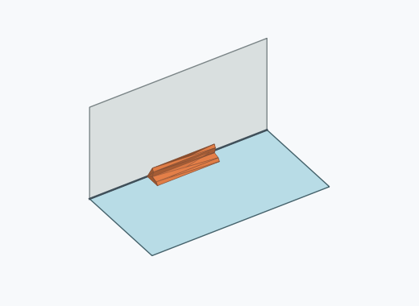
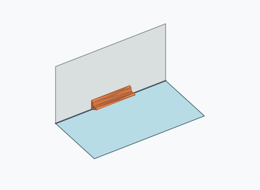
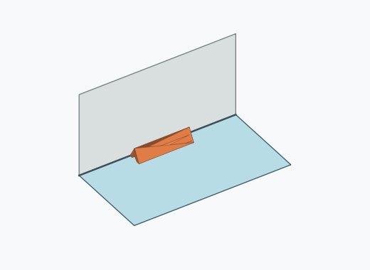
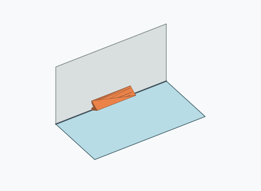
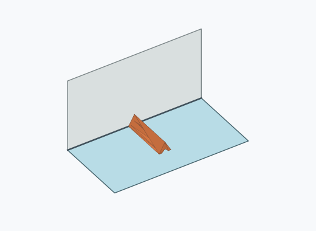
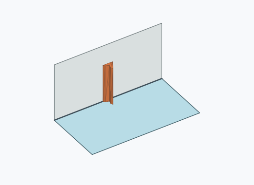
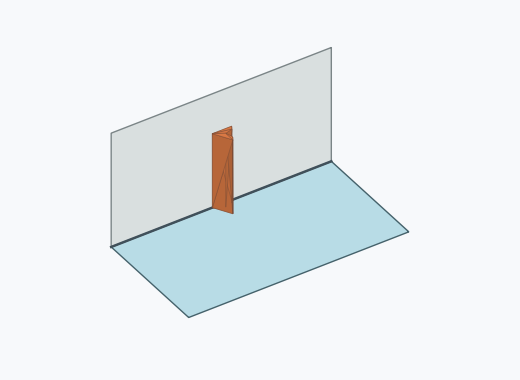
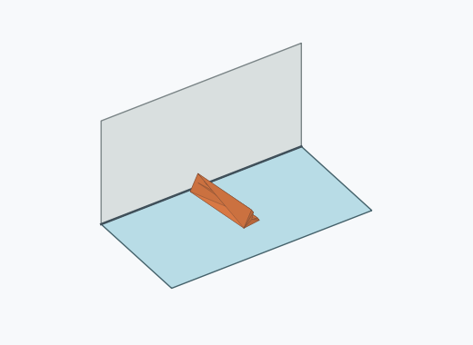
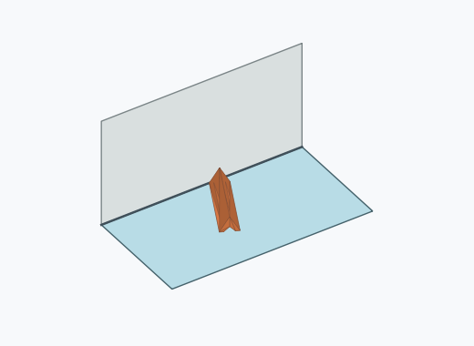

# Dl2i

[Workpiece index](../README.md#workpieces)

## Historical pose catalogue

Group numbers rank the saved pose basins by their combined incidence within each observation phase. The percentages in the table describe each individual pose. Groups below 1% remain visible.

[Group membership CSV](group_memberships.csv) · [Grouping method](../README.md#catalogue-grouping)

### Transport poses

9,965 settled outcomes across 10,000 historical drops on a 500 mm chute. Incidence uses all completed drops as the denominator.

Outcome counts: settled: 9,965, unsettled: 35.

| Pose | Group | Image | Count | Incidence | 95% interval | Share of settled outcomes |
| --- | --- | --- | ---: | ---: | ---: | ---: |
| Dl2i_0003 | Group 0 |  | 1926 | 19.26 % | 18.50–20.04 % | 19.33 % |
| Dl2i_0008 | Group 1 |  | 1837 | 18.37 % | 17.62–19.14 % | 18.43 % |
| Dl2i_0006 | Group 0 |  | 1703 | 17.03 % | 16.31–17.78 % | 17.09 % |
| Dl2i_0013 | Group 2 |  | 1623 | 16.23 % | 15.52–16.97 % | 16.29 % |
| Dl2i_0012 | Group 2 |  | 1188 | 11.88 % | 11.26–12.53 % | 11.92 % |
| Dl2i_0009 | Group 1 |  | 1025 | 10.25 % | 9.67–10.86 % | 10.29 % |
| Dl2i_0007 | Group 3 |  | 173 | 1.73 % | 1.49–2.00 % | 1.74 % |
| Dl2i_0005 | Group 4 |  | 145 | 1.45 % | 1.23–1.70 % | 1.46 % |
| Dl2i_0010 | Group 5 |  | 143 | 1.43 % | 1.22–1.68 % | 1.44 % |
| Dl2i_0001 | Group 6 |  | 95 | 0.95 % | 0.78–1.16 % | 0.95 % |
| Dl2i_0002 | Group 7 |  | 46 | 0.46 % | 0.35–0.61 % | 0.46 % |
| Dl2i_0011 | Group 8 |  | 46 | 0.46 % | 0.35–0.61 % | 0.46 % |
| Dl2i_0015 | Group 3 |  | 3 | 0.03 % | 0.01–0.09 % | 0.03 % |
| Dl2i_0016 | Group 3 |  | 3 | 0.03 % | 0.01–0.09 % | 0.03 % |
| Dl2i_0019 | Group 9 |  | 3 | 0.03 % | 0.01–0.09 % | 0.03 % |
| Dl2i_0018 | Group 4 |  | 2 | 0.02 % | 0.01–0.07 % | 0.02 % |
| Dl2i_0020 | Group 10 |  | 2 | 0.02 % | 0.01–0.07 % | 0.02 % |
| Dl2i_0014 | Group 3 |  | 1 | 0.01 % | 0.00–0.06 % | 0.01 % |
| Dl2i_0017 | Group 4 |  | 1 | 0.01 % | 0.00–0.06 % | 0.01 % |

[Pose catalogue JSON](poses.json) · [Pose catalogue YAML](poses.yaml) · [Frequencies](frequencies.csv) · [Trial records](trials.csv)

Pose orientations use `xyzw` quaternions from the workpiece frame to the chute frame. Recognition uses the recorded symmetry, a 5° tolerance, and a 1° ambiguity margin. The pose registry reserves previously observed IDs for later recognition.

### Historical run files

- [Configuration](config.json)
- [Manifest](manifest.json)
