# Dl4a

[Workpiece index](../README.md#workpieces)

## Historical pose catalogue

Group numbers rank the saved pose basins by their combined incidence within each observation phase. Pose 0 is the most frequent individual pose in its observation phase. The membership CSV links the displayed numbers to the saved pose IDs. Groups below 1% remain visible.

[Group membership CSV](group_memberships.csv) · [Grouping method](../README.md#catalogue-grouping)

### Transport poses

9,973 settled outcomes across 10,000 historical drops on a 500 mm chute. Incidence uses all completed drops as the denominator.

Outcome counts: settled: 9,973, unsettled: 27.

| Pose | Group | Image | Count | Incidence | 95% interval | Share of settled outcomes |
| --- | --- | --- | ---: | ---: | ---: | ---: |
| Pose 0 | Group 0 |  | 1611 | 16.11 % | 15.40–16.84 % | 16.15 % |
| Pose 1 | Group 1 |  | 1541 | 15.41 % | 14.72–16.13 % | 15.45 % |
| Pose 2 | Group 4 |  | 1503 | 15.03 % | 14.34–15.74 % | 15.07 % |
| Pose 3 | Group 5 | 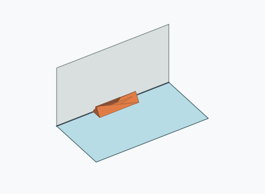 | 1470 | 14.70 % | 14.02–15.41 % | 14.74 % |
| Pose 4 | Group 2 | 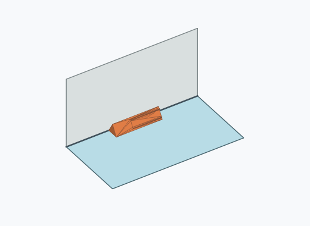 | 816 | 8.16 % | 7.64–8.71 % | 8.18 % |
| Pose 5 | Group 3 | 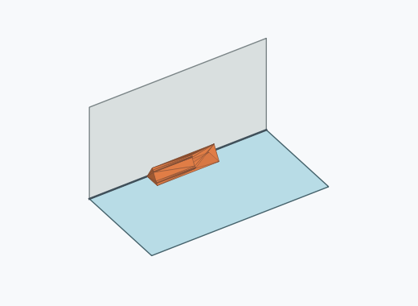 | 797 | 7.97 % | 7.46–8.52 % | 7.99 % |
| Pose 6 | Group 3 | 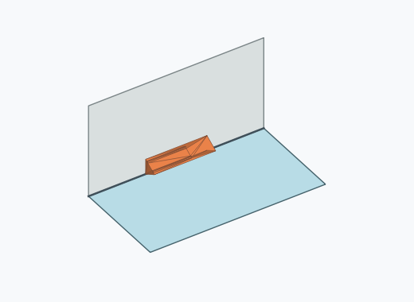 | 730 | 7.30 % | 6.81–7.83 % | 7.32 % |
| Pose 7 | Group 2 |  | 717 | 7.17 % | 6.68–7.69 % | 7.19 % |
| Pose 8 | Group 6 |  | 95 | 0.95 % | 0.78–1.16 % | 0.95 % |
| Pose 9 | Group 7 |  | 84 | 0.84 % | 0.68–1.04 % | 0.84 % |
| Pose 10 | Group 9 | 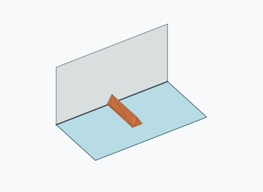 | 79 | 0.79 % | 0.63–0.98 % | 0.79 % |
| Pose 11 | Group 8 |  | 79 | 0.79 % | 0.63–0.98 % | 0.79 % |
| Pose 12 | Group 10 |  | 69 | 0.69 % | 0.55–0.87 % | 0.69 % |
| Pose 13 | Group 11 |  | 69 | 0.69 % | 0.55–0.87 % | 0.69 % |
| Pose 14 | Group 0 |  | 63 | 0.63 % | 0.49–0.81 % | 0.63 % |
| Pose 15 | Group 1 |  | 43 | 0.43 % | 0.32–0.58 % | 0.43 % |
| Pose 16 | Group 12 | 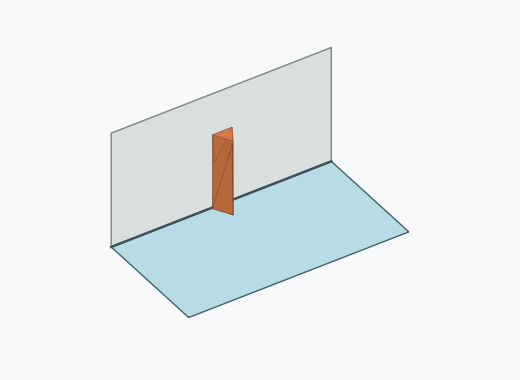 | 31 | 0.31 % | 0.22–0.44 % | 0.31 % |
| Pose 17 | Group 13 |  | 31 | 0.31 % | 0.22–0.44 % | 0.31 % |
| Pose 18 | Group 5 | 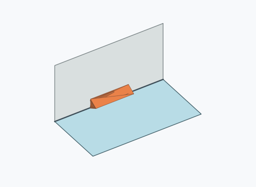 | 29 | 0.29 % | 0.20–0.42 % | 0.29 % |
| Pose 19 | Group 14 |  | 27 | 0.27 % | 0.19–0.39 % | 0.27 % |
| Pose 20 | Group 15 |  | 26 | 0.26 % | 0.18–0.38 % | 0.26 % |
| Pose 21 | Group 16 |  | 20 | 0.20 % | 0.13–0.31 % | 0.20 % |
| Pose 22 | Group 4 | 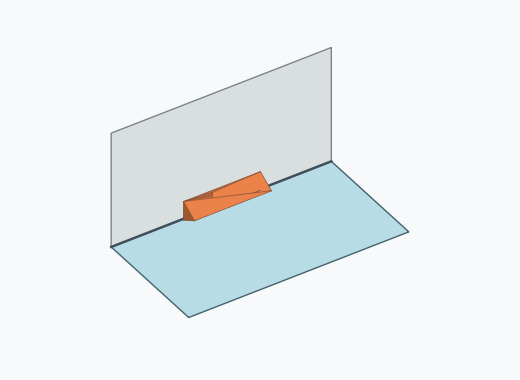 | 16 | 0.16 % | 0.10–0.26 % | 0.16 % |
| Pose 23 | Group 17 | 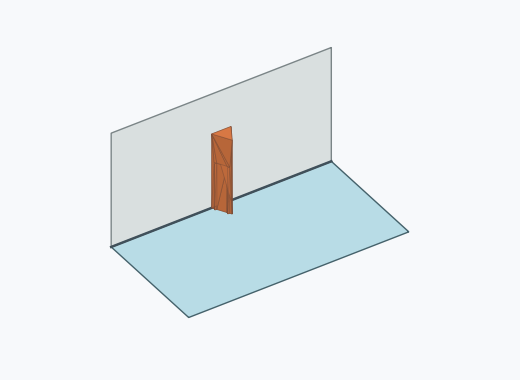 | 16 | 0.16 % | 0.10–0.26 % | 0.16 % |
| Pose 24 | Group 18 | 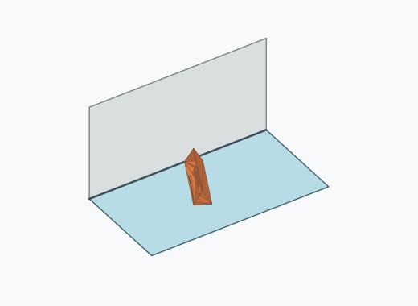 | 4 | 0.04 % | 0.02–0.10 % | 0.04 % |
| Pose 25 | Group 8 |  | 4 | 0.04 % | 0.02–0.10 % | 0.04 % |
| Pose 26 | Group 6 |  | 1 | 0.01 % | 0.00–0.06 % | 0.01 % |
| Pose 27 | Group 19 |  | 1 | 0.01 % | 0.00–0.06 % | 0.01 % |
| Pose 28 | Group 8 | 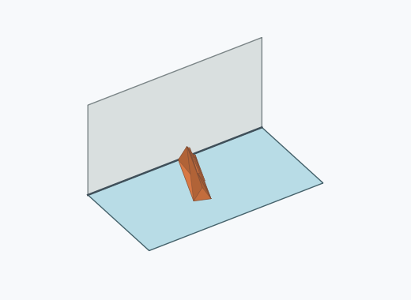 | 1 | 0.01 % | 0.00–0.06 % | 0.01 % |

[Pose catalogue JSON](poses.json) · [Pose catalogue YAML](poses.yaml) · [Frequencies](frequencies.csv) · [Trial records](trials.csv)

Pose orientations use `xyzw` quaternions from the workpiece frame to the chute frame. Recognition uses the recorded symmetry, a 5° tolerance, and a 1° ambiguity margin. The pose registry reserves previously observed IDs for later recognition.

### Historical run files

- [Configuration](config.json)
- [Manifest](manifest.json)
