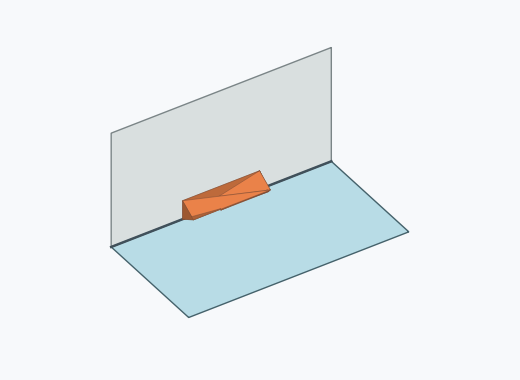
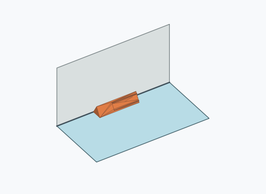
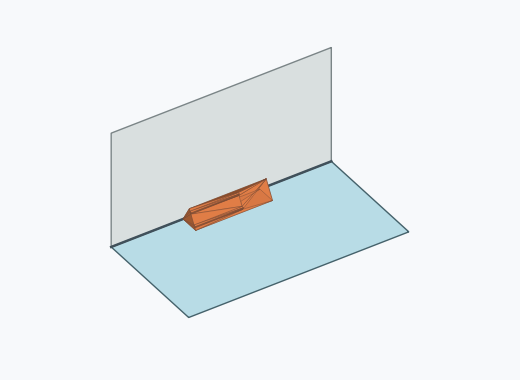
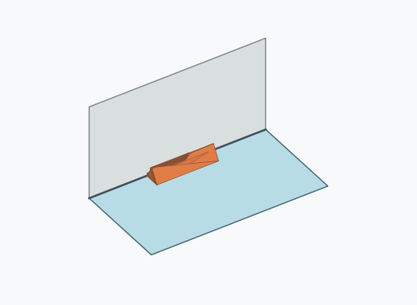

# Dl4a: grouped observed poses

10,000 completed drops; 9,973 settled. 29 assessed source poses; 6 groups meet the 1% cutoff.

Grouping uses 0.5 mm equivalent lift and a 60° maximum diameter. All members receive the same disturbance protocol.

| Representative | Image | Members | Combined count | Frequency | Retention AUC |
| --- | --- | --- | ---: | ---: | ---: |
| Dl4a_0004 |  | Dl4a_0003, Dl4a_0004 | 1674 | 16.74% | 1.0000 |
| Dl4a_0011 |  | Dl4a_0008, Dl4a_0011 | 1584 | 15.84% | 1.0000 |
| Dl4a_0022 |  | Dl4a_0022, Dl4a_0024 | 1533 | 15.33% | 1.0000 |
| Dl4a_0009 |  | Dl4a_0009, Dl4a_0010 | 1527 | 15.27% | 1.0000 |
| Dl4a_0002 |  | Dl4a_0002, Dl4a_0005 | 1519 | 15.19% | 1.0000 |
| Dl4a_0021 |  | Dl4a_0021, Dl4a_0023 | 1499 | 14.99% | 1.0000 |

[All original observations and member images](original_observations.json), [memberships](membership.csv), [barrier evidence](grouping_geometry.json), [member stability curves](group_stability.csv), [individual disturbance curves](stability.csv), [validation](validation.json).

Frequencies retain the original completed-drop denominator. Stability scores describe the configured virtual chute.
