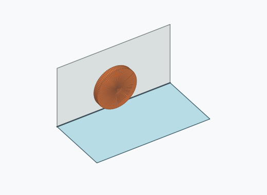
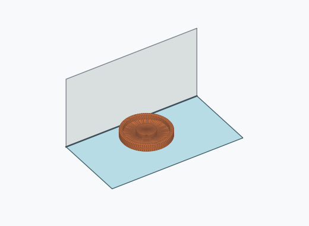
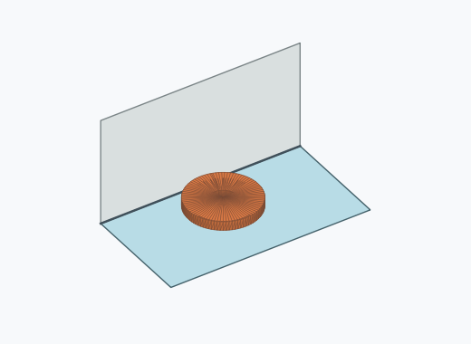

# Kf1i

[Workpiece index](../README.md#workpieces)

## 10,000-drop paper study

The stationary series recorded **10,000** settled outcomes. The moving series recorded **9** settled outcomes at the virtual exit. Each series contains 10,000 drops.

[Study overview](simulations/20261107_10000/README.md) · [Stationary results](simulations/20261107_10000/static/README.md) · [Moving results](simulations/20261107_10000/100mm_s/README.md)

## Historical pose catalogue

Group numbers rank the saved pose basins by their combined incidence within each observation phase. The percentages in the table describe each individual pose. Groups below 1% remain visible.

[Group membership CSV](group_memberships.csv) · [Grouping method](../README.md#catalogue-grouping)

### Transport poses

0 settled outcomes across 10,000 historical drops on a 500 mm chute. Incidence uses all completed drops as the denominator.

Outcome counts: stalled: 456, timeout: 15, unsettled: 9,529.

This historical transport run recorded zero settled poses.

[Pose catalogue JSON](poses.json) · [Pose catalogue YAML](poses.yaml) · [Frequencies](frequencies.csv) · [Trial records](trials.csv)

### Post-braking poses

9,445 settled outcomes across 10,000 historical drops on a 500 mm chute. Incidence uses all completed drops as the denominator.

Outcome counts: not_observed: 471, settled: 9,445, unsettled: 84.

The rest check followed the transport outcome and covered 9,529 trials.

| Pose | Group | Image | Count | Incidence | 95% interval | Share of settled outcomes |
| --- | --- | --- | ---: | ---: | ---: | ---: |
| Kf1i_stop_0001 | Group 0 |  | 2925 | 29.25 % | 28.37–30.15 % | 30.97 % |
| Kf1i_stop_0004 | Group 1 |  | 2694 | 26.94 % | 26.08–27.82 % | 28.52 % |
| Kf1i_stop_0002 | Group 2 |  | 1920 | 19.20 % | 18.44–19.98 % | 20.33 % |
| Kf1i_stop_0003 | Group 3 |  | 1906 | 19.06 % | 18.30–19.84 % | 20.18 % |

[Pose catalogue JSON](poses_after_stop.json) · [Pose catalogue YAML](poses_after_stop.yaml) · [Frequencies](frequencies_after_stop.csv) · [Trial records](trials_after_stop.csv)

Pose orientations use `xyzw` quaternions from the workpiece frame to the chute frame. Recognition uses the recorded symmetry, a 5° tolerance, and a 1° ambiguity margin. The pose registry reserves previously observed IDs for later recognition.

### Historical run files

- [Configuration](config.json)
- [Manifest](manifest.json)
- [Summary](summary.json)
- [Post-braking observations](stop_observations.csv)
- [Complete historical run archive](simulation_results.zip)
- [Execution record](execution.json)
- [Data validation](validation.json)
- [Earlier 1,000-drop comparisons](simulations/README.md)

The historical run used 16 worker processes.
[Historical simulator revision](https://github.com/match-BiBaZu/BiBaZu_PoseFindingDropSim/commit/82f8bd43c70a0eb160d27dc0f7232849842efe9c). The first 100 trials, including the post-braking observation, matched the earlier control run.
