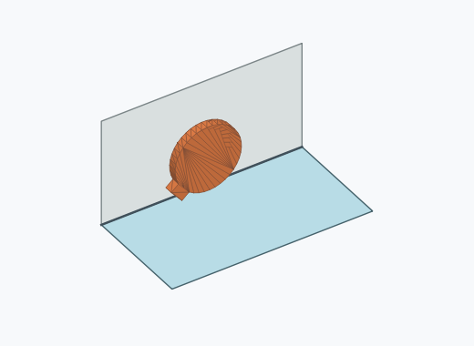
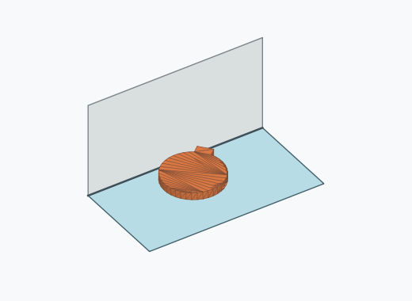
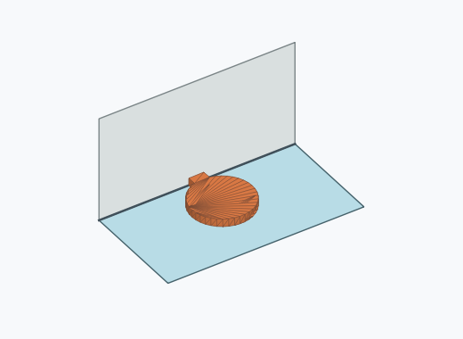

# Kf2a: grouped observed poses

10,000 completed drops; 7,584 settled. 6 assessed source poses; 3 groups meet the 1% cutoff.

Grouping uses 0.5 mm equivalent lift and a 60° maximum diameter. All members receive the same disturbance protocol.

| Representative | Image | Members | Combined count | Frequency | Retention AUC |
| --- | --- | --- | ---: | ---: | ---: |
| Kf2a_0003 |  | Kf2a_0003, Kf2a_0006 | 5378 | 53.78% | 1.0000 |
| Kf2a_0001 |  | Kf2a_0001 | 2097 | 20.97% | 1.0000 |
| Kf2a_0002 |  | Kf2a_0002 | 105 | 1.05% | 0.2552 |

[All original observations and member images](original_observations.json), [memberships](membership.csv), [barrier evidence](grouping_geometry.json), [member stability curves](group_stability.csv), [individual disturbance curves](stability.csv), [validation](validation.json).

Frequencies retain the original completed-drop denominator. Stability scores describe the configured virtual chute.
