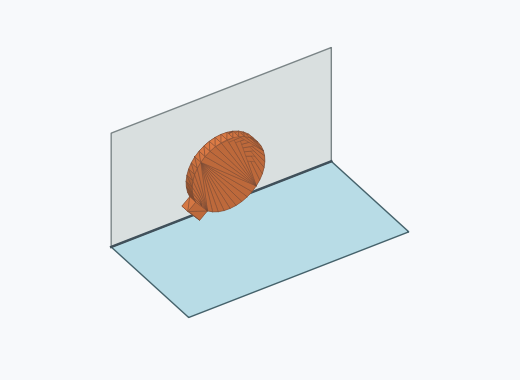
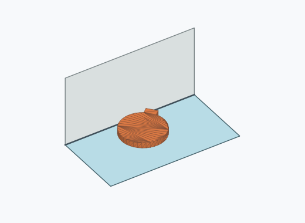
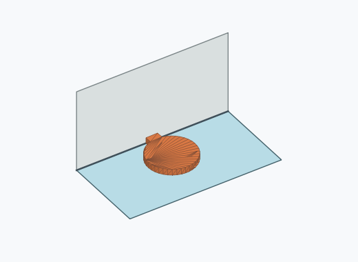

# Kf2a

[Workpiece index](../README.md#workpieces)

## Historical pose catalogue

Group numbers rank the saved pose basins by their combined incidence within each observation phase. Pose 0 is the most frequent individual pose in its observation phase. The membership CSV links the displayed numbers to the saved pose IDs. Groups below 1% remain visible.

[Group membership CSV](group_memberships.csv) · [Grouping method](../README.md#catalogue-grouping)

### Transport poses

762 settled outcomes across 1,000 historical drops on a 500 mm chute. Incidence uses all completed drops as the denominator.

Outcome counts: settled: 762, unsettled: 238.

| Pose | Group | Image | Count | Incidence | 95% interval | Share of settled outcomes |
| --- | --- | --- | ---: | ---: | ---: | ---: |
| Pose 0 | Group 0 |  | 541 | 54.10 % | 51.00–57.17 % | 71.00 % |
| Pose 1 | Group 1 |  | 216 | 21.60 % | 19.16–24.26 % | 28.35 % |
| Pose 2 | Group 2 |  | 5 | 0.50 % | 0.21–1.17 % | 0.66 % |

[Pose catalogue JSON](poses.json) · [Pose catalogue YAML](poses.yaml) · [Frequencies](frequencies.csv) · [Trial records](trials.csv)

Pose orientations use `xyzw` quaternions from the workpiece frame to the chute frame. Recognition uses the recorded symmetry, a 5° tolerance, and a 1° ambiguity margin. The pose registry reserves previously observed IDs for later recognition.

### Historical run files

- [Configuration](config.json)
- [Manifest](manifest.json)

<!-- remaining-workpieces-20261110_10000:start -->
## Additional 10,000-drop runs

10,000 stationary and 10,000 moving-belt drops with the archived reference settings.

[Results and validation](simulations/20261110_10000/README.md).
<!-- remaining-workpieces-20261110_10000:end -->
