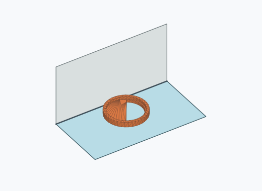
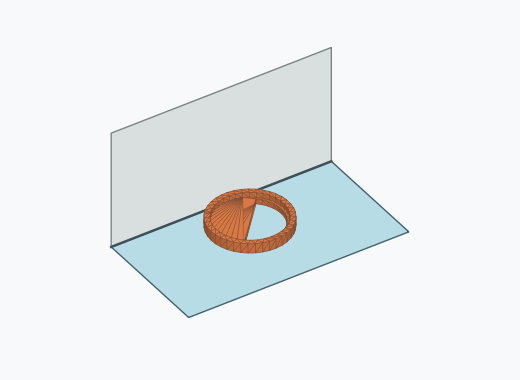
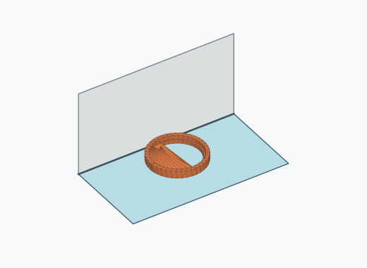
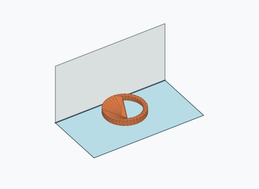
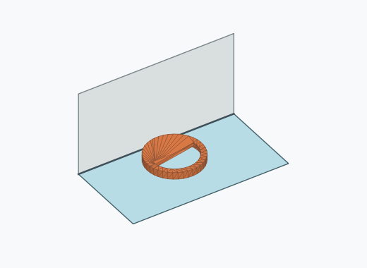
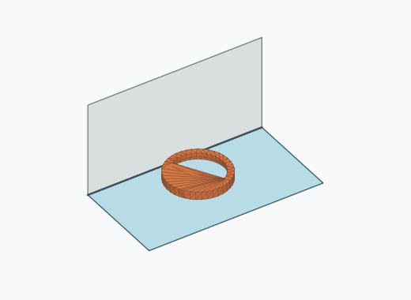
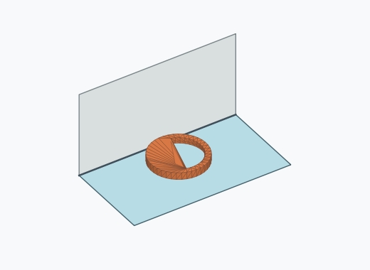
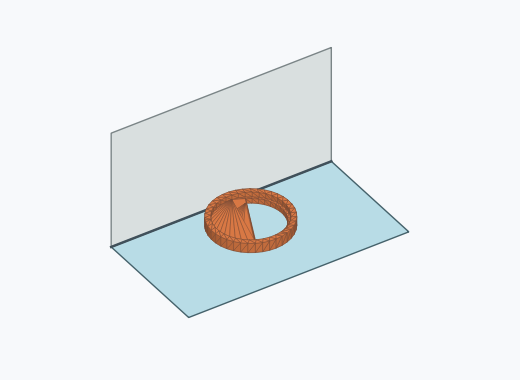
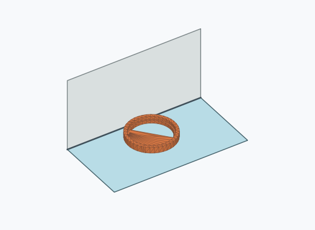
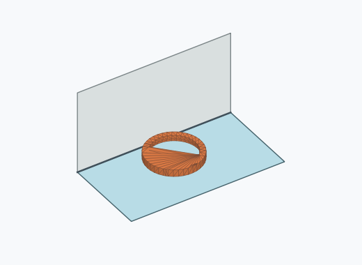

# Kf4i

[Workpiece index](../README.md#workpieces)

## Historical pose catalogue

Group numbers rank the saved pose basins by their combined incidence within each observation phase. Pose 0 is the most frequent individual pose in its observation phase. The membership CSV links the displayed numbers to the saved pose IDs. Groups below 1% remain visible.

[Group membership CSV](group_memberships.csv) · [Grouping method](../README.md#catalogue-grouping)

### Transport poses

132 settled outcomes across 1,000 historical drops on a 500 mm chute. Incidence uses all completed drops as the denominator.

Outcome counts: settled: 132, unsettled: 868.

| Pose | Group | Image | Count | Incidence | 95% interval | Share of settled outcomes |
| --- | --- | --- | ---: | ---: | ---: | ---: |
| Pose 0 | Group 1 |  | 12 | 1.20 % | 0.69–2.09 % | 9.09 % |
| Pose 1 | Group 1 |  | 11 | 1.10 % | 0.62–1.96 % | 8.33 % |
| Pose 2 | Group 0 |  | 10 | 1.00 % | 0.54–1.83 % | 7.58 % |
| Pose 3 | Group 0 |  | 10 | 1.00 % | 0.54–1.83 % | 7.58 % |
| Pose 4 | Group 0 |  | 8 | 0.80 % | 0.41–1.57 % | 6.06 % |
| Pose 5 | Group 0 |  | 7 | 0.70 % | 0.34–1.44 % | 5.30 % |
| Pose 6 | Group 1 |  | 7 | 0.70 % | 0.34–1.44 % | 5.30 % |
| Pose 7 | Group 3 |  | 6 | 0.60 % | 0.28–1.30 % | 4.55 % |
| Pose 8 | Group 0 |  | 5 | 0.50 % | 0.21–1.17 % | 3.79 % |
| Pose 9 | Group 0 |  | 5 | 0.50 % | 0.21–1.17 % | 3.79 % |
| Pose 10 | Group 4 |  | 5 | 0.50 % | 0.21–1.17 % | 3.79 % |
| Pose 11 | Group 1 |  | 5 | 0.50 % | 0.21–1.17 % | 3.79 % |
| Pose 12 | Group 1 |  | 5 | 0.50 % | 0.21–1.17 % | 3.79 % |
| Pose 13 | Group 0 |  | 4 | 0.40 % | 0.16–1.02 % | 3.03 % |
| Pose 14 | Group 5 |  | 4 | 0.40 % | 0.16–1.02 % | 3.03 % |
| Pose 15 | Group 2 |  | 4 | 0.40 % | 0.16–1.02 % | 3.03 % |
| Pose 16 | Group 2 |  | 4 | 0.40 % | 0.16–1.02 % | 3.03 % |
| Pose 17 | Group 3 |  | 3 | 0.30 % | 0.10–0.88 % | 2.27 % |
| Pose 18 | Group 1 |  | 3 | 0.30 % | 0.10–0.88 % | 2.27 % |
| Pose 19 | Group 1 |  | 3 | 0.30 % | 0.10–0.88 % | 2.27 % |
| Pose 20 | Group 2 |  | 3 | 0.30 % | 0.10–0.88 % | 2.27 % |
| Pose 21 | Group 6 |  | 2 | 0.20 % | 0.05–0.73 % | 1.52 % |
| Pose 22 | Group 3 |  | 2 | 0.20 % | 0.05–0.73 % | 1.52 % |
| Pose 23 | Group 7 |  | 2 | 0.20 % | 0.05–0.73 % | 1.52 % |
| Pose 24 | Group 8 |  | 1 | 0.10 % | 0.02–0.56 % | 0.76 % |
| Pose 25 | Group 9 |  | 1 | 0.10 % | 0.02–0.56 % | 0.76 % |

[Pose catalogue JSON](poses.json) · [Pose catalogue YAML](poses.yaml) · [Frequencies](frequencies.csv) · [Trial records](trials.csv)

Pose orientations use `xyzw` quaternions from the workpiece frame to the chute frame. Recognition uses the recorded symmetry, a 5° tolerance, and a 1° ambiguity margin. The pose registry reserves previously observed IDs for later recognition.

### Historical run files

- [Configuration](config.json)
- [Manifest](manifest.json)
