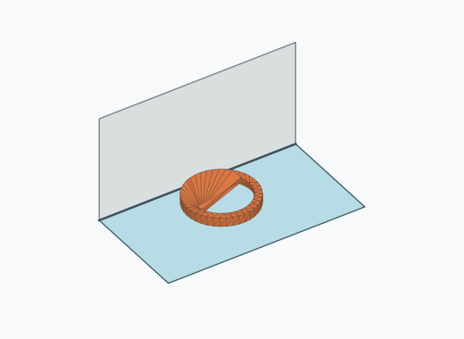
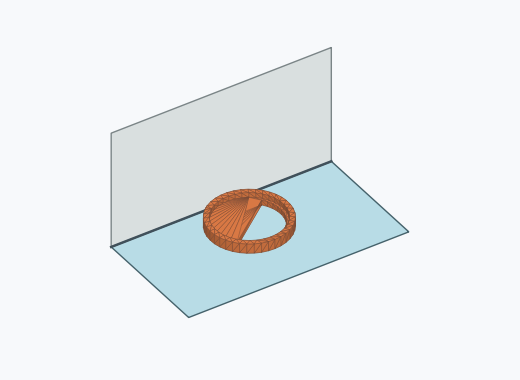
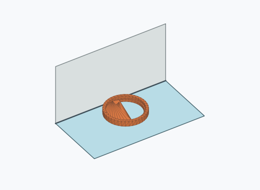

# Kf4i: grouped observed poses

10,000 completed drops; 1,333 settled. 35 assessed source poses; 3 groups meet the 1% cutoff.

Grouping uses 0.5 mm equivalent lift and a 60° maximum diameter. All members receive the same disturbance protocol.

| Representative | Image | Members | Combined count | Frequency | Retention AUC |
| --- | --- | --- | ---: | ---: | ---: |
| Kf4i_0002 |  | Kf4i_0001, Kf4i_0002, Kf4i_0003, Kf4i_0004, Kf4i_0005, Kf4i_0006, Kf4i_0008 | 498 | 4.98% | 0.9688 |
| Kf4i_0015 |  | Kf4i_0015, Kf4i_0018, Kf4i_0021, Kf4i_0022, Kf4i_0024, Kf4i_0030, Kf4i_0031 | 362 | 3.62% | 0.9375 |
| Kf4i_0023 |  | Kf4i_0019, Kf4i_0023 | 107 | 1.07% | 0.9479 |

[All original observations and member images](original_observations.json), [memberships](membership.csv), [barrier evidence](grouping_geometry.json), [member stability curves](group_stability.csv), [individual disturbance curves](stability.csv), [validation](validation.json).

Frequencies retain the original completed-drop denominator. Stability scores describe the configured virtual chute.
