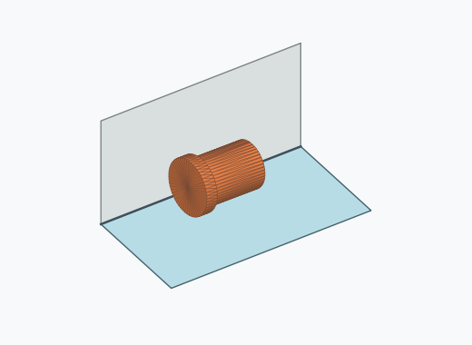
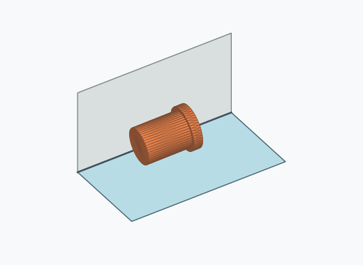

# Kk1a: grouped observed poses

10,000 completed drops; 2,887 settled. 3 assessed source poses; 2 groups meet the 1% cutoff.

Grouping uses 0.5 mm equivalent lift and a 60° maximum diameter. All members receive the same disturbance protocol.

| Representative | Image | Members | Combined count | Frequency | Retention AUC |
| --- | --- | --- | ---: | ---: | ---: |
| Kk1a_0001 |  | Kk1a_0001 | 1585 | 15.85% | 0.5469 |
| Kk1a_0002 |  | Kk1a_0002 | 1294 | 12.94% | 0.4427 |

[All original observations and member images](original_observations.json), [memberships](membership.csv), [barrier evidence](grouping_geometry.json), [member stability curves](group_stability.csv), [individual disturbance curves](stability.csv), [validation](validation.json).

Frequencies retain the original completed-drop denominator. Stability scores describe the configured virtual chute.
