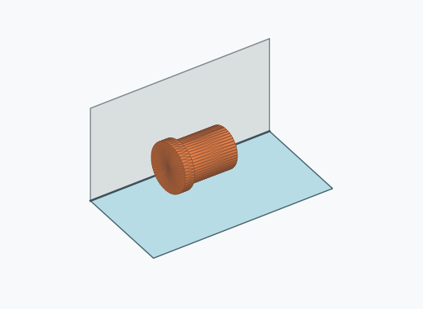
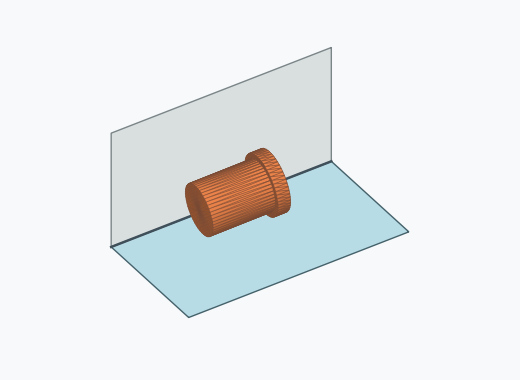
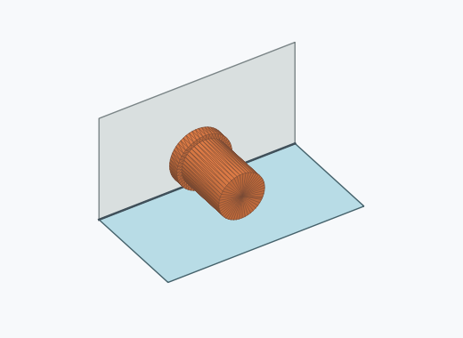

# Kk1a

[Workpiece index](../README.md#workpieces)

## 10,000-drop paper study

The stationary series recorded **9,676** settled outcomes. The moving series recorded **8,201** settled outcomes at the virtual exit. Each series contains 10,000 drops.

[Study overview](simulations/20261107_10000/README.md) · [Stationary results](simulations/20261107_10000/static/README.md) · [Moving results](simulations/20261107_10000/100mm_s/README.md)

## Historical pose catalogue

Group numbers rank the saved pose basins by their combined incidence within each observation phase. The percentages in the table describe each individual pose. Groups below 1% remain visible.

[Group membership CSV](group_memberships.csv) · [Grouping method](../README.md#catalogue-grouping)

### Transport poses

2,887 settled outcomes across 10,000 historical drops on a 500 mm chute. Incidence uses all completed drops as the denominator.

Outcome counts: settled: 2,887, unsettled: 7,113.

| Pose | Group | Image | Count | Incidence | 95% interval | Share of settled outcomes |
| --- | --- | --- | ---: | ---: | ---: | ---: |
| Kk1a_0001 | Group 0 |  | 1585 | 15.85 % | 15.15–16.58 % | 54.90 % |
| Kk1a_0002 | Group 1 |  | 1294 | 12.94 % | 12.30–13.61 % | 44.82 % |
| Kk1a_0003 | Group 2 |  | 8 | 0.08 % | 0.04–0.16 % | 0.28 % |

[Pose catalogue JSON](poses.json) · [Pose catalogue YAML](poses.yaml) · [Frequencies](frequencies.csv) · [Trial records](trials.csv)

Pose orientations use `xyzw` quaternions from the workpiece frame to the chute frame. Recognition uses the recorded symmetry, a 5° tolerance, and a 1° ambiguity margin. The pose registry reserves previously observed IDs for later recognition.

### Historical run files

- [Configuration](config.json)
- [Manifest](manifest.json)
- [Earlier 1,000-drop comparisons](simulations/README.md)
