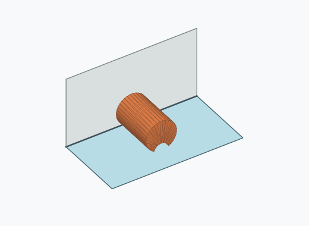
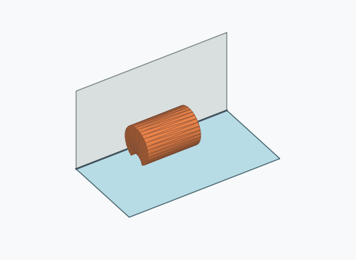
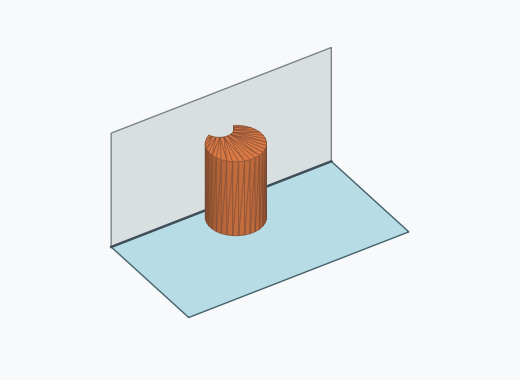
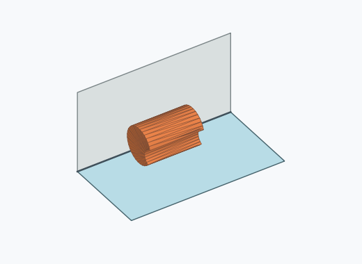
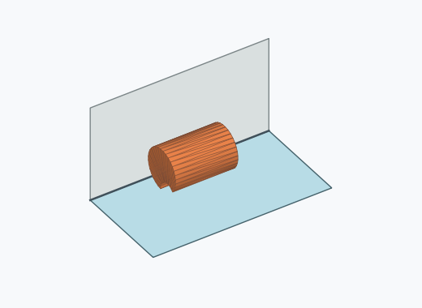
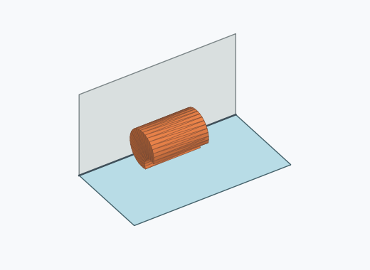
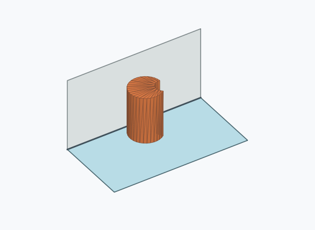

# Kk2i

[Workpiece index](../README.md#workpieces)

## Historical pose catalogue

Group numbers rank the saved pose basins by their combined incidence within each observation phase. Pose 0 is the most frequent individual pose in its observation phase. The membership CSV links the displayed numbers to the saved pose IDs. Groups below 1% remain visible.

[Group membership CSV](group_memberships.csv) · [Grouping method](../README.md#catalogue-grouping)

### Transport poses

8,448 settled outcomes across 10,000 historical drops on a 500 mm chute. Incidence uses all completed drops as the denominator.

Outcome counts: settled: 8,448, unsettled: 1,552.

| Pose | Group | Image | Count | Incidence | 95% interval | Share of settled outcomes |
| --- | --- | --- | ---: | ---: | ---: | ---: |
| Pose 0 | Group 0 |  | 2023 | 20.23 % | 19.45–21.03 % | 23.95 % |
| Pose 1 | Group 1 |  | 833 | 8.33 % | 7.80–8.89 % | 9.86 % |
| Pose 2 | Group 2 |  | 773 | 7.73 % | 7.22–8.27 % | 9.15 % |
| Pose 3 | Group 3 |  | 661 | 6.61 % | 6.14–7.11 % | 7.82 % |
| Pose 4 | Group 4 |  | 321 | 3.21 % | 2.88–3.57 % | 3.80 % |
| Pose 5 | Group 5 |  | 315 | 3.15 % | 2.83–3.51 % | 3.73 % |
| Pose 6 | Group 7 |  | 253 | 2.53 % | 2.24–2.86 % | 2.99 % |
| Pose 7 | Group 8 |  | 253 | 2.53 % | 2.24–2.86 % | 2.99 % |
| Pose 8 | Group 9 |  | 246 | 2.46 % | 2.17–2.78 % | 2.91 % |
| Pose 9 | Group 10 |  | 242 | 2.42 % | 2.14–2.74 % | 2.86 % |
| Pose 10 | Group 11 |  | 242 | 2.42 % | 2.14–2.74 % | 2.86 % |
| Pose 11 | Group 12 |  | 236 | 2.36 % | 2.08–2.68 % | 2.79 % |
| Pose 12 | Group 13 |  | 236 | 2.36 % | 2.08–2.68 % | 2.79 % |
| Pose 13 | Group 14 |  | 233 | 2.33 % | 2.05–2.64 % | 2.76 % |
| Pose 14 | Group 15 |  | 223 | 2.23 % | 1.96–2.54 % | 2.64 % |
| Pose 15 | Group 16 |  | 210 | 2.10 % | 1.84–2.40 % | 2.49 % |
| Pose 16 | Group 17 |  | 209 | 2.09 % | 1.83–2.39 % | 2.47 % |
| Pose 17 | Group 18 |  | 184 | 1.84 % | 1.59–2.12 % | 2.18 % |
| Pose 18 | Group 19 |  | 165 | 1.65 % | 1.42–1.92 % | 1.95 % |
| Pose 19 | Group 6 |  | 123 | 1.23 % | 1.03–1.47 % | 1.46 % |
| Pose 20 | Group 20 |  | 91 | 0.91 % | 0.74–1.12 % | 1.08 % |
| Pose 21 | Group 6 |  | 83 | 0.83 % | 0.67–1.03 % | 0.98 % |
| Pose 22 | Group 6 |  | 79 | 0.79 % | 0.63–0.98 % | 0.94 % |
| Pose 23 | Group 21 |  | 77 | 0.77 % | 0.62–0.96 % | 0.91 % |
| Pose 24 | Group 22 |  | 44 | 0.44 % | 0.33–0.59 % | 0.52 % |
| Pose 25 | Group 23 |  | 34 | 0.34 % | 0.24–0.47 % | 0.40 % |
| Pose 26 | Group 24 |  | 28 | 0.28 % | 0.19–0.40 % | 0.33 % |
| Pose 27 | Group 25 |  | 21 | 0.21 % | 0.14–0.32 % | 0.25 % |
| Pose 28 | Group 26 |  | 5 | 0.05 % | 0.02–0.12 % | 0.06 % |
| Pose 29 | Group 26 |  | 4 | 0.04 % | 0.02–0.10 % | 0.05 % |
| Pose 30 | Group 26 |  | 1 | 0.01 % | 0.00–0.06 % | 0.01 % |

[Pose catalogue JSON](poses.json) · [Pose catalogue YAML](poses.yaml) · [Frequencies](frequencies.csv) · [Trial records](trials.csv)

Pose orientations use `xyzw` quaternions from the workpiece frame to the chute frame. Recognition uses the recorded symmetry, a 5° tolerance, and a 1° ambiguity margin. The pose registry reserves previously observed IDs for later recognition.

### Historical run files

- [Configuration](config.json)
- [Manifest](manifest.json)

<!-- remaining-workpieces-20261110_10000:start -->
## Additional 10,000-drop runs

10,000 stationary and 10,000 moving-belt drops with the archived reference settings.

[Results and validation](simulations/20261110_10000/README.md).
<!-- remaining-workpieces-20261110_10000:end -->
