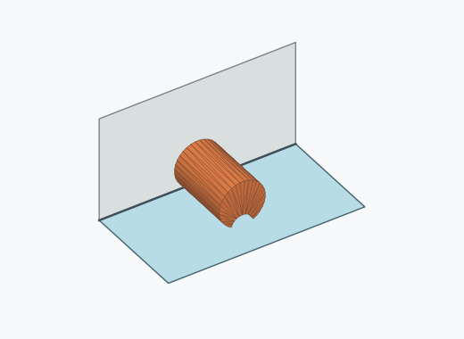
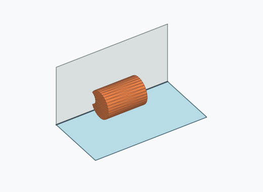
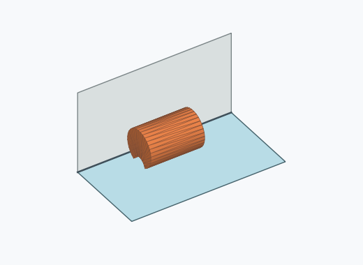
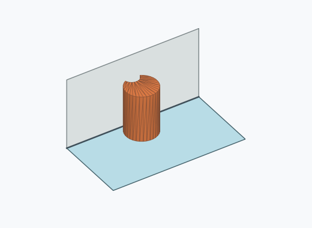
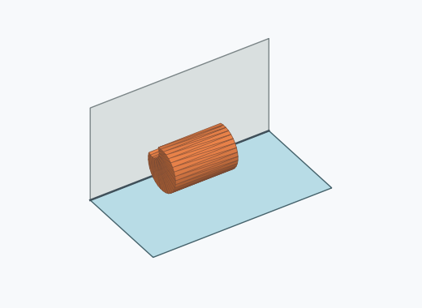

# Kk2i: grouped observed poses

10,000 completed drops; 8,448 settled. 31 assessed source poses; 20 groups meet the 1% cutoff.

Grouping uses 0.5 mm equivalent lift and a 60° maximum diameter. All members receive the same disturbance protocol.

| Representative | Image | Members | Combined count | Frequency | Retention AUC |
| --- | --- | --- | ---: | ---: | ---: |
| Kk2i_0018 |  | Kk2i_0018 | 2023 | 20.23% | 0.9948 |
| Kk2i_0017 |  | Kk2i_0017 | 833 | 8.33% | 1.0000 |
| Kk2i_0003 |  | Kk2i_0003 | 773 | 7.73% | 1.0000 |
| Kk2i_0004 |  | Kk2i_0004 | 661 | 6.61% | 1.0000 |
| Kk2i_0024 |  | Kk2i_0024 | 321 | 3.21% | 0.9115 |
| Kk2i_0026 |  | Kk2i_0026 | 315 | 3.15% | 0.9323 |
| Kk2i_0025 |  | Kk2i_0023, Kk2i_0025, Kk2i_0027 | 285 | 2.85% | 1.0000 |
| Kk2i_0015 |  | Kk2i_0015 | 253 | 2.53% | 0.7448 |
| Kk2i_0021 |  | Kk2i_0021 | 253 | 2.53% | 0.8958 |
| Kk2i_0016 |  | Kk2i_0016 | 246 | 2.46% | 0.7891 |
| Kk2i_0029 |  | Kk2i_0029 | 242 | 2.42% | 0.9323 |
| Kk2i_0030 |  | Kk2i_0030 | 242 | 2.42% | 0.8958 |
| Kk2i_0020 |  | Kk2i_0020 | 236 | 2.36% | 0.8958 |
| Kk2i_0028 |  | Kk2i_0028 | 236 | 2.36% | 0.9479 |
| Kk2i_0022 |  | Kk2i_0022 | 233 | 2.33% | 0.8958 |
| Kk2i_0019 |  | Kk2i_0019 | 223 | 2.23% | 0.8646 |
| Kk2i_0005 |  | Kk2i_0005 | 210 | 2.10% | 0.8490 |
| Kk2i_0006 |  | Kk2i_0006 | 209 | 2.09% | 0.7969 |
| Kk2i_0008 |  | Kk2i_0008 | 184 | 1.84% | 0.8125 |
| Kk2i_0010 |  | Kk2i_0010 | 165 | 1.65% | 0.7891 |

[All original observations and member images](original_observations.json), [memberships](membership.csv), [barrier evidence](grouping_geometry.json), [member stability curves](group_stability.csv), [individual disturbance curves](stability.csv), [validation](validation.json).

Frequencies retain the original completed-drop denominator. Stability scores describe the configured virtual chute.
