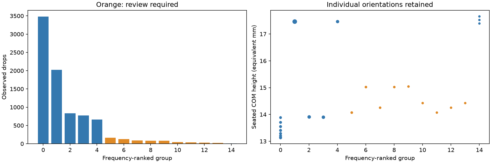
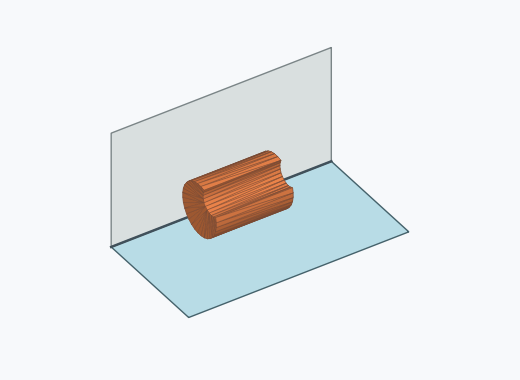
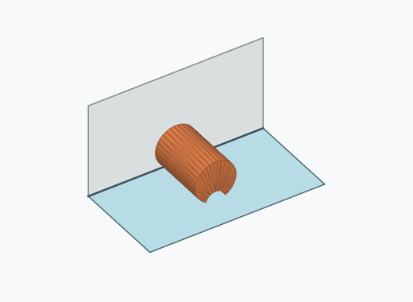
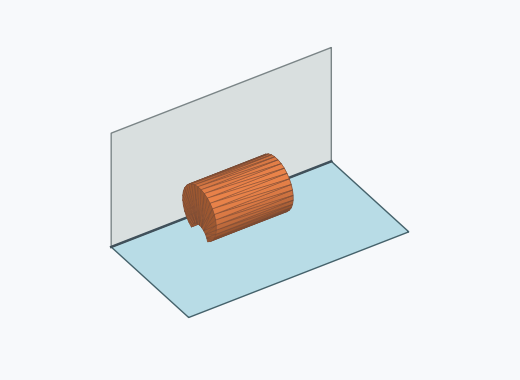
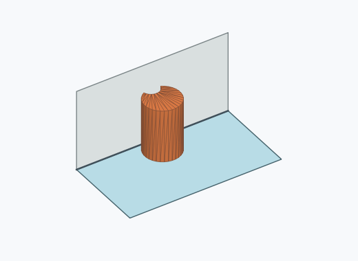
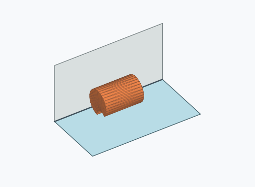
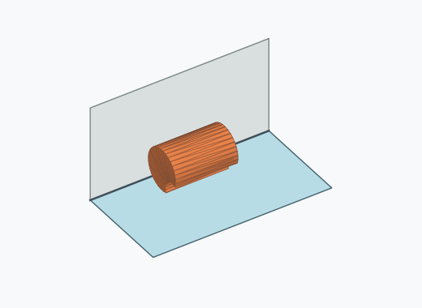

# Kk2i: rolling-surface grouping

60° local paths, 0.1° sampling, 0.5 mm escape barrier. Individual feature directions remain intact.

Minima with an escape barrier above 0.5 mm remain distinct. A higher observation that can reach multiple minima is marked for review. Sampling covers observed local geodesics; unsampled paths may exist.

| Group | Members | Drops | Incidence | Review | Illustration (saved orientation) |
| --- | ---: | ---: | ---: | --- | --- |
| 0 | 15 | 3480 | 34.80% | False |  |
| 1 | 1 | 2023 | 20.23% | False |  |
| 2 | 1 | 833 | 8.33% | False |  |
| 3 | 1 | 773 | 7.73% | False |  |
| 4 | 1 | 661 | 6.61% | False |  |
| 5 | 1 | 165 | 1.65% | True |  |
| 6 | 1 | 123 | 1.23% | True |  |
| 7 | 1 | 91 | 0.91% | True |  |
| 8 | 1 | 83 | 0.83% | True |  |
| 9 | 1 | 79 | 0.79% | True |  |
| 10 | 1 | 44 | 0.44% | True |  |
| 11 | 1 | 34 | 0.34% | True |  |
| 12 | 1 | 28 | 0.28% | True |  |
| 13 | 1 | 21 | 0.21% | True |  |
| 14 | 3 | 10 | 0.10% | False |  |

Illustrations are frequency-selected existing pose images; they are not stability-ranked representatives.

[Full sampled path heights, persistent minima and minimax assignments](energy_paths.json.gz) · [Provenance](provenance.json)

[Reproducible simulator patch](simulator.patch): check out the simulator base revision recorded in provenance, apply the patch, and run its tests. The patch preserves the legacy engine for every mesh outside the six verified identities.
