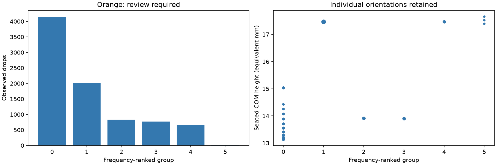
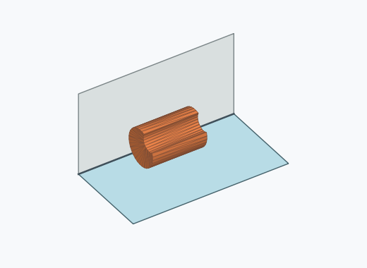
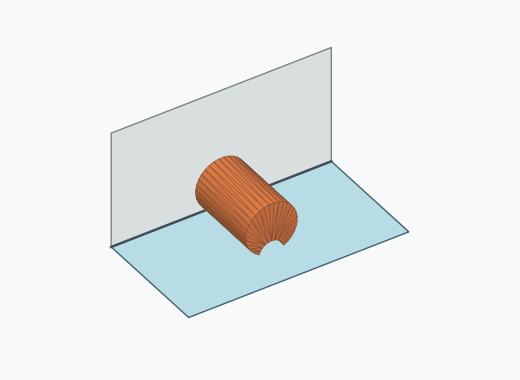
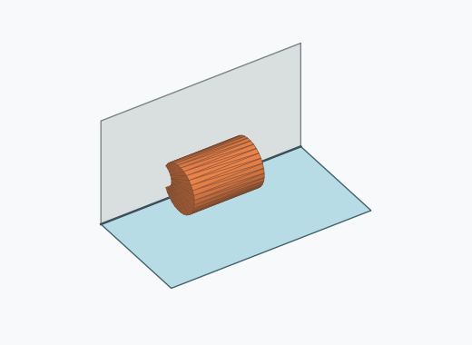
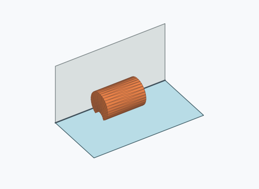
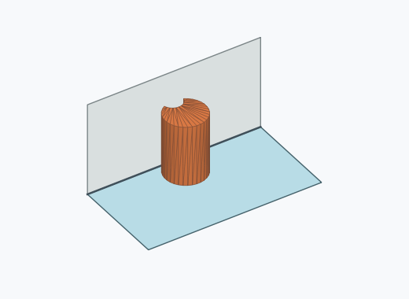

# Kk2i: rounded support families

A rounded support family ignores circumferential roll while retaining the extrusion-axis direction and broad cut-feature supports. The pinned meshes use source Z as their extrusion axis. Axis alignment uses 10°, and broad-support normals use 5°. A side hull facet is broad when its area is at least twice the median side-strip area. Kk2i retains broad wall/belt support distinctions. Kl2a also merges end-on-belt azimuths. Kk4a retains the signed axis direction; tilted observations stay separate for review. This simple geometric classification does not claim a 0.5 mm energy barrier or add rotational recognition symmetry.

| Group | Displayed poses | Drops | Incidence | Review | Saved orientation |
| --- | --- | ---: | ---: | --- | --- |
| 0 | 4, 5, 6, 7, 8, 9, 10, 11, 12, 13, 14, 15, 16, 17, 18, 19, 20, 21, 22, 23, 24, 25, 26, 27 | 4148 | 41.48% | False |  |
| 1 | 0 | 2023 | 20.23% | False |  |
| 2 | 1 | 833 | 8.33% | False |  |
| 3 | 2 | 773 | 7.73% | False |  |
| 4 | 3 | 661 | 6.61% | False |  |
| 5 | 28, 29, 30 | 10 | 0.10% | False |  |

Illustrations use an existing frequent orientation, without claiming a stability representative.

[Per-pose axes, supporting normals and family signatures](grouping_evidence.json.gz) · [Provenance](provenance.json) · [Reproducible simulator patch](simulator.patch)

To reproduce, check out the simulator base revision in provenance, apply simulator.patch, and run the tests.
