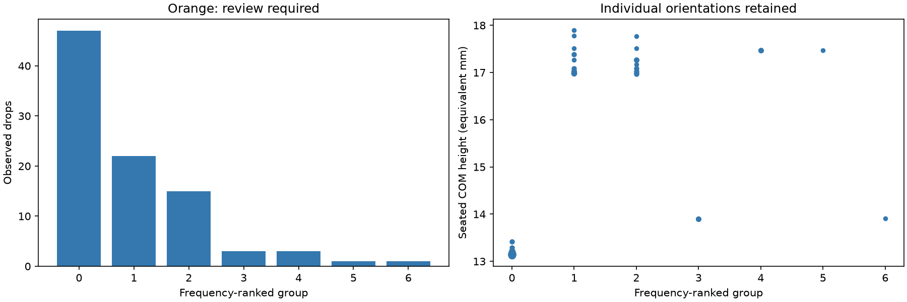

# Kk2i: 100mm_s, 100 validation drops

The archived 10,000-drop study's physical settings were reused, with 100 trials and seed 42. Raw simulation records are preserved in the losslessly verified archive. Grouping was applied afterward; no disturbance sweeps were run. Recognition uses the saved catalogue symmetry and tolerances. A small sample can miss rare basins.

Settled: 92/100. Assigned groups: 7; separate review poses: 0.

[Raw records](simulation_results.tar.xz) · [Configuration](config.json) · [Validation](validation.json) · [Individual observations](observations.json) · [Groups](groups.json) · [Full path evidence](energy_paths.json.gz)
