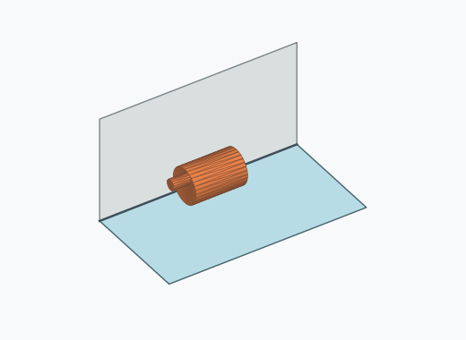
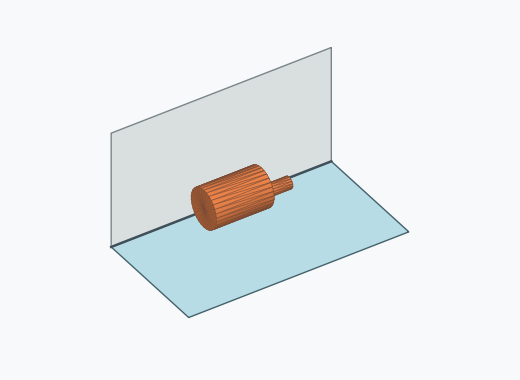

# Kk4a: grouped observed poses

10,000 completed drops; 7,726 settled. 121 assessed source poses; 4 groups meet the 1% cutoff.

Grouping uses 0.5 mm equivalent lift and a 60° maximum diameter. All members receive the same disturbance protocol.

| Representative | Image | Members | Combined count | Frequency | Retention AUC |
| --- | --- | --- | ---: | ---: | ---: |
| Kk4a_0018 |  | Kk4a_0018 | 173 | 1.73% | 0.7370 |
| Kk4a_0053 |  | Kk4a_0053 | 123 | 1.23% | 0.7005 |
| Kk4a_0097 |  | Kk4a_0097 | 106 | 1.06% | 0.7448 |
| Kk4a_0009 |  | Kk4a_0009 | 102 | 1.02% | 0.7448 |

[All original observations and member images](original_observations.json), [memberships](membership.csv), [barrier evidence](grouping_geometry.json), [member stability curves](group_stability.csv), [individual disturbance curves](stability.csv), [validation](validation.json).

Frequencies retain the original completed-drop denominator. Stability scores describe the configured virtual chute.
