# Kk4a

[Workpiece index](../README.md#workpieces)

## Historical pose catalogue

Group numbers rank the saved pose basins by their combined incidence within each observation phase. Pose 0 is the most frequent individual pose in its observation phase. The membership CSV links the displayed numbers to the saved pose IDs. Groups below 1% remain visible.

[Group membership CSV](group_memberships.csv) · [Grouping method](../README.md#catalogue-grouping)

### Transport poses

7,726 settled outcomes across 10,000 historical drops on a 500 mm chute. Incidence uses all completed drops as the denominator.

Outcome counts: settled: 7,726, unsettled: 2,274.

| Pose | Group | Image | Count | Incidence | 95% interval | Share of settled outcomes |
| --- | --- | --- | ---: | ---: | ---: | ---: |
| Pose 0 | Group 0 |  | 173 | 1.73 % | 1.49–2.00 % | 2.24 % |
| Pose 1 | Group 1 |  | 123 | 1.23 % | 1.03–1.47 % | 1.59 % |
| Pose 2 | Group 2 |  | 106 | 1.06 % | 0.88–1.28 % | 1.37 % |
| Pose 3 | Group 3 |  | 102 | 1.02 % | 0.84–1.24 % | 1.32 % |
| Pose 4 | Group 4 |  | 99 | 0.99 % | 0.81–1.20 % | 1.28 % |
| Pose 5 | Group 5 |  | 98 | 0.98 % | 0.80–1.19 % | 1.27 % |
| Pose 6 | Group 6 |  | 94 | 0.94 % | 0.77–1.15 % | 1.22 % |
| Pose 7 | Group 7 |  | 94 | 0.94 % | 0.77–1.15 % | 1.22 % |
| Pose 8 | Group 8 |  | 94 | 0.94 % | 0.77–1.15 % | 1.22 % |
| Pose 9 | Group 9 |  | 89 | 0.89 % | 0.72–1.09 % | 1.15 % |
| Pose 10 | Group 10 | 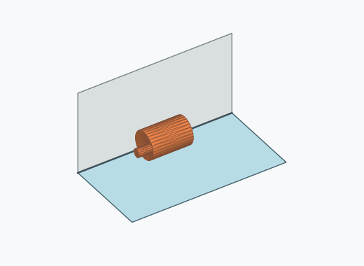 | 89 | 0.89 % | 0.72–1.09 % | 1.15 % |
| Pose 11 | Group 11 |  | 88 | 0.88 % | 0.71–1.08 % | 1.14 % |
| Pose 12 | Group 12 | 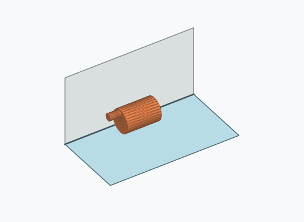 | 88 | 0.88 % | 0.71–1.08 % | 1.14 % |
| Pose 13 | Group 13 |  | 88 | 0.88 % | 0.71–1.08 % | 1.14 % |
| Pose 14 | Group 14 |  | 87 | 0.87 % | 0.71–1.07 % | 1.13 % |
| Pose 15 | Group 15 |  | 86 | 0.86 % | 0.70–1.06 % | 1.11 % |
| Pose 16 | Group 16 |  | 86 | 0.86 % | 0.70–1.06 % | 1.11 % |
| Pose 17 | Group 17 |  | 83 | 0.83 % | 0.67–1.03 % | 1.07 % |
| Pose 18 | Group 18 |  | 83 | 0.83 % | 0.67–1.03 % | 1.07 % |
| Pose 19 | Group 19 |  | 82 | 0.82 % | 0.66–1.02 % | 1.06 % |
| Pose 20 | Group 20 |  | 81 | 0.81 % | 0.65–1.01 % | 1.05 % |
| Pose 21 | Group 21 | 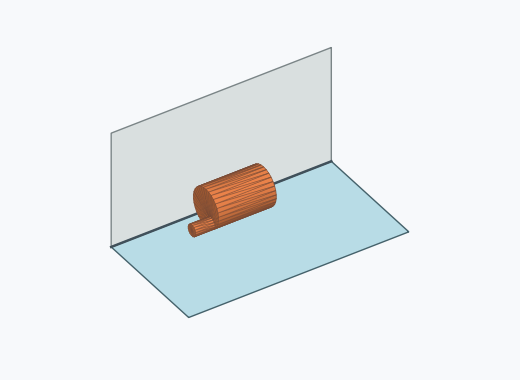 | 80 | 0.80 % | 0.64–0.99 % | 1.04 % |
| Pose 22 | Group 22 |  | 79 | 0.79 % | 0.63–0.98 % | 1.02 % |
| Pose 23 | Group 23 |  | 78 | 0.78 % | 0.63–0.97 % | 1.01 % |
| Pose 24 | Group 24 |  | 76 | 0.76 % | 0.61–0.95 % | 0.98 % |
| Pose 25 | Group 25 |  | 76 | 0.76 % | 0.61–0.95 % | 0.98 % |
| Pose 26 | Group 26 |  | 76 | 0.76 % | 0.61–0.95 % | 0.98 % |
| Pose 27 | Group 27 |  | 76 | 0.76 % | 0.61–0.95 % | 0.98 % |
| Pose 28 | Group 28 |  | 76 | 0.76 % | 0.61–0.95 % | 0.98 % |
| Pose 29 | Group 29 |  | 76 | 0.76 % | 0.61–0.95 % | 0.98 % |
| Pose 30 | Group 30 |  | 76 | 0.76 % | 0.61–0.95 % | 0.98 % |
| Pose 31 | Group 31 |  | 76 | 0.76 % | 0.61–0.95 % | 0.98 % |
| Pose 32 | Group 32 |  | 76 | 0.76 % | 0.61–0.95 % | 0.98 % |
| Pose 33 | Group 33 |  | 75 | 0.75 % | 0.60–0.94 % | 0.97 % |
| Pose 34 | Group 34 |  | 74 | 0.74 % | 0.59–0.93 % | 0.96 % |
| Pose 35 | Group 35 |  | 73 | 0.73 % | 0.58–0.92 % | 0.94 % |
| Pose 36 | Group 36 |  | 72 | 0.72 % | 0.57–0.91 % | 0.93 % |
| Pose 37 | Group 37 | 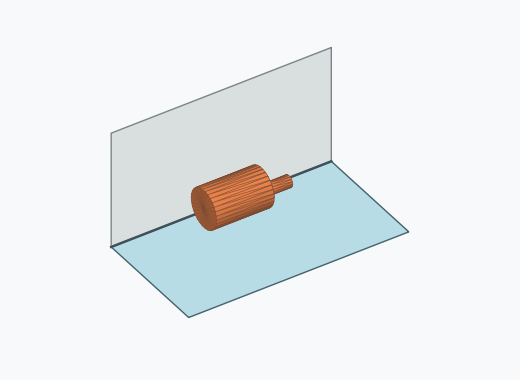 | 72 | 0.72 % | 0.57–0.91 % | 0.93 % |
| Pose 38 | Group 38 |  | 71 | 0.71 % | 0.56–0.89 % | 0.92 % |
| Pose 39 | Group 39 |  | 71 | 0.71 % | 0.56–0.89 % | 0.92 % |
| Pose 40 | Group 40 |  | 71 | 0.71 % | 0.56–0.89 % | 0.92 % |
| Pose 41 | Group 41 |  | 71 | 0.71 % | 0.56–0.89 % | 0.92 % |
| Pose 42 | Group 42 |  | 70 | 0.70 % | 0.55–0.88 % | 0.91 % |
| Pose 43 | Group 43 |  | 70 | 0.70 % | 0.55–0.88 % | 0.91 % |
| Pose 44 | Group 44 | 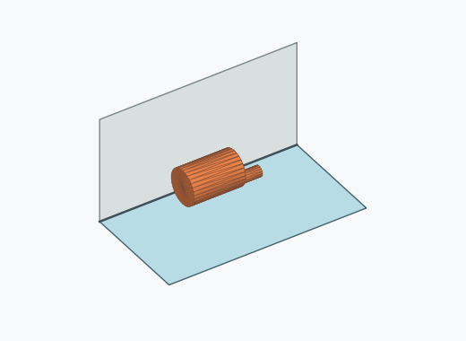 | 70 | 0.70 % | 0.55–0.88 % | 0.91 % |
| Pose 45 | Group 45 |  | 69 | 0.69 % | 0.55–0.87 % | 0.89 % |
| Pose 46 | Group 46 |  | 69 | 0.69 % | 0.55–0.87 % | 0.89 % |
| Pose 47 | Group 47 |  | 68 | 0.68 % | 0.54–0.86 % | 0.88 % |
| Pose 48 | Group 48 |  | 66 | 0.66 % | 0.52–0.84 % | 0.85 % |
| Pose 49 | Group 49 |  | 66 | 0.66 % | 0.52–0.84 % | 0.85 % |
| Pose 50 | Group 50 |  | 66 | 0.66 % | 0.52–0.84 % | 0.85 % |
| Pose 51 | Group 51 |  | 65 | 0.65 % | 0.51–0.83 % | 0.84 % |
| Pose 52 | Group 52 |  | 65 | 0.65 % | 0.51–0.83 % | 0.84 % |
| Pose 53 | Group 53 |  | 65 | 0.65 % | 0.51–0.83 % | 0.84 % |
| Pose 54 | Group 54 |  | 65 | 0.65 % | 0.51–0.83 % | 0.84 % |
| Pose 55 | Group 55 |  | 65 | 0.65 % | 0.51–0.83 % | 0.84 % |
| Pose 56 | Group 56 |  | 64 | 0.64 % | 0.50–0.82 % | 0.83 % |
| Pose 57 | Group 57 |  | 62 | 0.62 % | 0.48–0.79 % | 0.80 % |
| Pose 58 | Group 58 |  | 62 | 0.62 % | 0.48–0.79 % | 0.80 % |
| Pose 59 | Group 59 |  | 62 | 0.62 % | 0.48–0.79 % | 0.80 % |
| Pose 60 | Group 60 |  | 61 | 0.61 % | 0.48–0.78 % | 0.79 % |
| Pose 61 | Group 61 |  | 61 | 0.61 % | 0.48–0.78 % | 0.79 % |
| Pose 62 | Group 62 |  | 60 | 0.60 % | 0.47–0.77 % | 0.78 % |
| Pose 63 | Group 63 |  | 60 | 0.60 % | 0.47–0.77 % | 0.78 % |
| Pose 64 | Group 64 |  | 60 | 0.60 % | 0.47–0.77 % | 0.78 % |
| Pose 65 | Group 65 |  | 59 | 0.59 % | 0.46–0.76 % | 0.76 % |
| Pose 66 | Group 66 |  | 59 | 0.59 % | 0.46–0.76 % | 0.76 % |
| Pose 67 | Group 67 | 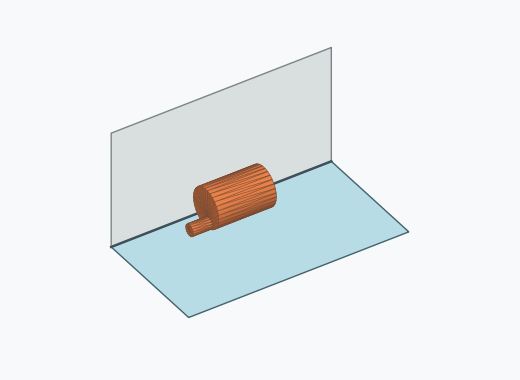 | 58 | 0.58 % | 0.45–0.75 % | 0.75 % |
| Pose 68 | Group 68 |  | 58 | 0.58 % | 0.45–0.75 % | 0.75 % |
| Pose 69 | Group 69 |  | 58 | 0.58 % | 0.45–0.75 % | 0.75 % |
| Pose 70 | Group 70 |  | 58 | 0.58 % | 0.45–0.75 % | 0.75 % |
| Pose 71 | Group 71 |  | 57 | 0.57 % | 0.44–0.74 % | 0.74 % |
| Pose 72 | Group 72 |  | 57 | 0.57 % | 0.44–0.74 % | 0.74 % |
| Pose 73 | Group 73 |  | 56 | 0.56 % | 0.43–0.73 % | 0.72 % |
| Pose 74 | Group 74 |  | 56 | 0.56 % | 0.43–0.73 % | 0.72 % |
| Pose 75 | Group 75 |  | 56 | 0.56 % | 0.43–0.73 % | 0.72 % |
| Pose 76 | Group 76 |  | 55 | 0.55 % | 0.42–0.72 % | 0.71 % |
| Pose 77 | Group 77 |  | 55 | 0.55 % | 0.42–0.72 % | 0.71 % |
| Pose 78 | Group 78 |  | 54 | 0.54 % | 0.41–0.70 % | 0.70 % |
| Pose 79 | Group 79 |  | 54 | 0.54 % | 0.41–0.70 % | 0.70 % |
| Pose 80 | Group 80 |  | 54 | 0.54 % | 0.41–0.70 % | 0.70 % |
| Pose 81 | Group 81 |  | 53 | 0.53 % | 0.41–0.69 % | 0.69 % |
| Pose 82 | Group 82 |  | 53 | 0.53 % | 0.41–0.69 % | 0.69 % |
| Pose 83 | Group 83 |  | 52 | 0.52 % | 0.40–0.68 % | 0.67 % |
| Pose 84 | Group 84 |  | 52 | 0.52 % | 0.40–0.68 % | 0.67 % |
| Pose 85 | Group 85 |  | 52 | 0.52 % | 0.40–0.68 % | 0.67 % |
| Pose 86 | Group 86 |  | 52 | 0.52 % | 0.40–0.68 % | 0.67 % |
| Pose 87 | Group 87 |  | 51 | 0.51 % | 0.39–0.67 % | 0.66 % |
| Pose 88 | Group 88 |  | 51 | 0.51 % | 0.39–0.67 % | 0.66 % |
| Pose 89 | Group 89 | 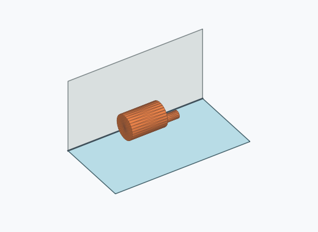 | 51 | 0.51 % | 0.39–0.67 % | 0.66 % |
| Pose 90 | Group 90 |  | 51 | 0.51 % | 0.39–0.67 % | 0.66 % |
| Pose 91 | Group 91 |  | 50 | 0.50 % | 0.38–0.66 % | 0.65 % |
| Pose 92 | Group 92 |  | 50 | 0.50 % | 0.38–0.66 % | 0.65 % |
| Pose 93 | Group 93 |  | 49 | 0.49 % | 0.37–0.65 % | 0.63 % |
| Pose 94 | Group 94 |  | 48 | 0.48 % | 0.36–0.64 % | 0.62 % |
| Pose 95 | Group 95 |  | 48 | 0.48 % | 0.36–0.64 % | 0.62 % |
| Pose 96 | Group 96 |  | 48 | 0.48 % | 0.36–0.64 % | 0.62 % |
| Pose 97 | Group 97 |  | 48 | 0.48 % | 0.36–0.64 % | 0.62 % |
| Pose 98 | Group 98 |  | 48 | 0.48 % | 0.36–0.64 % | 0.62 % |
| Pose 99 | Group 99 | 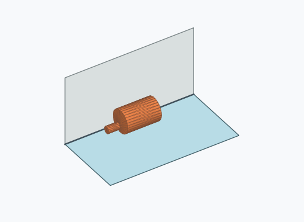 | 48 | 0.48 % | 0.36–0.64 % | 0.62 % |
| Pose 100 | Group 100 |  | 47 | 0.47 % | 0.35–0.62 % | 0.61 % |
| Pose 101 | Group 101 |  | 47 | 0.47 % | 0.35–0.62 % | 0.61 % |
| Pose 102 | Group 102 |  | 46 | 0.46 % | 0.35–0.61 % | 0.60 % |
| Pose 103 | Group 103 |  | 45 | 0.45 % | 0.34–0.60 % | 0.58 % |
| Pose 104 | Group 104 |  | 44 | 0.44 % | 0.33–0.59 % | 0.57 % |
| Pose 105 | Group 105 |  | 44 | 0.44 % | 0.33–0.59 % | 0.57 % |
| Pose 106 | Group 106 |  | 44 | 0.44 % | 0.33–0.59 % | 0.57 % |
| Pose 107 | Group 107 |  | 43 | 0.43 % | 0.32–0.58 % | 0.56 % |
| Pose 108 | Group 108 |  | 42 | 0.42 % | 0.31–0.57 % | 0.54 % |
| Pose 109 | Group 109 |  | 41 | 0.41 % | 0.30–0.56 % | 0.53 % |
| Pose 110 | Group 110 |  | 40 | 0.40 % | 0.29–0.54 % | 0.52 % |
| Pose 111 | Group 111 | 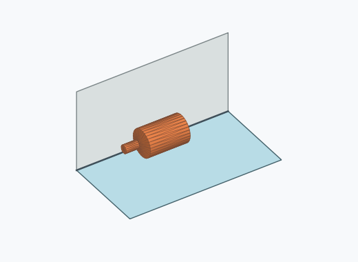 | 40 | 0.40 % | 0.29–0.54 % | 0.52 % |
| Pose 112 | Group 112 |  | 40 | 0.40 % | 0.29–0.54 % | 0.52 % |
| Pose 113 | Group 113 |  | 39 | 0.39 % | 0.29–0.53 % | 0.50 % |
| Pose 114 | Group 114 |  | 35 | 0.35 % | 0.25–0.49 % | 0.45 % |
| Pose 115 | Group 115 |  | 35 | 0.35 % | 0.25–0.49 % | 0.45 % |
| Pose 116 | Group 116 | 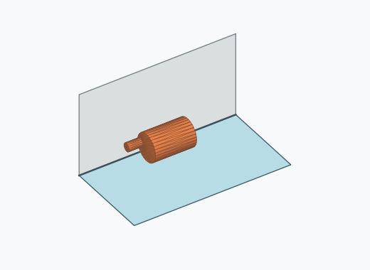 | 34 | 0.34 % | 0.24–0.47 % | 0.44 % |
| Pose 117 | Group 117 |  | 32 | 0.32 % | 0.23–0.45 % | 0.41 % |
| Pose 118 | Group 118 |  | 29 | 0.29 % | 0.20–0.42 % | 0.38 % |
| Pose 119 | Group 119 |  | 24 | 0.24 % | 0.16–0.36 % | 0.31 % |
| Pose 120 | Group 120 | 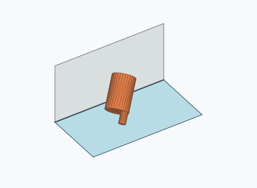 | 1 | 0.01 % | 0.00–0.06 % | 0.01 % |

[Pose catalogue JSON](poses.json) · [Pose catalogue YAML](poses.yaml) · [Frequencies](frequencies.csv) · [Trial records](trials.csv)

Pose orientations use `xyzw` quaternions from the workpiece frame to the chute frame. Recognition uses the recorded symmetry, a 5° tolerance, and a 1° ambiguity margin. The pose registry reserves previously observed IDs for later recognition.

### Historical run files

- [Configuration](config.json)
- [Manifest](manifest.json)
