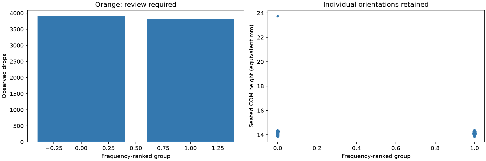
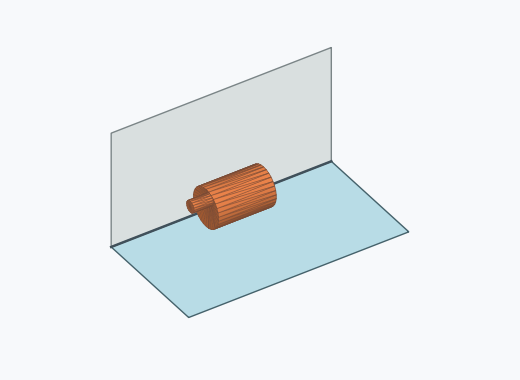

# Kk4a: rolling-surface grouping

60° local paths, 0.1° sampling, 0.5 mm escape barrier. Individual feature directions remain intact.

Minima with an escape barrier above 0.5 mm remain distinct. A higher observation that can reach multiple minima is marked for review. Sampling covers observed local geodesics; unsampled paths may exist.

| Group | Members | Drops | Incidence | Review | Illustration (saved orientation) |
| --- | ---: | ---: | ---: | --- | --- |
| 0 | 61 | 3898 | 38.98% | False |  |
| 1 | 60 | 3828 | 38.28% | False |  |

Illustrations are frequency-selected existing pose images; they are not stability-ranked representatives.

[Full sampled path heights, persistent minima and minimax assignments](energy_paths.json.gz) · [Provenance](provenance.json)

[Reproducible simulator patch](simulator.patch): check out the simulator base revision recorded in provenance, apply the patch, and run its tests. The patch preserves the legacy engine for every mesh outside the six verified identities.
