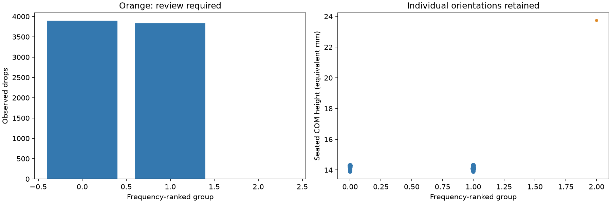
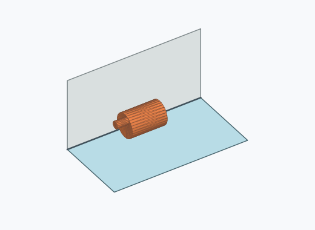
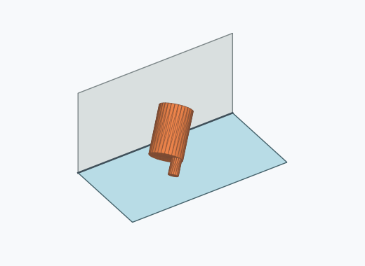

# Kk4a: rounded support families

A rounded support family ignores circumferential roll while retaining the extrusion-axis direction and broad cut-feature supports. The pinned meshes use source Z as their extrusion axis. Axis alignment uses 10°, and broad-support normals use 5°. A side hull facet is broad when its area is at least twice the median side-strip area. Kk2i retains broad wall/belt support distinctions. Kl2a also merges end-on-belt azimuths. Kk4a retains the signed axis direction; tilted observations stay separate for review. This simple geometric classification does not claim a 0.5 mm energy barrier or add rotational recognition symmetry.

| Group | Displayed poses | Drops | Incidence | Review | Saved orientation |
| --- | --- | ---: | ---: | --- | --- |
| 0 | 1, 6, 7, 9, 10, 12, 14, 15, 17, 20, 21, 22, 26, 27, 28, 30, 31, 33, 34, 36, 40, 43, 46, 47, 49, 50, 51, 52, 53, 54, 55, 58, 63, 64, 66, 67, 69, 71, 72, 73, 76, 77, 80, 82, 83, 85, 88, 90, 92, 93, 97, 98, 99, 101, 102, 105, 107, 109, 111, 116 | 3897 | 38.97% | False |  |
| 1 | 0, 2, 3, 4, 5, 8, 11, 13, 16, 18, 19, 23, 24, 25, 29, 32, 35, 37, 38, 39, 41, 42, 44, 45, 48, 56, 57, 59, 60, 61, 62, 65, 68, 70, 74, 75, 78, 79, 81, 84, 86, 87, 89, 91, 94, 95, 96, 100, 103, 104, 106, 108, 110, 112, 113, 114, 115, 117, 118, 119 | 3828 | 38.28% | False |  |
| 2 | 120 | 1 | 0.01% | True |  |

Illustrations use an existing frequent orientation, without claiming a stability representative.

[Per-pose axes, supporting normals and family signatures](grouping_evidence.json.gz) · [Provenance](provenance.json) · [Reproducible simulator patch](simulator.patch)

To reproduce, check out the simulator base revision in provenance, apply simulator.patch, and run the tests.
