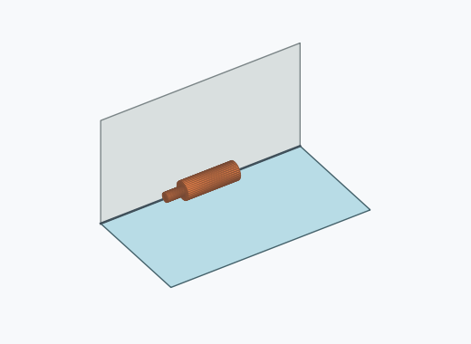
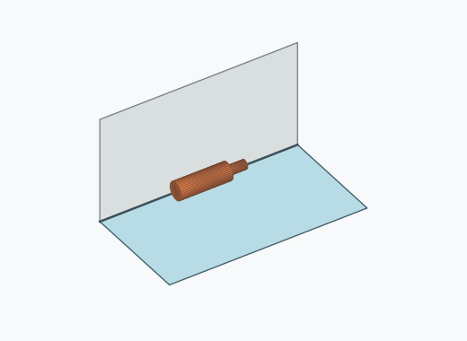

# Kl1i: grouped observed poses

10,000 completed drops; 9,333 settled. 2 assessed source poses; 2 groups meet the 1% cutoff.

Grouping uses 0.5 mm equivalent lift and a 60° maximum diameter. All members receive the same disturbance protocol.

| Representative | Image | Members | Combined count | Frequency | Retention AUC |
| --- | --- | --- | ---: | ---: | ---: |
| Kl1i_0001 |  | Kl1i_0001 | 4757 | 47.57% | 1.0000 |
| Kl1i_0002 |  | Kl1i_0002 | 4576 | 45.76% | 1.0000 |

[All original observations and member images](original_observations.json), [memberships](membership.csv), [barrier evidence](grouping_geometry.json), [member stability curves](group_stability.csv), [individual disturbance curves](stability.csv), [validation](validation.json).

Frequencies retain the original completed-drop denominator. Stability scores describe the configured virtual chute.
