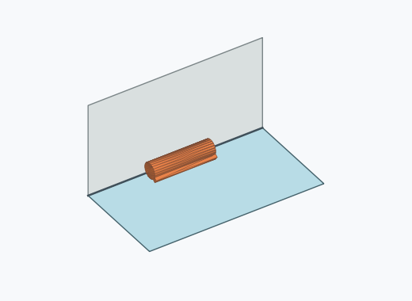
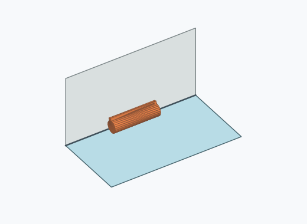
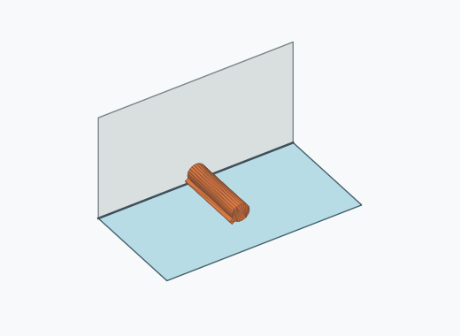
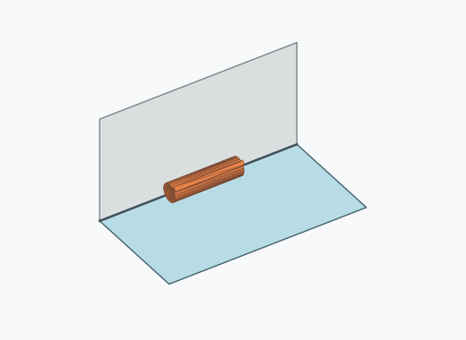
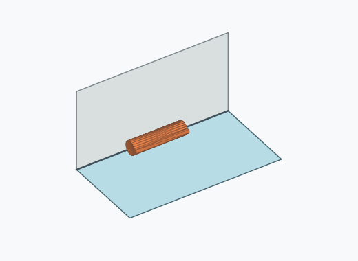
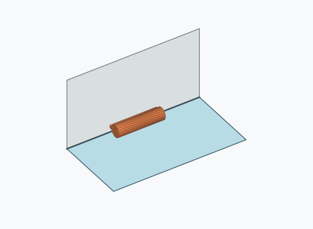
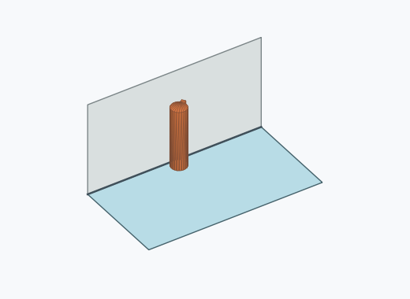

# Kl2a: grouped observed poses

10,000 completed drops; 9,912 settled. 27 assessed source poses; 16 groups meet the 1% cutoff.

Grouping uses 0.5 mm equivalent lift and a 60° maximum diameter. All members receive the same disturbance protocol.

| Representative | Image | Members | Combined count | Frequency | Retention AUC |
| --- | --- | --- | ---: | ---: | ---: |
| Kl2a_0007 |  | Kl2a_0007 | 1780 | 17.80% | 1.0000 |
| Kl2a_0018 |  | Kl2a_0015, Kl2a_0018 | 1474 | 14.74% | 1.0000 |
| Kl2a_0008 |  | Kl2a_0008 | 1195 | 11.95% | 1.0000 |
| Kl2a_0009 |  | Kl2a_0009 | 628 | 6.28% | 0.9479 |
| Kl2a_0006 |  | Kl2a_0006 | 518 | 5.18% | 0.8958 |
| Kl2a_0011 |  | Kl2a_0011 | 482 | 4.82% | 0.9688 |
| Kl2a_0019 |  | Kl2a_0019, Kl2a_0026 | 427 | 4.27% | 0.9792 |
| Kl2a_0002 |  | Kl2a_0002, Kl2a_0004 | 422 | 4.22% | 1.0000 |
| Kl2a_0017 |  | Kl2a_0017 | 408 | 4.08% | 1.0000 |
| Kl2a_0003 |  | Kl2a_0003 | 395 | 3.95% | 0.9479 |
| Kl2a_0014 |  | Kl2a_0014 | 387 | 3.87% | 1.0000 |
| Kl2a_0013 |  | Kl2a_0013 | 380 | 3.80% | 1.0000 |
| Kl2a_0020 |  | Kl2a_0020 | 374 | 3.74% | 0.9688 |
| Kl2a_0012 |  | Kl2a_0010, Kl2a_0012 | 371 | 3.71% | 1.0000 |
| Kl2a_0022 |  | Kl2a_0022 | 364 | 3.64% | 0.9688 |
| Kl2a_0001 |  | Kl2a_0001 | 187 | 1.87% | 0.6875 |

[All original observations and member images](original_observations.json), [memberships](membership.csv), [barrier evidence](grouping_geometry.json), [member stability curves](group_stability.csv), [individual disturbance curves](stability.csv), [validation](validation.json).

Frequencies retain the original completed-drop denominator. Stability scores describe the configured virtual chute.
