# Kl2a

[Workpiece index](../README.md#workpieces)

## Historical pose catalogue

Group numbers rank the current support families by their combined incidence within each observation phase. Pose 0 is the most frequent individual pose in its observation phase. The membership CSV links the displayed numbers to the saved pose IDs. Groups below 1% remain visible.

[Group membership CSV](group_memberships.csv) · [Grouping method](../README.md#catalogue-grouping)

### Transport poses

9,912 settled outcomes across 10,000 historical drops on a 500 mm chute. Incidence uses all completed drops as the denominator.

Outcome counts: settled: 9,912, unsettled: 88.

| Pose | Group | Image | Count | Incidence | 95% interval | Share of settled outcomes |
| --- | --- | --- | ---: | ---: | ---: | ---: |
| Pose 0 | Group 1 |  | 1780 | 17.80 % | 17.06–18.56 % | 17.96 % |
| Pose 1 | Group 2 | 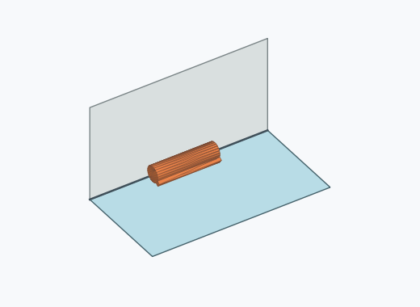 | 1195 | 11.95 % | 11.33–12.60 % | 12.06 % |
| Pose 2 | Group 1 |  | 867 | 8.67 % | 8.13–9.24 % | 8.75 % |
| Pose 3 | Group 0 | 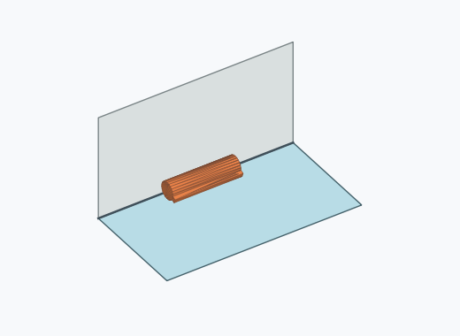 | 628 | 6.28 % | 5.82–6.77 % | 6.34 % |
| Pose 4 | Group 2 | 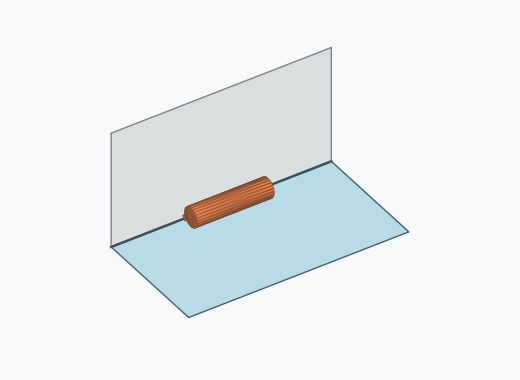 | 607 | 6.07 % | 5.62–6.56 % | 6.12 % |
| Pose 5 | Group 0 |  | 518 | 5.18 % | 4.76–5.63 % | 5.23 % |
| Pose 6 | Group 0 |  | 482 | 4.82 % | 4.42–5.26 % | 4.86 % |
| Pose 7 | Group 3 | 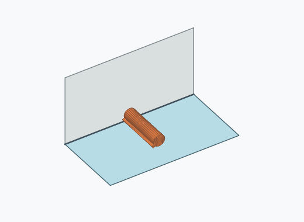 | 425 | 4.25 % | 3.87–4.66 % | 4.29 % |
| Pose 8 | Group 0 |  | 408 | 4.08 % | 3.71–4.49 % | 4.12 % |
| Pose 9 | Group 0 |  | 395 | 3.95 % | 3.59–4.35 % | 3.99 % |
| Pose 10 | Group 0 |  | 387 | 3.87 % | 3.51–4.27 % | 3.90 % |
| Pose 11 | Group 0 | 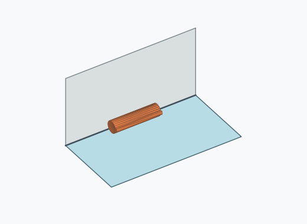 | 380 | 3.80 % | 3.44–4.19 % | 3.83 % |
| Pose 12 | Group 0 | 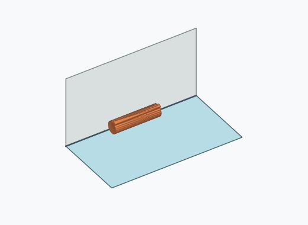 | 374 | 3.74 % | 3.39–4.13 % | 3.77 % |
| Pose 13 | Group 0 |  | 364 | 3.64 % | 3.29–4.03 % | 3.67 % |
| Pose 14 | Group 0 |  | 354 | 3.54 % | 3.20–3.92 % | 3.57 % |
| Pose 15 | Group 0 | 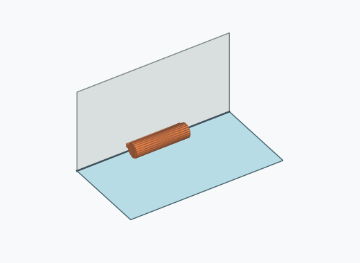 | 338 | 3.38 % | 3.04–3.75 % | 3.41 % |
| Pose 16 | Group 4 |  | 187 | 1.87 % | 1.62–2.15 % | 1.89 % |
| Pose 17 | Group 0 |  | 68 | 0.68 % | 0.54–0.86 % | 0.69 % |
| Pose 18 | Group 4 |  | 58 | 0.58 % | 0.45–0.75 % | 0.59 % |
| Pose 19 | Group 0 |  | 33 | 0.33 % | 0.24–0.46 % | 0.33 % |
| Pose 20 | Group 5 | 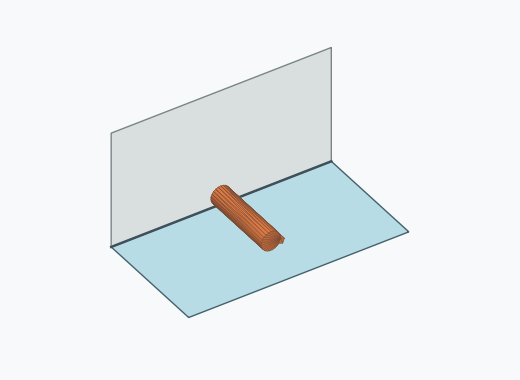 | 29 | 0.29 % | 0.20–0.42 % | 0.29 % |
| Pose 21 | Group 4 |  | 16 | 0.16 % | 0.10–0.26 % | 0.16 % |
| Pose 22 | Group 3 | 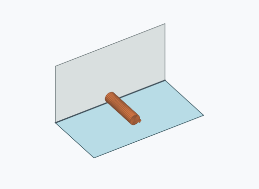 | 11 | 0.11 % | 0.06–0.20 % | 0.11 % |
| Pose 23 | Review 6 | 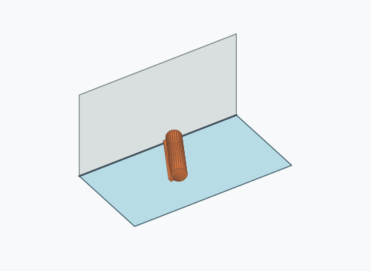 | 3 | 0.03 % | 0.01–0.09 % | 0.03 % |
| Pose 24 | Group 3 |  | 2 | 0.02 % | 0.01–0.07 % | 0.02 % |
| Pose 25 | Group 4 | 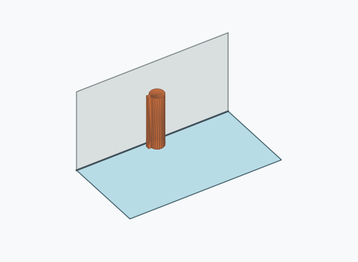 | 2 | 0.02 % | 0.01–0.07 % | 0.02 % |
| Pose 26 | Group 5 |  | 1 | 0.01 % | 0.00–0.06 % | 0.01 % |

[Pose catalogue JSON](poses.json) · [Pose catalogue YAML](poses.yaml) · [Frequencies](frequencies.csv) · [Trial records](trials.csv)

Pose orientations use `xyzw` quaternions from the workpiece frame to the chute frame. Recognition uses the recorded symmetry, a 5° tolerance, and a 1° ambiguity margin. The pose registry reserves previously observed IDs for later recognition.

### Historical run files

- [Configuration](config.json)
- [Manifest](manifest.json)

<!-- remaining-workpieces-20261110_10000:start -->
## Additional 10,000-drop runs

10,000 stationary and 10,000 moving-belt drops with the archived reference settings.

[Results and validation](simulations/20261110_10000/README.md).
<!-- remaining-workpieces-20261110_10000:end -->

## Rounded support-family refinement (13 November 2026)

A rounded support family ignores circumferential roll while retaining the extrusion-axis direction and broad cut-feature supports. The pinned meshes use source Z as their extrusion axis. Axis alignment uses 10°, and broad-support normals use 5°. A side hull facet is broad when its area is at least twice the median side-strip area. Kk2i retains broad wall/belt support distinctions. Kl2a also merges end-on-belt azimuths. Kk4a retains the signed axis direction; tilted observations stay separate for review. This simple geometric classification does not claim a 0.5 mm energy barrier or add rotational recognition symmetry.

6 assigned groups and 1 separate review poses. Individual poses, displayed pose numbers, IDs, counts, feature directions and recognition tolerances are unchanged. No disturbance sweeps or stability representatives were inferred.

[Current grouping evidence](grouping/20261113_contact/README.md) · [Paired validation](simulations/20261113_contact_100/README.md) · [Previous energy grouping](grouping/20261113/README.md)

The root checksum manifest covers exact committed Git bytes; Windows checkout line endings may differ.
