# Kl2a: rolling-surface grouping

60° local paths, 0.1° sampling, 0.5 mm escape barrier. Individual feature directions remain intact.

Minima with an escape barrier above 0.5 mm remain distinct. A higher observation that can reach multiple minima is marked for review. Sampling covers observed local geodesics; unsampled paths may exist.

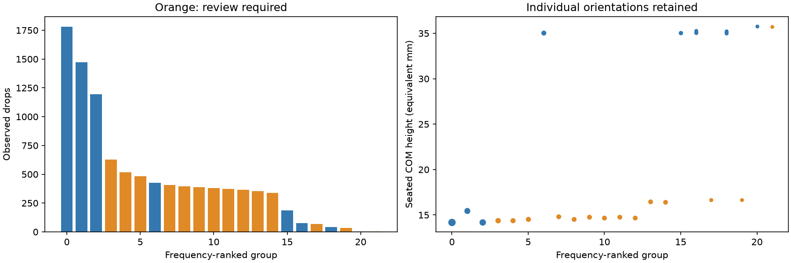

| Group | Members | Drops | Incidence | Review | Illustration (saved orientation) |
| --- | ---: | ---: | ---: | --- | --- |
| 0 | 1 | 1780 | 17.80% | False |  |
| 1 | 2 | 1474 | 14.74% | False |  |
| 2 | 1 | 1195 | 11.95% | False | 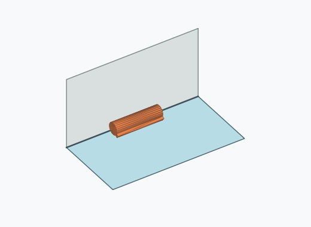 |
| 3 | 1 | 628 | 6.28% | True | 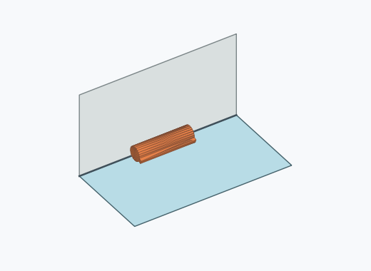 |
| 4 | 1 | 518 | 5.18% | True |  |
| 5 | 1 | 482 | 4.82% | True |  |
| 6 | 1 | 425 | 4.25% | False | 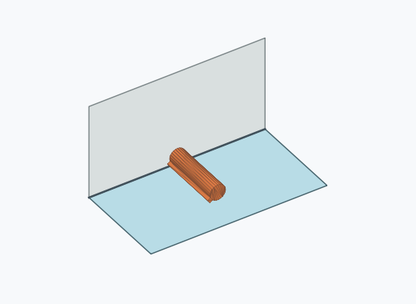 |
| 7 | 1 | 408 | 4.08% | True |  |
| 8 | 1 | 395 | 3.95% | True |  |
| 9 | 1 | 387 | 3.87% | True |  |
| 10 | 1 | 380 | 3.80% | True | 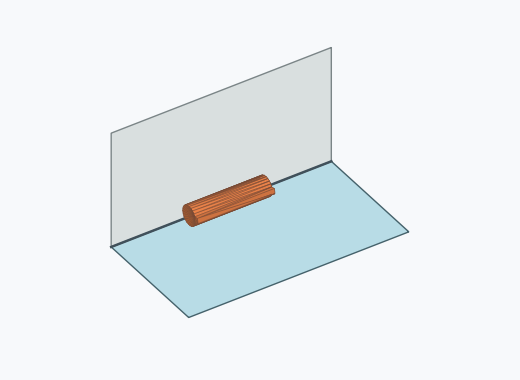 |
| 11 | 1 | 374 | 3.74% | True | 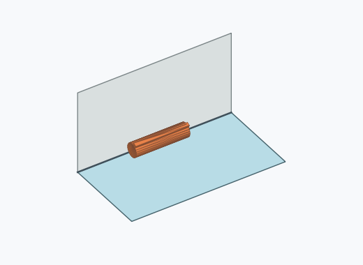 |
| 12 | 1 | 364 | 3.64% | True |  |
| 13 | 1 | 354 | 3.54% | True |  |
| 14 | 1 | 338 | 3.38% | True | 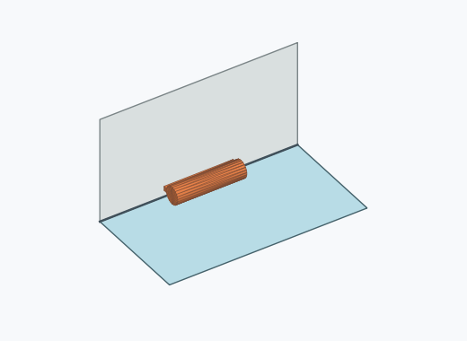 |
| 15 | 1 | 187 | 1.87% | False | 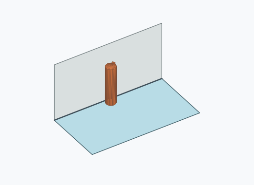 |
| 16 | 3 | 76 | 0.76% | False |  |
| 17 | 1 | 68 | 0.68% | True |  |
| 18 | 3 | 41 | 0.41% | False | 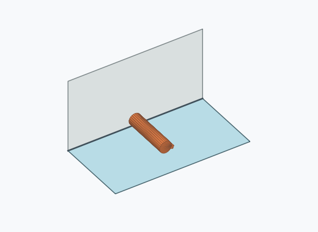 |
| 19 | 1 | 33 | 0.33% | True |  |
| 20 | 1 | 3 | 0.03% | False | 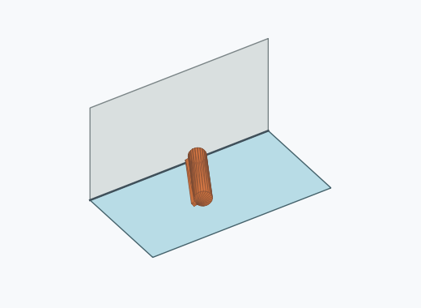 |
| 21 | 1 | 2 | 0.02% | True | 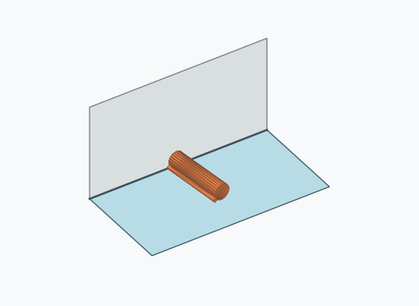 |

Illustrations are frequency-selected existing pose images; they are not stability-ranked representatives.

[Full sampled path heights, persistent minima and minimax assignments](energy_paths.json.gz) · [Provenance](provenance.json)

[Reproducible simulator patch](simulator.patch): check out the simulator base revision recorded in provenance, apply the patch, and run its tests. The patch preserves the legacy engine for every mesh outside the six verified identities.
