# Kl4i: grouped observed poses

10,000 completed drops; 9,620 settled. 41 assessed source poses; 30 groups meet the 1% cutoff.

Grouping uses 0.5 mm equivalent lift and a 60° maximum diameter. All members receive the same disturbance protocol.

| Representative | Image | Members | Combined count | Frequency | Retention AUC |
| --- | --- | --- | ---: | ---: | ---: |
| Kl4i_0008 |  | Kl4i_0008 | 1117 | 11.17% | 0.9115 |
| Kl4i_0028 |  | Kl4i_0028 | 851 | 8.51% | 0.5911 |
| Kl4i_0030 |  | Kl4i_0030 | 746 | 7.46% | 0.9635 |
| Kl4i_0010 | 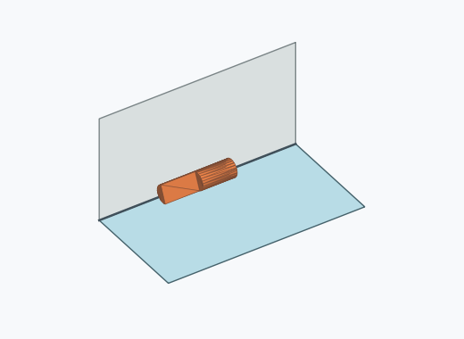 | Kl4i_0010 | 420 | 4.20% | 0.9635 |
| Kl4i_0023 |  | Kl4i_0023 | 388 | 3.88% | 0.9167 |
| Kl4i_0024 | 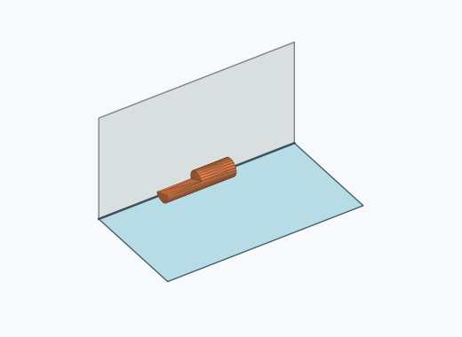 | Kl4i_0024 | 373 | 3.73% | 0.7005 |
| Kl4i_0012 | 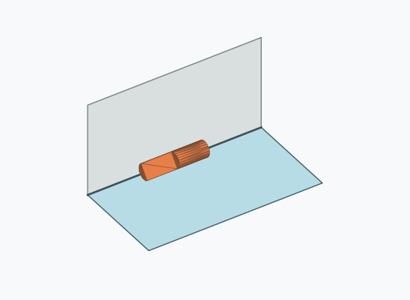 | Kl4i_0012 | 372 | 3.72% | 1.0000 |
| Kl4i_0020 |  | Kl4i_0020 | 369 | 3.69% | 0.9635 |
| Kl4i_0036 |  | Kl4i_0036 | 348 | 3.48% | 0.9844 |
| Kl4i_0034 |  | Kl4i_0034 | 347 | 3.47% | 1.0000 |
| Kl4i_0032 | 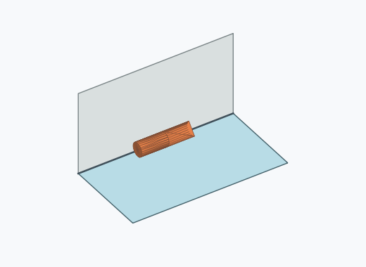 | Kl4i_0032 | 331 | 3.31% | 0.9844 |
| Kl4i_0038 |  | Kl4i_0038 | 327 | 3.27% | 1.0000 |
| Kl4i_0014 |  | Kl4i_0014 | 325 | 3.25% | 0.9245 |
| Kl4i_0027 |  | Kl4i_0027 | 316 | 3.16% | 0.7917 |
| Kl4i_0017 |  | Kl4i_0017 | 305 | 3.05% | 0.9844 |
| Kl4i_0001 | 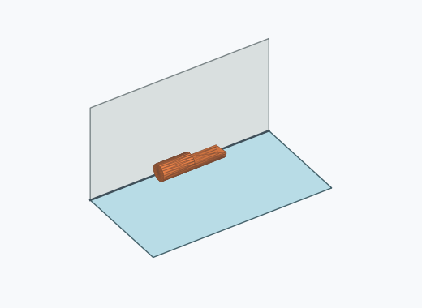 | Kl4i_0001 | 260 | 2.60% | 1.0000 |
| Kl4i_0018 |  | Kl4i_0015, Kl4i_0018 | 223 | 2.23% | 0.8438 |
| Kl4i_0002 | 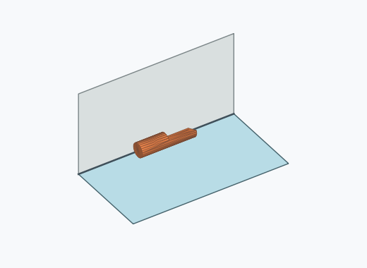 | Kl4i_0002 | 204 | 2.04% | 0.8750 |
| Kl4i_0021 | 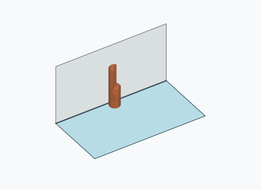 | Kl4i_0021, Kl4i_0022 | 155 | 1.55% | 0.5521 |
| Kl4i_0003 | 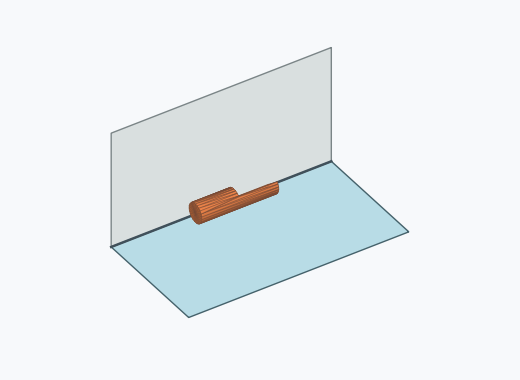 | Kl4i_0003 | 152 | 1.52% | 0.8281 |
| Kl4i_0007 |  | Kl4i_0007 | 145 | 1.45% | 0.6927 |
| Kl4i_0005 |  | Kl4i_0005 | 140 | 1.40% | 0.8958 |
| Kl4i_0004 |  | Kl4i_0004 | 131 | 1.31% | 0.7969 |
| Kl4i_0029 | 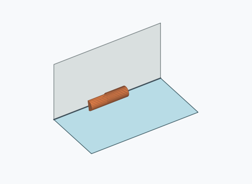 | Kl4i_0029 | 127 | 1.27% | 0.9479 |
| Kl4i_0009 | 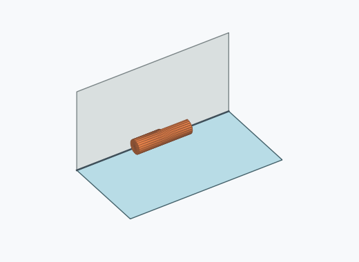 | Kl4i_0009 | 124 | 1.24% | 0.9479 |
| Kl4i_0019 | 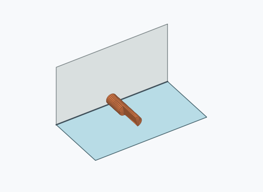 | Kl4i_0019, Kl4i_0039, Kl4i_0040, Kl4i_0041 | 123 | 1.23% | 0.8281 |
| Kl4i_0006 | 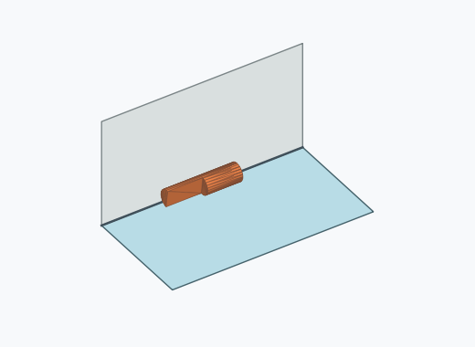 | Kl4i_0006 | 118 | 1.18% | 0.8568 |
| Kl4i_0011 |  | Kl4i_0011 | 113 | 1.13% | 1.0000 |
| Kl4i_0031 |  | Kl4i_0031 | 109 | 1.09% | 1.0000 |
| Kl4i_0026 | 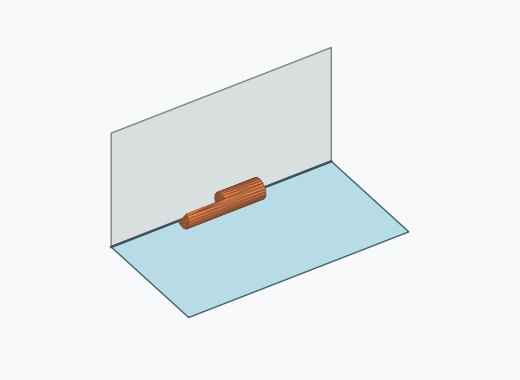 | Kl4i_0026 | 103 | 1.03% | 0.5703 |

[All original observations and member images](original_observations.json), [memberships](membership.csv), [barrier evidence](grouping_geometry.json), [member stability curves](group_stability.csv), [individual disturbance curves](stability.csv), [validation](validation.json).

Frequencies retain the original completed-drop denominator. Stability scores describe the configured virtual chute.
