# Kl4i

[Workpiece index](../README.md#workpieces)

## Historical pose catalogue

Group numbers rank the saved pose basins by their combined incidence within each observation phase. Pose 0 is the most frequent individual pose in its observation phase. The membership CSV links the displayed numbers to the saved pose IDs. Groups below 1% remain visible.

[Group membership CSV](group_memberships.csv) · [Grouping method](../README.md#catalogue-grouping)

### Transport poses

9,620 settled outcomes across 10,000 historical drops on a 500 mm chute. Incidence uses all completed drops as the denominator.

Outcome counts: settled: 9,620, unsettled: 380.

| Pose | Group | Image | Count | Incidence | 95% interval | Share of settled outcomes |
| --- | --- | --- | ---: | ---: | ---: | ---: |
| Pose 0 | Group 0 | 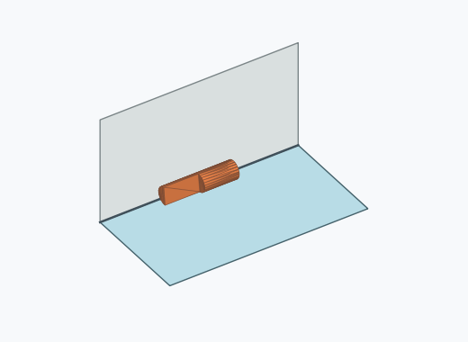 | 1117 | 11.17 % | 10.57–11.80 % | 11.61 % |
| Pose 1 | Group 1 |  | 851 | 8.51 % | 7.98–9.07 % | 8.85 % |
| Pose 2 | Group 2 |  | 746 | 7.46 % | 6.96–7.99 % | 7.75 % |
| Pose 3 | Group 3 | 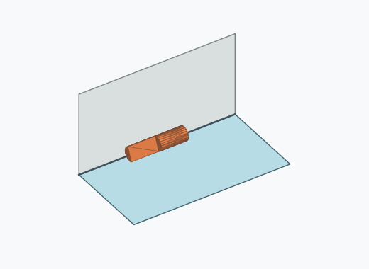 | 420 | 4.20 % | 3.82–4.61 % | 4.37 % |
| Pose 4 | Group 4 | 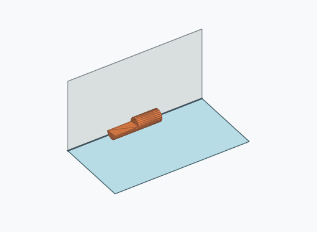 | 388 | 3.88 % | 3.52–4.28 % | 4.03 % |
| Pose 5 | Group 5 | 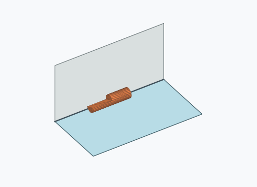 | 373 | 3.73 % | 3.38–4.12 % | 3.88 % |
| Pose 6 | Group 6 |  | 372 | 3.72 % | 3.37–4.11 % | 3.87 % |
| Pose 7 | Group 7 |  | 369 | 3.69 % | 3.34–4.08 % | 3.84 % |
| Pose 8 | Group 8 |  | 348 | 3.48 % | 3.14–3.86 % | 3.62 % |
| Pose 9 | Group 9 |  | 347 | 3.47 % | 3.13–3.85 % | 3.61 % |
| Pose 10 | Group 10 | 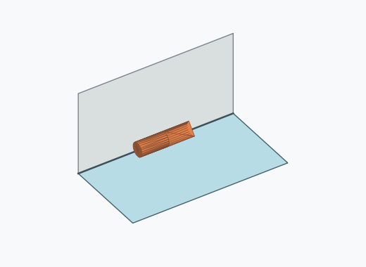 | 331 | 3.31 % | 2.98–3.68 % | 3.44 % |
| Pose 11 | Group 11 |  | 327 | 3.27 % | 2.94–3.64 % | 3.40 % |
| Pose 12 | Group 12 | 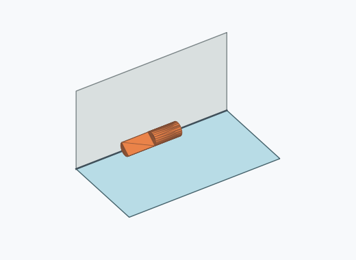 | 325 | 3.25 % | 2.92–3.62 % | 3.38 % |
| Pose 13 | Group 13 |  | 316 | 3.16 % | 2.83–3.52 % | 3.28 % |
| Pose 14 | Group 14 |  | 305 | 3.05 % | 2.73–3.41 % | 3.17 % |
| Pose 15 | Group 15 | 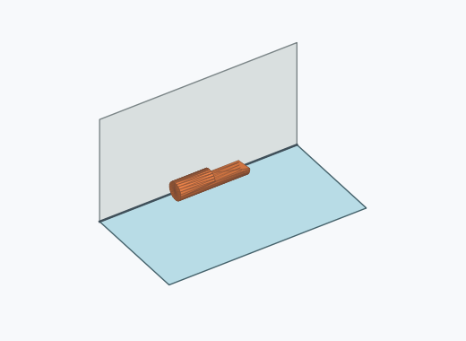 | 260 | 2.60 % | 2.31–2.93 % | 2.70 % |
| Pose 16 | Group 17 | 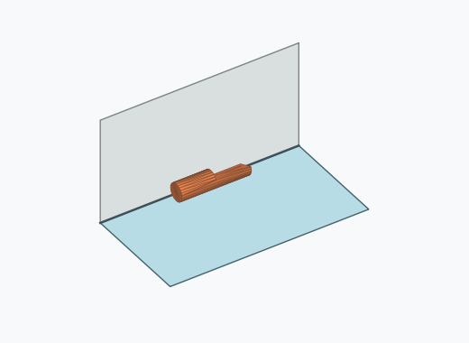 | 204 | 2.04 % | 1.78–2.34 % | 2.12 % |
| Pose 17 | Group 16 |  | 171 | 1.71 % | 1.47–1.98 % | 1.78 % |
| Pose 18 | Group 19 | 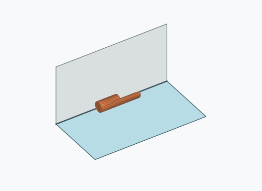 | 152 | 1.52 % | 1.30–1.78 % | 1.58 % |
| Pose 19 | Group 20 |  | 145 | 1.45 % | 1.23–1.70 % | 1.51 % |
| Pose 20 | Group 21 |  | 140 | 1.40 % | 1.19–1.65 % | 1.46 % |
| Pose 21 | Group 18 | 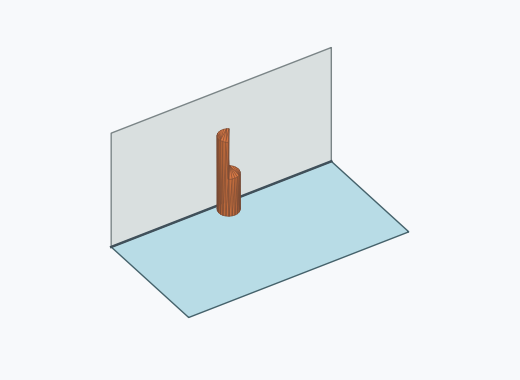 | 137 | 1.37 % | 1.16–1.62 % | 1.42 % |
| Pose 22 | Group 22 |  | 131 | 1.31 % | 1.11–1.55 % | 1.36 % |
| Pose 23 | Group 23 |  | 127 | 1.27 % | 1.07–1.51 % | 1.32 % |
| Pose 24 | Group 24 | 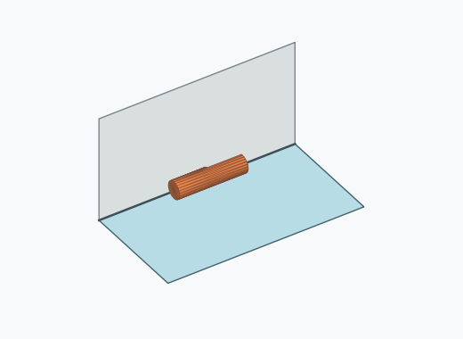 | 124 | 1.24 % | 1.04–1.48 % | 1.29 % |
| Pose 25 | Group 26 |  | 118 | 1.18 % | 0.99–1.41 % | 1.23 % |
| Pose 26 | Group 27 |  | 113 | 1.13 % | 0.94–1.36 % | 1.17 % |
| Pose 27 | Group 28 |  | 109 | 1.09 % | 0.90–1.31 % | 1.13 % |
| Pose 28 | Group 25 | 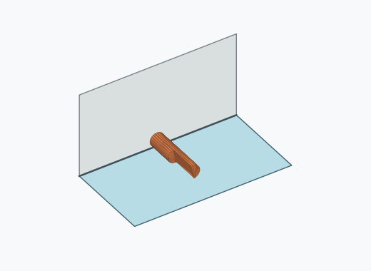 | 107 | 1.07 % | 0.89–1.29 % | 1.11 % |
| Pose 29 | Group 29 | 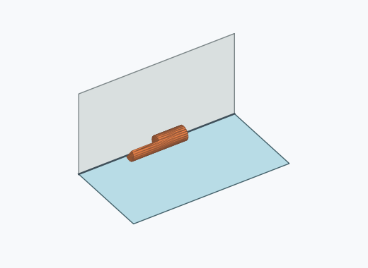 | 103 | 1.03 % | 0.85–1.25 % | 1.07 % |
| Pose 30 | Group 30 |  | 86 | 0.86 % | 0.70–1.06 % | 0.89 % |
| Pose 31 | Group 31 |  | 85 | 0.85 % | 0.69–1.05 % | 0.88 % |
| Pose 32 | Group 32 |  | 83 | 0.83 % | 0.67–1.03 % | 0.86 % |
| Pose 33 | Group 33 |  | 79 | 0.79 % | 0.63–0.98 % | 0.82 % |
| Pose 34 | Group 34 |  | 73 | 0.73 % | 0.58–0.92 % | 0.76 % |
| Pose 35 | Group 16 |  | 52 | 0.52 % | 0.40–0.68 % | 0.54 % |
| Pose 36 | Group 35 |  | 52 | 0.52 % | 0.40–0.68 % | 0.54 % |
| Pose 37 | Group 18 | 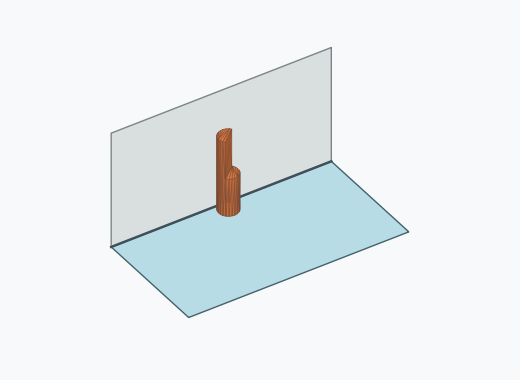 | 18 | 0.18 % | 0.11–0.28 % | 0.19 % |
| Pose 38 | Group 25 | 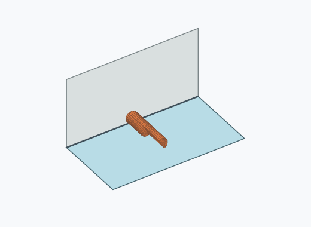 | 13 | 0.13 % | 0.08–0.22 % | 0.14 % |
| Pose 39 | Group 25 |  | 2 | 0.02 % | 0.01–0.07 % | 0.02 % |
| Pose 40 | Group 25 |  | 1 | 0.01 % | 0.00–0.06 % | 0.01 % |

[Pose catalogue JSON](poses.json) · [Pose catalogue YAML](poses.yaml) · [Frequencies](frequencies.csv) · [Trial records](trials.csv)

Pose orientations use `xyzw` quaternions from the workpiece frame to the chute frame. Recognition uses the recorded symmetry, a 5° tolerance, and a 1° ambiguity margin. The pose registry reserves previously observed IDs for later recognition.

### Historical run files

- [Configuration](config.json)
- [Manifest](manifest.json)

<!-- remaining-workpieces-20261110_10000:start -->
## Additional 10,000-drop runs

10,000 stationary and 10,000 moving-belt drops with the archived reference settings.

[Results and validation](simulations/20261110_10000/README.md).
<!-- remaining-workpieces-20261110_10000:end -->
