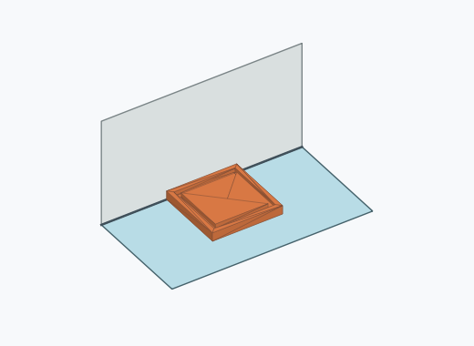
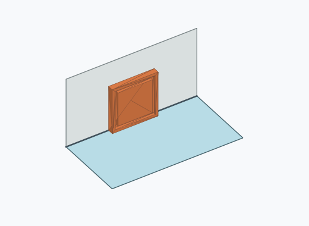
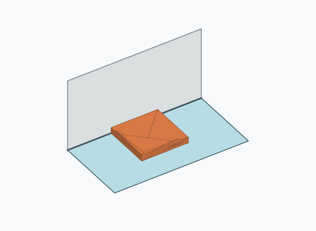

# Qf1i: grouped observed poses

10,000 completed drops; 9,870 settled. 13 assessed source poses; 4 groups meet the 1% cutoff.

Grouping uses 0.5 mm equivalent lift and a 60° maximum diameter. All members receive the same disturbance protocol.

| Representative | Image | Members | Combined count | Frequency | Retention AUC |
| --- | --- | --- | ---: | ---: | ---: |
| Qf1i_0005 |  | Qf1i_0005, Qf1i_0012 | 2552 | 25.52% | 1.0000 |
| Qf1i_0002 |  | Qf1i_0002 | 2524 | 25.24% | 1.0000 |
| Qf1i_0006 |  | Qf1i_0006 | 2410 | 24.10% | 1.0000 |
| Qf1i_0001 |  | Qf1i_0001, Qf1i_0008 | 2314 | 23.14% | 1.0000 |

[All original observations and member images](original_observations.json), [memberships](membership.csv), [barrier evidence](grouping_geometry.json), [member stability curves](group_stability.csv), [individual disturbance curves](stability.csv), [validation](validation.json).

Frequencies retain the original completed-drop denominator. Stability scores describe the configured virtual chute.
