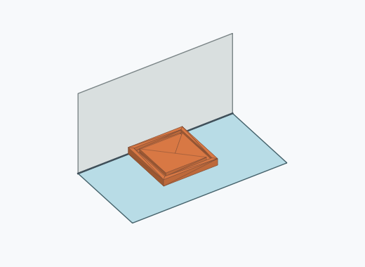
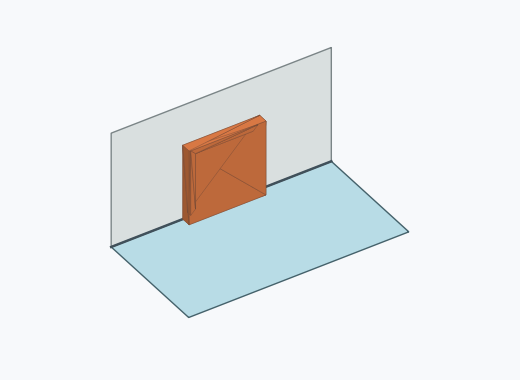
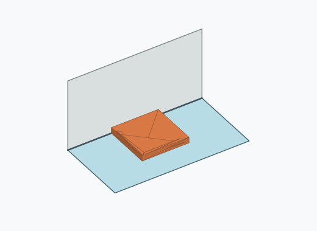
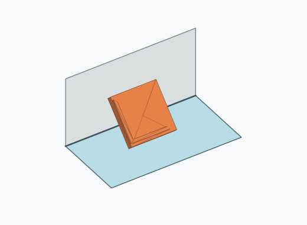
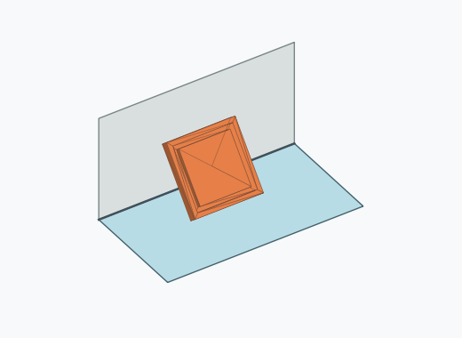
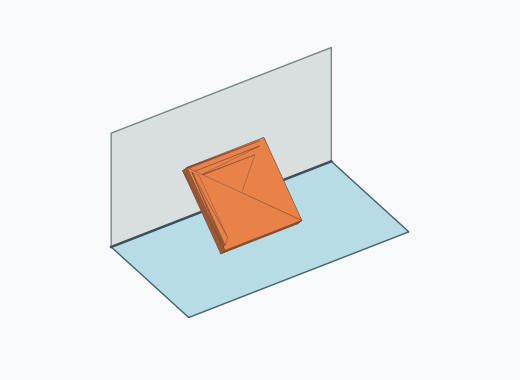
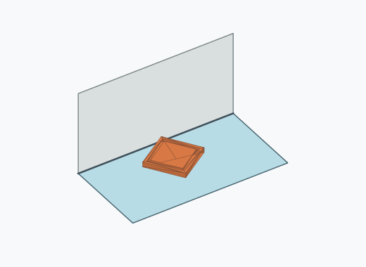
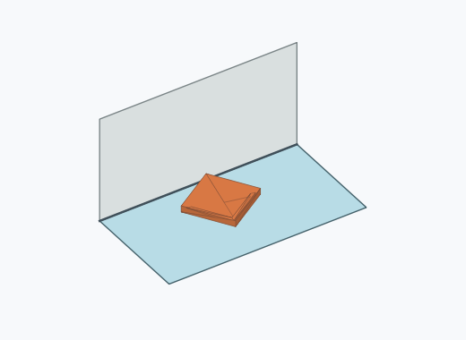

# Qf1i

[Workpiece index](../README.md#workpieces)

## 10,000-drop paper study

The stationary series recorded **9,943** settled outcomes. The moving series recorded **9,991** settled outcomes at the virtual exit. Each series contains 10,000 drops.

[Study overview](simulations/20261107_10000/README.md) · [Stationary results](simulations/20261107_10000/static/README.md) · [Moving results](simulations/20261107_10000/100mm_s/README.md)

## Historical pose catalogue

Group numbers rank the saved pose basins by their combined incidence within each observation phase. The percentages in the table describe each individual pose. Groups below 1% remain visible.

[Group membership CSV](group_memberships.csv) · [Grouping method](../README.md#catalogue-grouping)

### Transport poses

9,870 settled outcomes across 10,000 historical drops on a 500 mm chute. Incidence uses all completed drops as the denominator.

Outcome counts: settled: 9,870, unsettled: 130.

| Pose | Group | Image | Count | Incidence | 95% interval | Share of settled outcomes |
| --- | --- | --- | ---: | ---: | ---: | ---: |
| Qf1i_0005 | Group 0 |  | 2546 | 25.46 % | 24.62–26.32 % | 25.80 % |
| Qf1i_0002 | Group 1 |  | 2524 | 25.24 % | 24.40–26.10 % | 25.57 % |
| Qf1i_0006 | Group 2 |  | 2410 | 24.10 % | 23.27–24.95 % | 24.42 % |
| Qf1i_0001 | Group 3 |  | 2311 | 23.11 % | 22.29–23.95 % | 23.41 % |
| Qf1i_0009 | Group 4 |  | 19 | 0.19 % | 0.12–0.30 % | 0.19 % |
| Qf1i_0013 | Group 5 |  | 18 | 0.18 % | 0.11–0.28 % | 0.18 % |
| Qf1i_0003 | Group 4 |  | 11 | 0.11 % | 0.06–0.20 % | 0.11 % |
| Qf1i_0010 | Group 4 |  | 9 | 0.09 % | 0.05–0.17 % | 0.09 % |
| Qf1i_0014 | Group 5 |  | 7 | 0.07 % | 0.03–0.14 % | 0.07 % |
| Qf1i_0012 | Group 0 |  | 6 | 0.06 % | 0.03–0.13 % | 0.06 % |
| Qf1i_0008 | Group 3 |  | 3 | 0.03 % | 0.01–0.09 % | 0.03 % |
| Qf1i_0011 | Group 4 |  | 3 | 0.03 % | 0.01–0.09 % | 0.03 % |
| Qf1i_0015 | Group 5 |  | 3 | 0.03 % | 0.01–0.09 % | 0.03 % |

[Pose catalogue JSON](poses.json) · [Pose catalogue YAML](poses.yaml) · [Frequencies](frequencies.csv) · [Trial records](trials.csv)

Pose orientations use `xyzw` quaternions from the workpiece frame to the chute frame. Recognition uses the recorded symmetry, a 5° tolerance, and a 1° ambiguity margin. The pose registry reserves previously observed IDs for later recognition.

### Historical run files

- [Configuration](config.json)
- [Manifest](manifest.json)
- [Earlier 1,000-drop comparisons](simulations/README.md)
