# Qf2a

[Workpiece index](../README.md#workpieces)

## Historical pose catalogue

Group numbers rank the saved pose basins by their combined incidence within each observation phase. The percentages in the table describe each individual pose. Groups below 1% remain visible.

[Group membership CSV](group_memberships.csv) · [Grouping method](../README.md#catalogue-grouping)

### Transport poses

9,829 settled outcomes across 10,000 historical drops on a 500 mm chute. Incidence uses all completed drops as the denominator.

Outcome counts: settled: 9,829, unsettled: 171.

| Pose | Group | Image | Count | Incidence | 95% interval | Share of settled outcomes |
| --- | --- | --- | ---: | ---: | ---: | ---: |
| Qf2a_0006 | Group 0 | 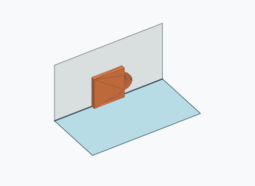 | 1483 | 14.83 % | 14.15–15.54 % | 15.09 % |
| Qf2a_0013 | Group 1 | 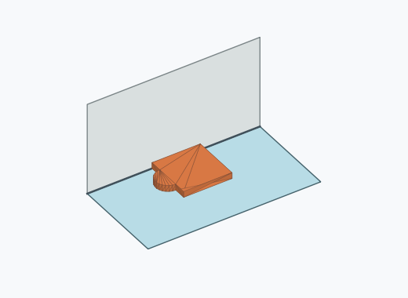 | 1370 | 13.70 % | 13.04–14.39 % | 13.94 % |
| Qf2a_0012 | Group 2 | 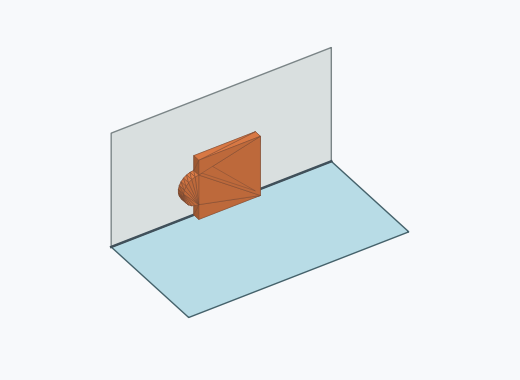 | 1292 | 12.92 % | 12.28–13.59 % | 13.14 % |
| Qf2a_0009 | Group 3 | 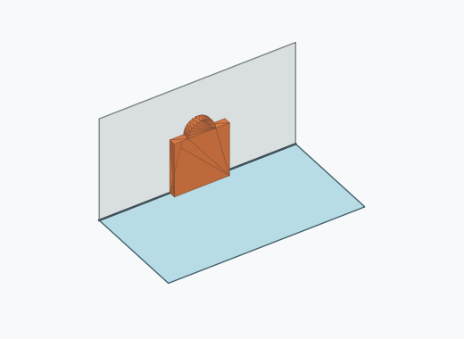 | 1247 | 12.47 % | 11.84–13.13 % | 12.69 % |
| Qf2a_0001 | Group 4 | 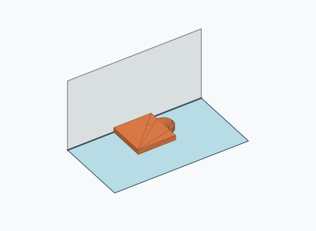 | 1191 | 11.91 % | 11.29–12.56 % | 12.12 % |
| Qf2a_0005 | Group 5 | 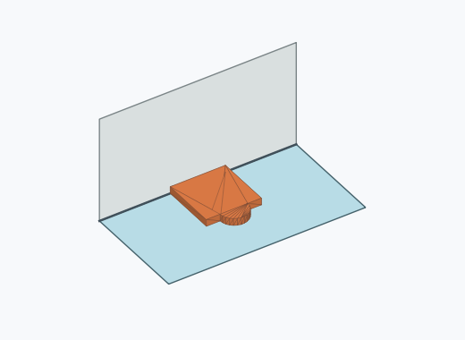 | 1114 | 11.14 % | 10.54–11.77 % | 11.33 % |
| Qf2a_0007 | Group 6 | 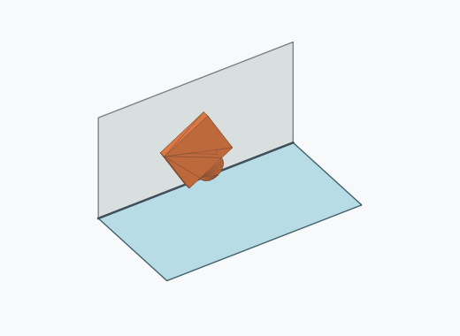 | 745 | 7.45 % | 6.95–7.98 % | 7.58 % |
| Qf2a_0008 | Group 7 | 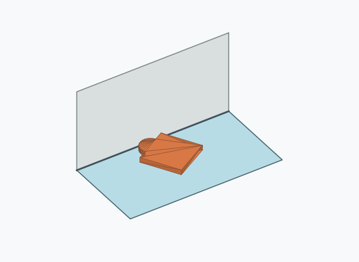 | 530 | 5.30 % | 4.88–5.76 % | 5.39 % |
| Qf2a_0011 | Group 8 | 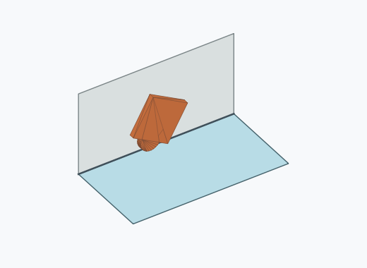 | 409 | 4.09 % | 3.72–4.50 % | 4.16 % |
| Qf2a_0002 | Group 9 | 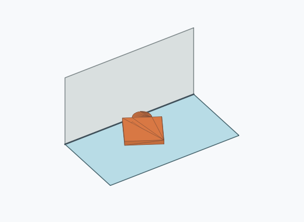 | 362 | 3.62 % | 3.27–4.00 % | 3.68 % |
| Qf2a_0018 | Group 10 | 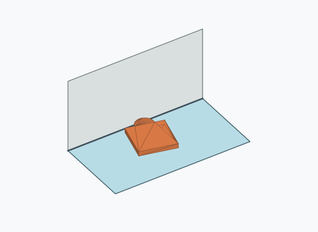 | 25 | 0.25 % | 0.17–0.37 % | 0.25 % |
| Qf2a_0014 | Group 11 | 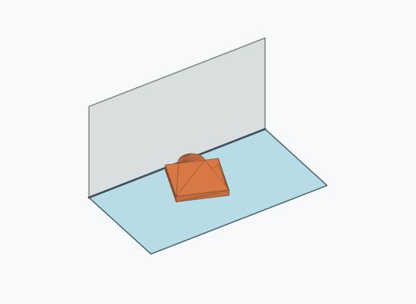 | 18 | 0.18 % | 0.11–0.28 % | 0.18 % |
| Qf2a_0017 | Group 10 | 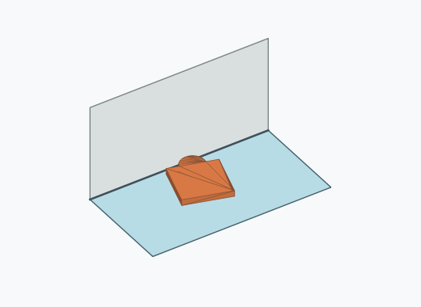 | 9 | 0.09 % | 0.05–0.17 % | 0.09 % |
| Qf2a_0016 | Group 11 | 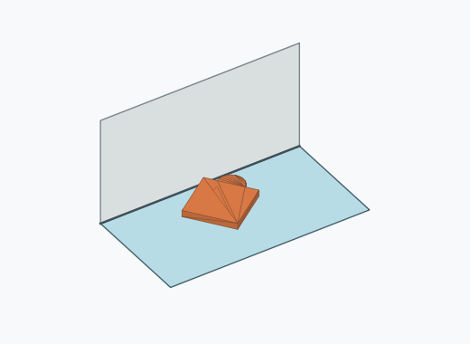 | 7 | 0.07 % | 0.03–0.14 % | 0.07 % |
| Qf2a_0010 | Group 7 | 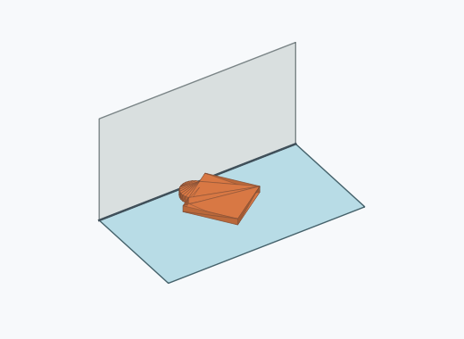 | 6 | 0.06 % | 0.03–0.13 % | 0.06 % |
| Qf2a_0019 | Group 12 |  | 4 | 0.04 % | 0.02–0.10 % | 0.04 % |
| Qf2a_0003 | Group 5 | 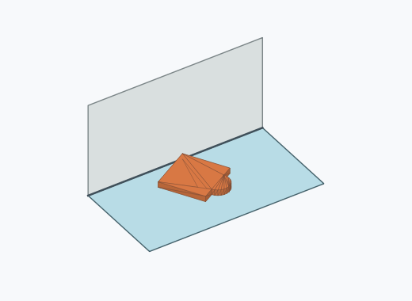 | 3 | 0.03 % | 0.01–0.09 % | 0.03 % |
| Qf2a_0015 | Group 4 | 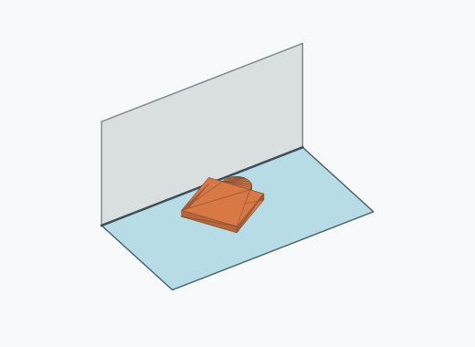 | 3 | 0.03 % | 0.01–0.09 % | 0.03 % |
| Qf2a_0020 | Group 13 | 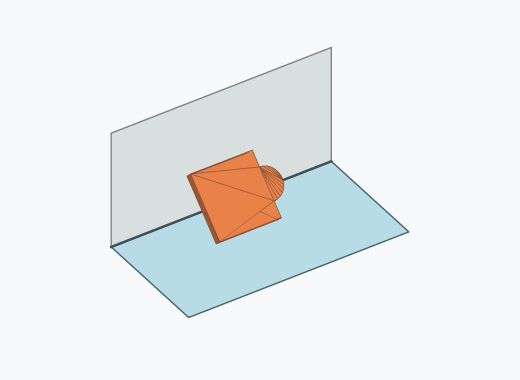 | 3 | 0.03 % | 0.01–0.09 % | 0.03 % |
| Qf2a_0023 | Group 1 | 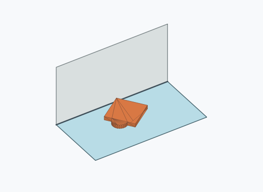 | 3 | 0.03 % | 0.01–0.09 % | 0.03 % |
| Qf2a_0021 | Group 14 | 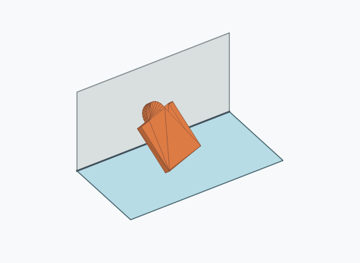 | 2 | 0.02 % | 0.01–0.07 % | 0.02 % |
| Qf2a_0022 | Group 5 | 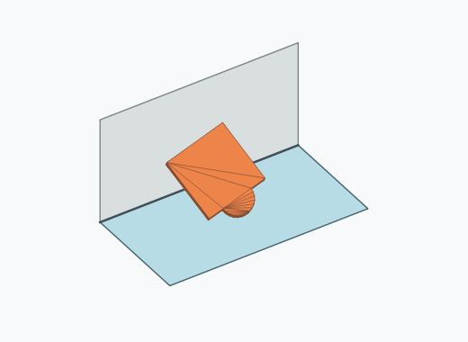 | 1 | 0.01 % | 0.00–0.06 % | 0.01 % |
| Qf2a_0024 | Group 1 | 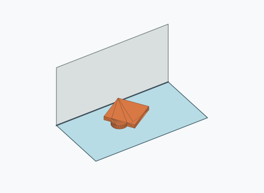 | 1 | 0.01 % | 0.00–0.06 % | 0.01 % |
| Qf2a_0025 | Group 15 |  | 1 | 0.01 % | 0.00–0.06 % | 0.01 % |

[Pose catalogue JSON](poses.json) · [Pose catalogue YAML](poses.yaml) · [Frequencies](frequencies.csv) · [Trial records](trials.csv)

Pose orientations use `xyzw` quaternions from the workpiece frame to the chute frame. Recognition uses the recorded symmetry, a 5° tolerance, and a 1° ambiguity margin. The pose registry reserves previously observed IDs for later recognition.

### Historical run files

- [Configuration](config.json)
- [Manifest](manifest.json)
