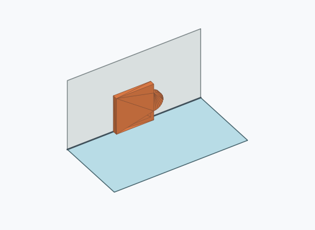
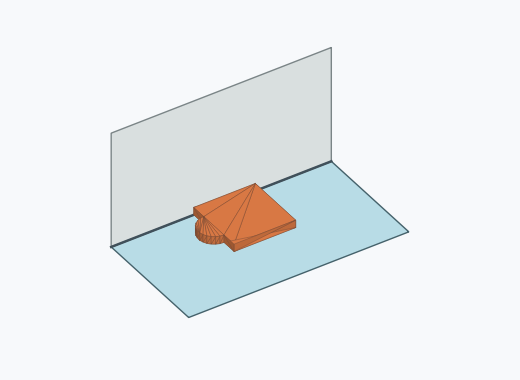
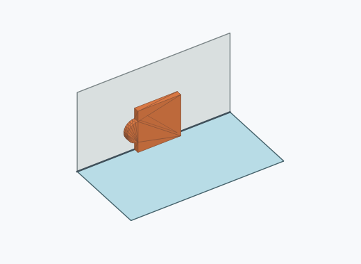
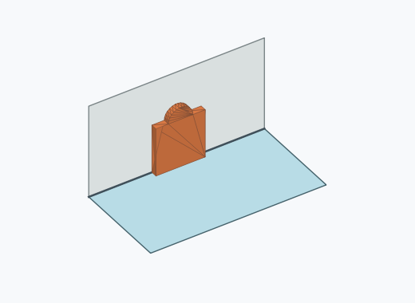
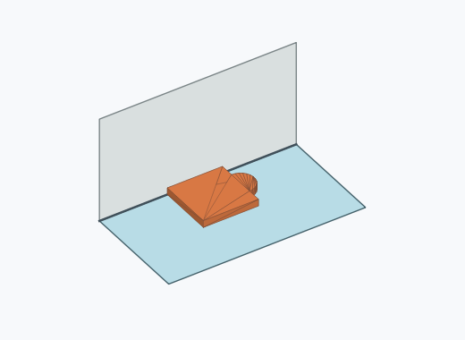
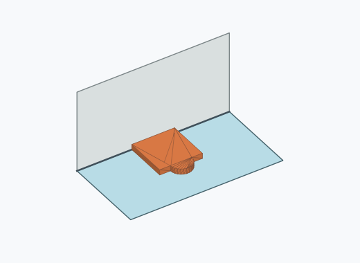
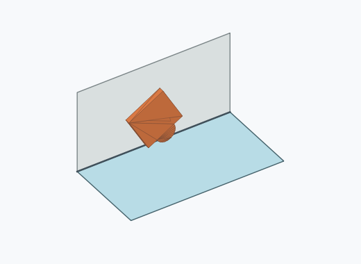
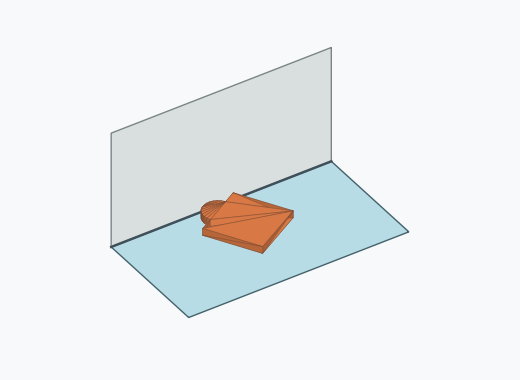
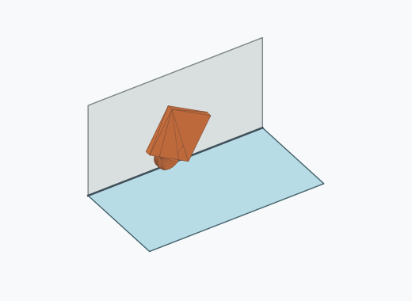
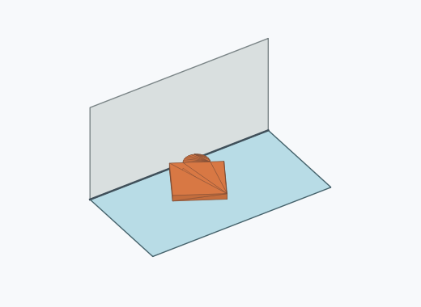

# Qf2a: grouped observed poses

10,000 completed drops; 9,829 settled. 24 assessed source poses; 10 groups meet the 1% cutoff.

Grouping uses 0.5 mm equivalent lift and a 60° maximum diameter. All members receive the same disturbance protocol.

| Representative | Image | Members | Combined count | Frequency | Retention AUC |
| --- | --- | --- | ---: | ---: | ---: |
| Qf2a_0006 |  | Qf2a_0006 | 1483 | 14.83% | 1.0000 |
| Qf2a_0013 |  | Qf2a_0013, Qf2a_0023, Qf2a_0024 | 1374 | 13.74% | 1.0000 |
| Qf2a_0012 |  | Qf2a_0012 | 1292 | 12.92% | 1.0000 |
| Qf2a_0009 |  | Qf2a_0009 | 1247 | 12.47% | 1.0000 |
| Qf2a_0001 |  | Qf2a_0001, Qf2a_0015 | 1194 | 11.94% | 1.0000 |
| Qf2a_0005 |  | Qf2a_0003, Qf2a_0005, Qf2a_0022 | 1118 | 11.18% | 1.0000 |
| Qf2a_0007 |  | Qf2a_0007 | 745 | 7.45% | 1.0000 |
| Qf2a_0008 |  | Qf2a_0008, Qf2a_0010 | 533 | 5.33% | 0.9792 |
| Qf2a_0011 |  | Qf2a_0011 | 409 | 4.09% | 1.0000 |
| Qf2a_0002 |  | Qf2a_0002 | 362 | 3.62% | 1.0000 |

[All original observations and member images](original_observations.json), [memberships](membership.csv), [barrier evidence](grouping_geometry.json), [member stability curves](group_stability.csv), [individual disturbance curves](stability.csv), [validation](validation.json).

Frequencies retain the original completed-drop denominator. Stability scores describe the configured virtual chute.
