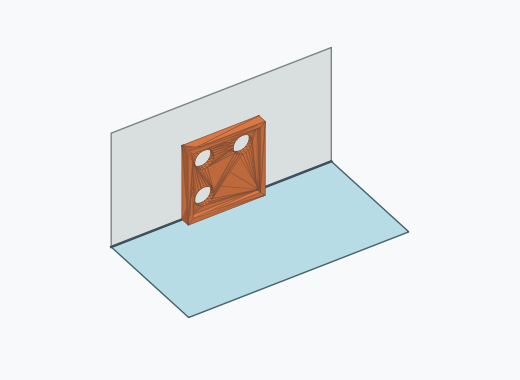
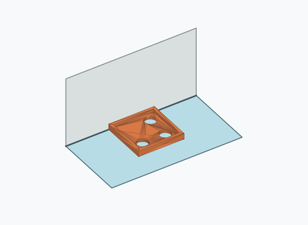
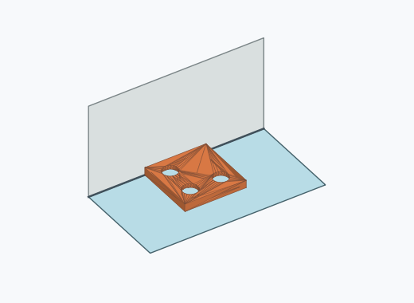
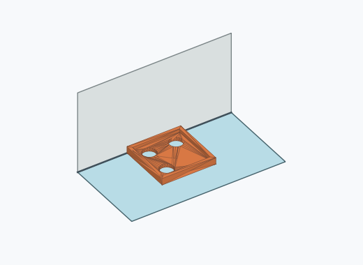
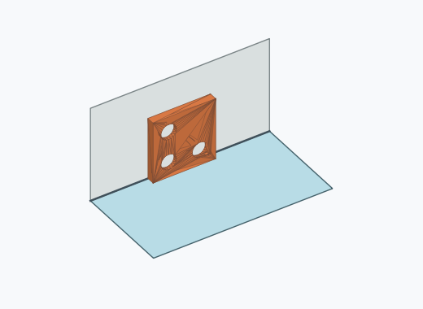
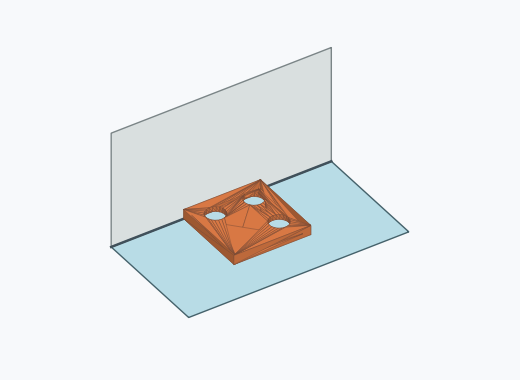

# Qf4i: grouped observed poses

10,000 completed drops; 9,835 settled. 29 assessed source poses; 16 groups meet the 1% cutoff.

Grouping uses 0.5 mm equivalent lift and a 60° maximum diameter. All members receive the same disturbance protocol.

| Representative | Image | Members | Combined count | Frequency | Retention AUC |
| --- | --- | --- | ---: | ---: | ---: |
| Qf4i_0007 |  | Qf4i_0007 | 752 | 7.52% | 1.0000 |
| Qf4i_0012 |  | Qf4i_0012 | 706 | 7.06% | 1.0000 |
| Qf4i_0005 |  | Qf4i_0005 | 702 | 7.02% | 1.0000 |
| Qf4i_0009 |  | Qf4i_0009 | 702 | 7.02% | 1.0000 |
| Qf4i_0006 |  | Qf4i_0006 | 634 | 6.34% | 1.0000 |
| Qf4i_0013 |  | Qf4i_0013 | 616 | 6.16% | 1.0000 |
| Qf4i_0010 |  | Qf4i_0010, Qf4i_0021 | 614 | 6.14% | 1.0000 |
| Qf4i_0015 |  | Qf4i_0015 | 610 | 6.10% | 1.0000 |
| Qf4i_0017 |  | Qf4i_0017 | 601 | 6.01% | 1.0000 |
| Qf4i_0002 |  | Qf4i_0002 | 594 | 5.94% | 1.0000 |
| Qf4i_0008 |  | Qf4i_0008 | 590 | 5.90% | 1.0000 |
| Qf4i_0003 |  | Qf4i_0003 | 568 | 5.68% | 1.0000 |
| Qf4i_0016 |  | Qf4i_0016 | 553 | 5.53% | 1.0000 |
| Qf4i_0011 |  | Qf4i_0011 | 547 | 5.47% | 1.0000 |
| Qf4i_0004 |  | Qf4i_0004, Qf4i_0018 | 502 | 5.02% | 1.0000 |
| Qf4i_0001 |  | Qf4i_0001, Qf4i_0029 | 499 | 4.99% | 1.0000 |

[All original observations and member images](original_observations.json), [memberships](membership.csv), [barrier evidence](grouping_geometry.json), [member stability curves](group_stability.csv), [individual disturbance curves](stability.csv), [validation](validation.json).

Frequencies retain the original completed-drop denominator. Stability scores describe the configured virtual chute.
