# Qf4i

[Workpiece index](../README.md#workpieces)

## Historical pose catalogue

Group numbers rank the saved pose basins by their combined incidence within each observation phase. The percentages in the table describe each individual pose. Groups below 1% remain visible.

[Group membership CSV](group_memberships.csv) · [Grouping method](../README.md#catalogue-grouping)

### Transport poses

9,835 settled outcomes across 10,000 historical drops on a 500 mm chute. Incidence uses all completed drops as the denominator.

Outcome counts: settled: 9,835, unsettled: 165.

| Pose | Group | Image | Count | Incidence | 95% interval | Share of settled outcomes |
| --- | --- | --- | ---: | ---: | ---: | ---: |
| Qf4i_0007 | Group 0 | 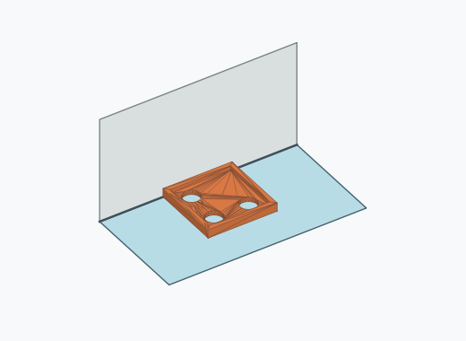 | 752 | 7.52 % | 7.02–8.05 % | 7.65 % |
| Qf4i_0012 | Group 1 |  | 706 | 7.06 % | 6.57–7.58 % | 7.18 % |
| Qf4i_0005 | Group 2 |  | 702 | 7.02 % | 6.54–7.54 % | 7.14 % |
| Qf4i_0009 | Group 3 | 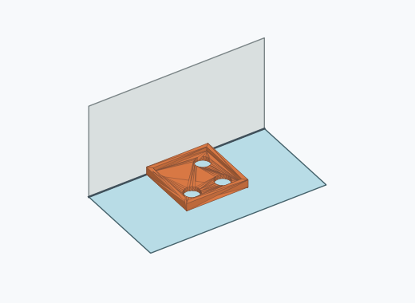 | 702 | 7.02 % | 6.54–7.54 % | 7.14 % |
| Qf4i_0006 | Group 4 |  | 634 | 6.34 % | 5.88–6.83 % | 6.45 % |
| Qf4i_0013 | Group 5 | 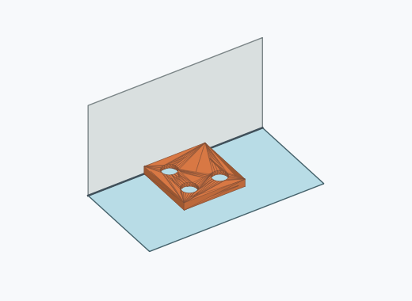 | 616 | 6.16 % | 5.71–6.65 % | 6.26 % |
| Qf4i_0010 | Group 6 |  | 613 | 6.13 % | 5.68–6.62 % | 6.23 % |
| Qf4i_0015 | Group 7 | 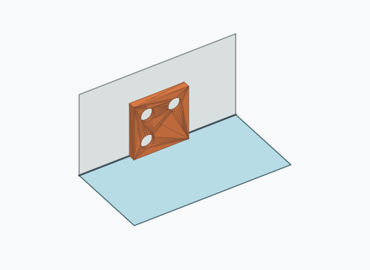 | 610 | 6.10 % | 5.65–6.59 % | 6.20 % |
| Qf4i_0017 | Group 8 |  | 601 | 6.01 % | 5.56–6.49 % | 6.11 % |
| Qf4i_0002 | Group 9 | 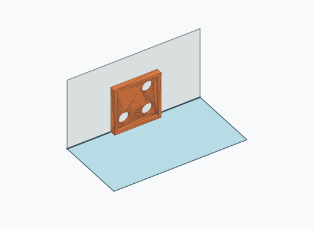 | 594 | 5.94 % | 5.49–6.42 % | 6.04 % |
| Qf4i_0008 | Group 10 |  | 590 | 5.90 % | 5.45–6.38 % | 6.00 % |
| Qf4i_0003 | Group 11 |  | 568 | 5.68 % | 5.24–6.15 % | 5.78 % |
| Qf4i_0016 | Group 12 |  | 553 | 5.53 % | 5.10–6.00 % | 5.62 % |
| Qf4i_0011 | Group 13 |  | 547 | 5.47 % | 5.04–5.93 % | 5.56 % |
| Qf4i_0004 | Group 14 |  | 501 | 5.01 % | 4.60–5.46 % | 5.09 % |
| Qf4i_0001 | Group 15 | 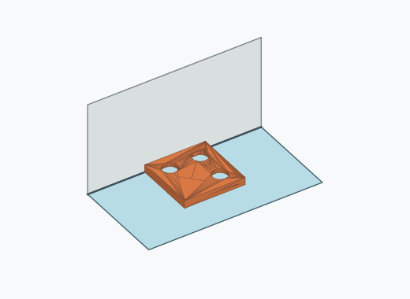 | 498 | 4.98 % | 4.57–5.42 % | 5.06 % |
| Qf4i_0014 | Group 16 |  | 10 | 0.10 % | 0.05–0.18 % | 0.10 % |
| Qf4i_0020 | Group 19 | 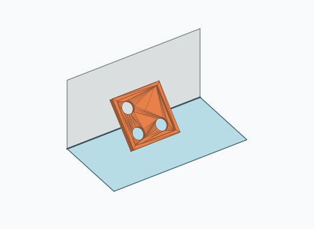 | 7 | 0.07 % | 0.03–0.14 % | 0.07 % |
| Qf4i_0024 | Group 17 |  | 6 | 0.06 % | 0.03–0.13 % | 0.06 % |
| Qf4i_0027 | Group 18 | 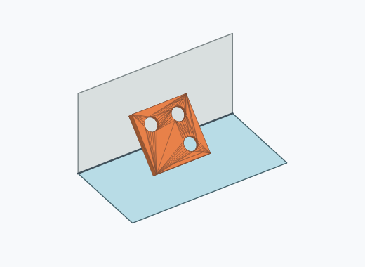 | 6 | 0.06 % | 0.03–0.13 % | 0.06 % |
| Qf4i_0026 | Group 17 | 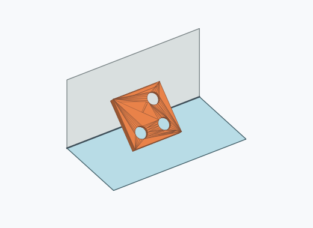 | 5 | 0.05 % | 0.02–0.12 % | 0.05 % |
| Qf4i_0019 | Group 20 |  | 3 | 0.03 % | 0.01–0.09 % | 0.03 % |
| Qf4i_0023 | Group 21 |  | 3 | 0.03 % | 0.01–0.09 % | 0.03 % |
| Qf4i_0022 | Group 16 | 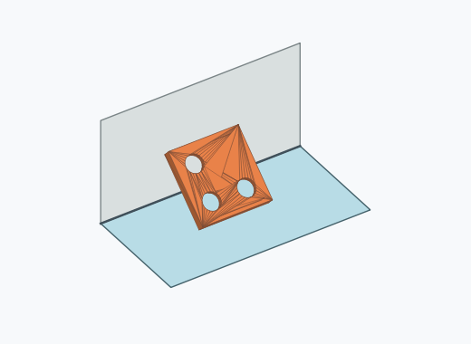 | 2 | 0.02 % | 0.01–0.07 % | 0.02 % |
| Qf4i_0028 | Group 18 | 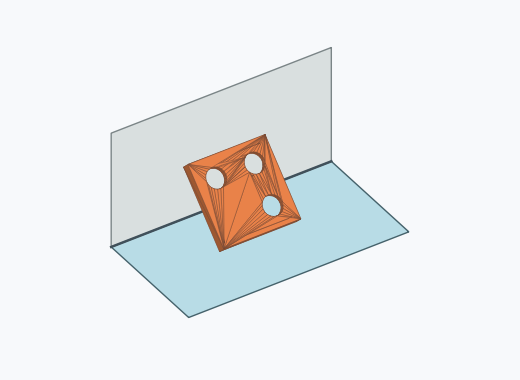 | 2 | 0.02 % | 0.01–0.07 % | 0.02 % |
| Qf4i_0018 | Group 14 | 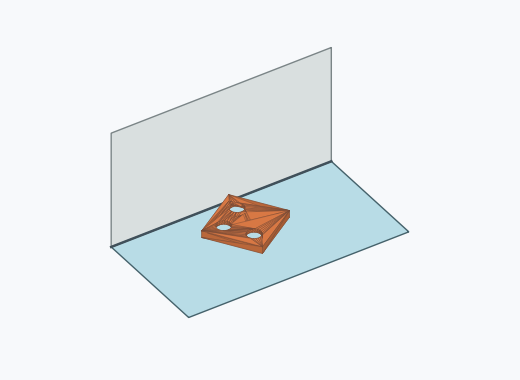 | 1 | 0.01 % | 0.00–0.06 % | 0.01 % |
| Qf4i_0021 | Group 6 |  | 1 | 0.01 % | 0.00–0.06 % | 0.01 % |
| Qf4i_0025 | Group 22 |  | 1 | 0.01 % | 0.00–0.06 % | 0.01 % |
| Qf4i_0029 | Group 15 | 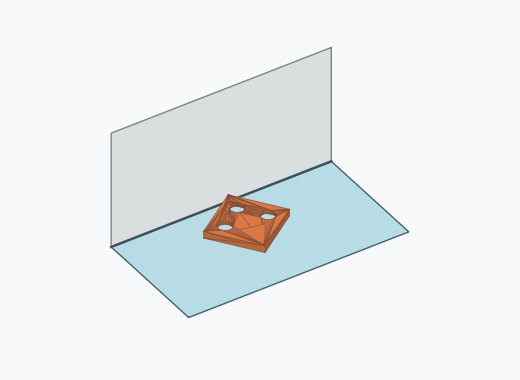 | 1 | 0.01 % | 0.00–0.06 % | 0.01 % |

[Pose catalogue JSON](poses.json) · [Pose catalogue YAML](poses.yaml) · [Frequencies](frequencies.csv) · [Trial records](trials.csv)

Pose orientations use `xyzw` quaternions from the workpiece frame to the chute frame. Recognition uses the recorded symmetry, a 5° tolerance, and a 1° ambiguity margin. The pose registry reserves previously observed IDs for later recognition.

### Historical run files

- [Configuration](config.json)
- [Manifest](manifest.json)
