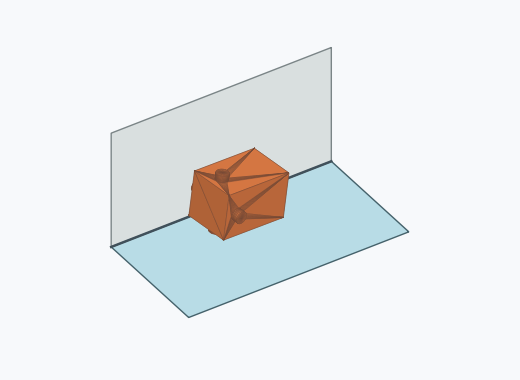
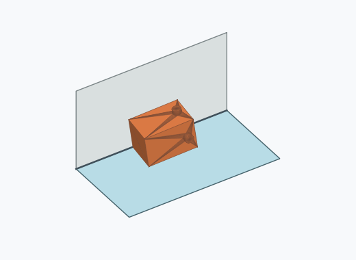
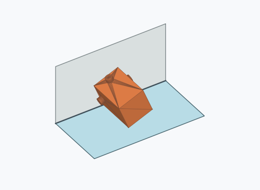
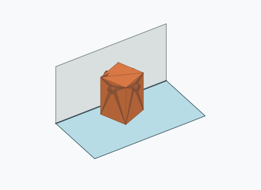
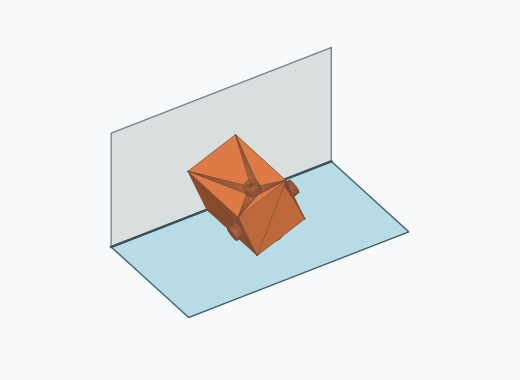

# Qk1a: grouped observed poses

10,000 completed drops; 9,956 settled. 13 assessed source poses; 6 groups meet the 1% cutoff.

Grouping uses 0.5 mm equivalent lift and a 60° maximum diameter. All members receive the same disturbance protocol.

| Representative | Image | Members | Combined count | Frequency | Retention AUC |
| --- | --- | --- | ---: | ---: | ---: |
| Qk1a_0007 |  | Qk1a_0005, Qk1a_0007 | 2317 | 23.17% | 1.0000 |
| Qk1a_0008 |  | Qk1a_0008 | 2187 | 21.87% | 1.0000 |
| Qk1a_0012 |  | Qk1a_0010, Qk1a_0011, Qk1a_0012, Qk1a_0013 | 1430 | 14.30% | 1.0000 |
| Qk1a_0009 |  | Qk1a_0009 | 1372 | 13.72% | 1.0000 |
| Qk1a_0004 |  | Qk1a_0001, Qk1a_0002, Qk1a_0003, Qk1a_0004 | 1370 | 13.70% | 1.0000 |
| Qk1a_0006 |  | Qk1a_0006 | 1280 | 12.80% | 1.0000 |

[All original observations and member images](original_observations.json), [memberships](membership.csv), [barrier evidence](grouping_geometry.json), [member stability curves](group_stability.csv), [individual disturbance curves](stability.csv), [validation](validation.json).

Frequencies retain the original completed-drop denominator. Stability scores describe the configured virtual chute.
