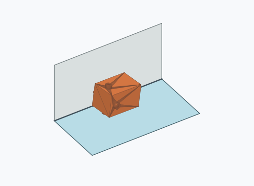
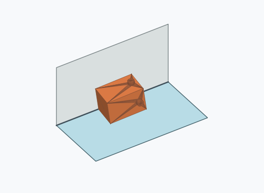
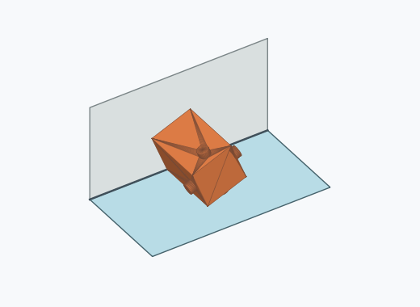
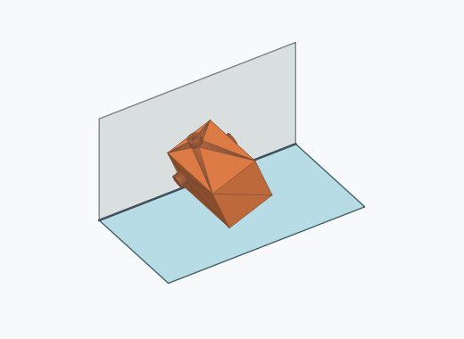
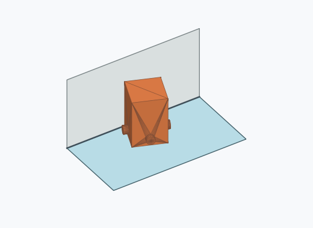
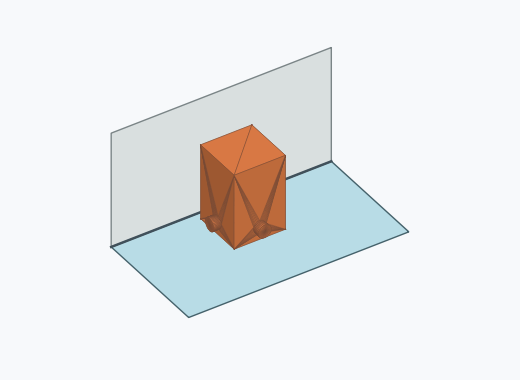
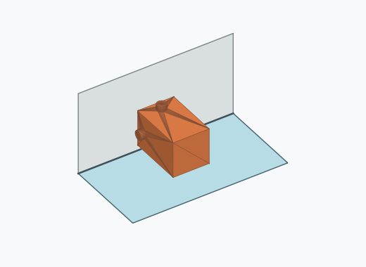
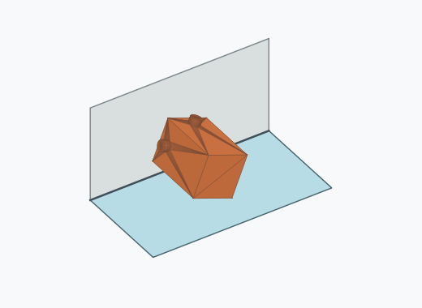
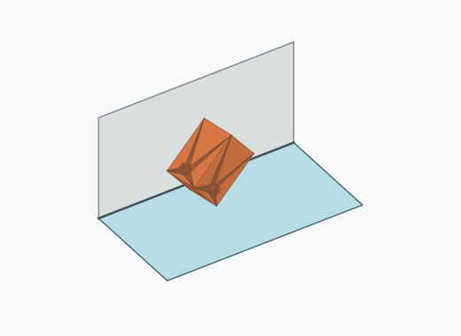
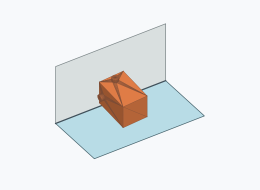

# Qk1a

[Workpiece index](../README.md#workpieces)

## 10,000-drop paper study

The stationary series recorded **9,899** settled outcomes. The moving series recorded **9,953** settled outcomes at the virtual exit. Each series contains 10,000 drops.

[Study overview](simulations/20261107_10000/README.md) · [Stationary results](simulations/20261107_10000/static/README.md) · [Moving results](simulations/20261107_10000/100mm_s/README.md)

## Historical pose catalogue

Group numbers rank the saved pose basins by their combined incidence within each observation phase. The percentages in the table describe each individual pose. Groups below 1% remain visible.

[Group membership CSV](group_memberships.csv) · [Grouping method](../README.md#catalogue-grouping)

### Transport poses

9,956 settled outcomes across 10,000 historical drops on a 500 mm chute. Incidence uses all completed drops as the denominator.

Outcome counts: settled: 9,956, unsettled: 44.

| Pose | Group | Image | Count | Incidence | 95% interval | Share of settled outcomes |
| --- | --- | --- | ---: | ---: | ---: | ---: |
| Qk1a_0007 | Group 0 |  | 2279 | 22.79 % | 21.98–23.62 % | 22.89 % |
| Qk1a_0008 | Group 1 |  | 2187 | 21.87 % | 21.07–22.69 % | 21.97 % |
| Qk1a_0009 | Group 3 |  | 1372 | 13.72 % | 13.06–14.41 % | 13.78 % |
| Qk1a_0006 | Group 5 |  | 1280 | 12.80 % | 12.16–13.47 % | 12.86 % |
| Qk1a_0012 | Group 2 |  | 996 | 9.96 % | 9.39–10.56 % | 10.00 % |
| Qk1a_0004 | Group 4 |  | 469 | 4.69 % | 4.29–5.12 % | 4.71 % |
| Qk1a_0003 | Group 4 |  | 440 | 4.40 % | 4.02–4.82 % | 4.42 % |
| Qk1a_0001 | Group 4 |  | 436 | 4.36 % | 3.98–4.78 % | 4.38 % |
| Qk1a_0010 | Group 2 |  | 242 | 2.42 % | 2.14–2.74 % | 2.43 % |
| Qk1a_0011 | Group 2 |  | 190 | 1.90 % | 1.65–2.19 % | 1.91 % |
| Qk1a_0005 | Group 0 |  | 38 | 0.38 % | 0.28–0.52 % | 0.38 % |
| Qk1a_0002 | Group 4 |  | 25 | 0.25 % | 0.17–0.37 % | 0.25 % |
| Qk1a_0013 | Group 2 |  | 2 | 0.02 % | 0.01–0.07 % | 0.02 % |

[Pose catalogue JSON](poses.json) · [Pose catalogue YAML](poses.yaml) · [Frequencies](frequencies.csv) · [Trial records](trials.csv)

Pose orientations use `xyzw` quaternions from the workpiece frame to the chute frame. Recognition uses the recorded symmetry, a 5° tolerance, and a 1° ambiguity margin. The pose registry reserves previously observed IDs for later recognition.

### Historical run files

- [Configuration](config.json)
- [Manifest](manifest.json)
- [Earlier 1,000-drop comparisons](simulations/README.md)
