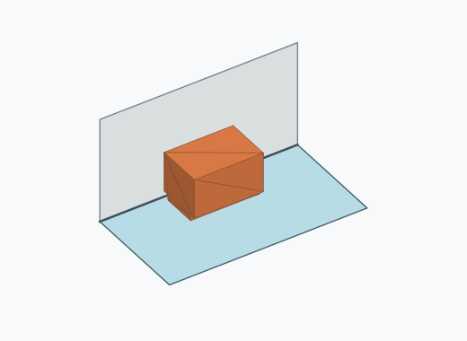
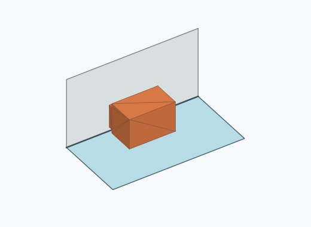
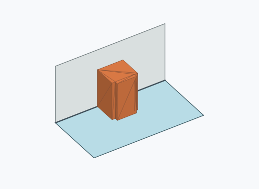
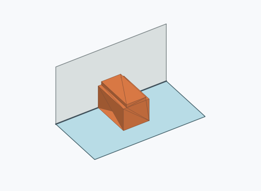
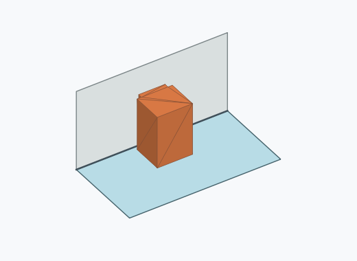
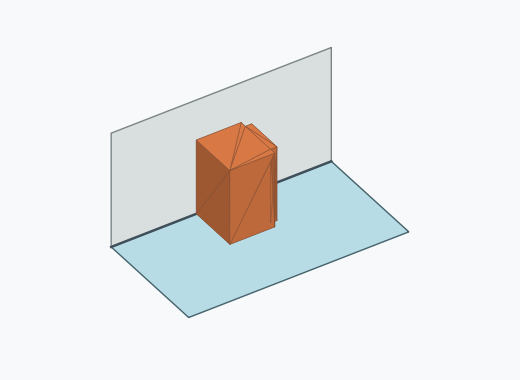
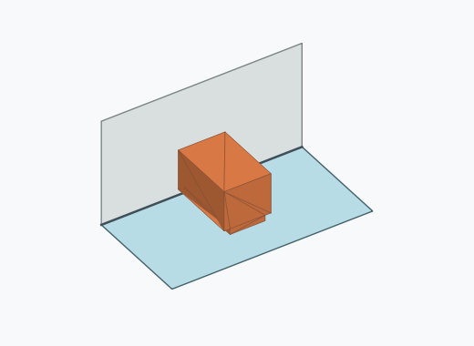
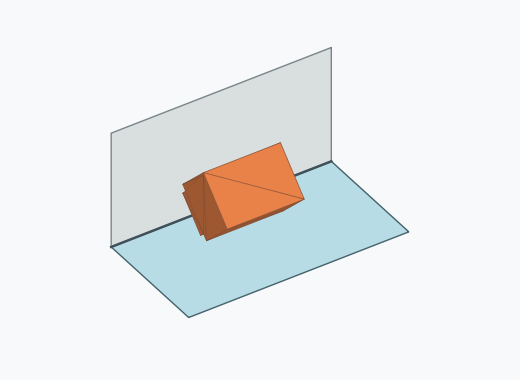
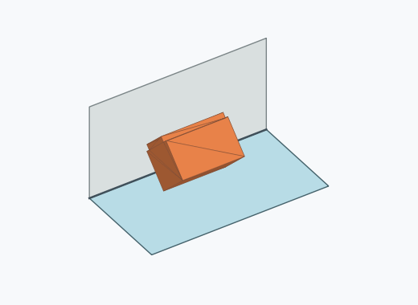
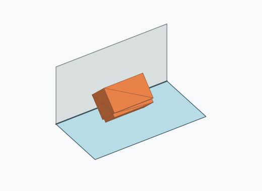

# Qk2i

[Workpiece index](../README.md#workpieces)

## Historical pose catalogue

Group numbers rank the saved pose basins by their combined incidence within each observation phase. The percentages in the table describe each individual pose. Groups below 1% remain visible.

[Group membership CSV](group_memberships.csv) · [Grouping method](../README.md#catalogue-grouping)

### Transport poses

10,000 settled outcomes across 10,000 historical drops on a 500 mm chute. Incidence uses all completed drops as the denominator.

Outcome counts: settled: 10,000.

| Pose | Group | Image | Count | Incidence | 95% interval | Share of settled outcomes |
| --- | --- | --- | ---: | ---: | ---: | ---: |
| Qk2i_0004 | Group 0 |  | 1188 | 11.88 % | 11.26–12.53 % | 11.88 % |
| Qk2i_0012 | Group 1 |  | 1147 | 11.47 % | 10.86–12.11 % | 11.47 % |
| Qk2i_0011 | Group 2 |  | 1145 | 11.45 % | 10.84–12.09 % | 11.45 % |
| Qk2i_0006 | Group 3 |  | 1113 | 11.13 % | 10.53–11.76 % | 11.13 % |
| Qk2i_0003 | Group 4 |  | 712 | 7.12 % | 6.63–7.64 % | 7.12 % |
| Qk2i_0015 | Group 5 |  | 705 | 7.05 % | 6.56–7.57 % | 7.05 % |
| Qk2i_0005 | Group 6 |  | 672 | 6.72 % | 6.25–7.23 % | 6.72 % |
| Qk2i_0009 | Group 7 |  | 667 | 6.67 % | 6.20–7.18 % | 6.67 % |
| Qk2i_0002 | Group 8 |  | 644 | 6.44 % | 5.98–6.94 % | 6.44 % |
| Qk2i_0001 | Group 9 |  | 643 | 6.43 % | 5.97–6.93 % | 6.43 % |
| Qk2i_0010 | Group 10 |  | 622 | 6.22 % | 5.76–6.71 % | 6.22 % |
| Qk2i_0014 | Group 11 |  | 575 | 5.75 % | 5.31–6.22 % | 5.75 % |
| Qk2i_0013 | Group 12 |  | 125 | 1.25 % | 1.05–1.49 % | 1.25 % |
| Qk2i_0007 | Group 13 |  | 27 | 0.27 % | 0.19–0.39 % | 0.27 % |
| Qk2i_0008 | Group 14 |  | 15 | 0.15 % | 0.09–0.25 % | 0.15 % |

[Pose catalogue JSON](poses.json) · [Pose catalogue YAML](poses.yaml) · [Frequencies](frequencies.csv) · [Trial records](trials.csv)

Pose orientations use `xyzw` quaternions from the workpiece frame to the chute frame. Recognition uses the recorded symmetry, a 5° tolerance, and a 1° ambiguity margin. The pose registry reserves previously observed IDs for later recognition.

### Historical run files

- [Configuration](config.json)
- [Manifest](manifest.json)
