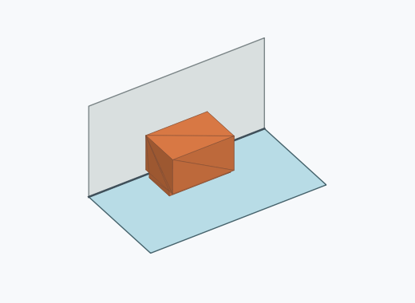
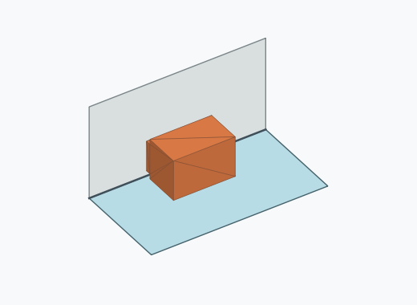
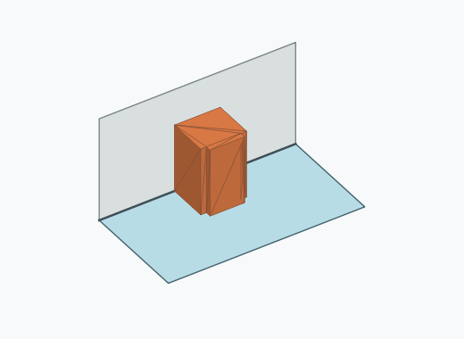
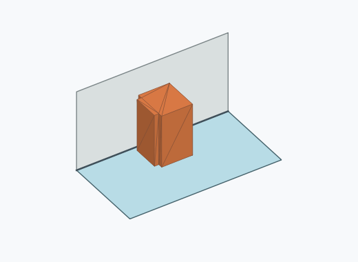
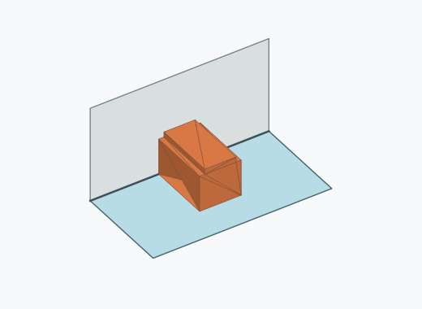
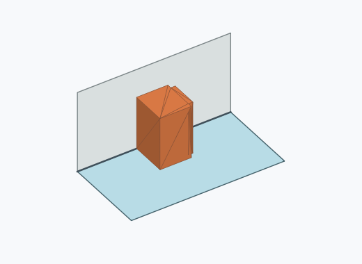
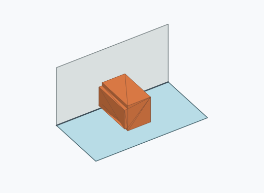
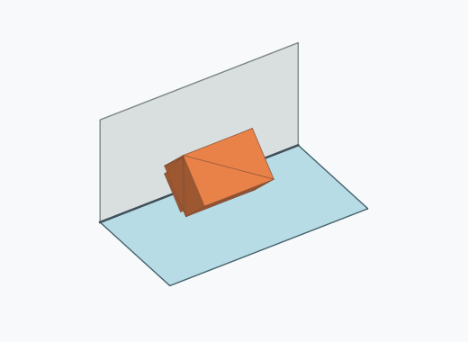

# Qk2i: grouped observed poses

10,000 completed drops; 10,000 settled. 15 assessed source poses; 13 groups meet the 1% cutoff.

Grouping uses 0.5 mm equivalent lift and a 60° maximum diameter. All members receive the same disturbance protocol.

| Representative | Image | Members | Combined count | Frequency | Retention AUC |
| --- | --- | --- | ---: | ---: | ---: |
| Qk2i_0004 |  | Qk2i_0004 | 1188 | 11.88% | 1.0000 |
| Qk2i_0012 |  | Qk2i_0012 | 1147 | 11.47% | 1.0000 |
| Qk2i_0011 |  | Qk2i_0011 | 1145 | 11.45% | 1.0000 |
| Qk2i_0006 |  | Qk2i_0006 | 1113 | 11.13% | 1.0000 |
| Qk2i_0003 |  | Qk2i_0003 | 712 | 7.12% | 1.0000 |
| Qk2i_0015 |  | Qk2i_0015 | 705 | 7.05% | 1.0000 |
| Qk2i_0005 |  | Qk2i_0005 | 672 | 6.72% | 1.0000 |
| Qk2i_0009 |  | Qk2i_0009 | 667 | 6.67% | 1.0000 |
| Qk2i_0002 |  | Qk2i_0002 | 644 | 6.44% | 1.0000 |
| Qk2i_0001 |  | Qk2i_0001 | 643 | 6.43% | 1.0000 |
| Qk2i_0010 |  | Qk2i_0010 | 622 | 6.22% | 1.0000 |
| Qk2i_0014 |  | Qk2i_0014 | 575 | 5.75% | 1.0000 |
| Qk2i_0013 |  | Qk2i_0013 | 125 | 1.25% | 1.0000 |

[All original observations and member images](original_observations.json), [memberships](membership.csv), [barrier evidence](grouping_geometry.json), [member stability curves](group_stability.csv), [individual disturbance curves](stability.csv), [validation](validation.json).

Frequencies retain the original completed-drop denominator. Stability scores describe the configured virtual chute.
